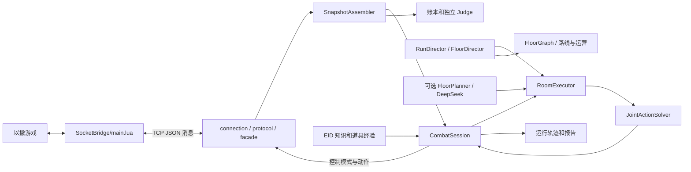

# 当前代码结构与调用链

本文以仓库当前源码为准，面向需要阅读和修改代码的开发者。记录基线：`9102534`。这是**现状说明**；后续希望达到的机制族结构见[玩法模块架构契约](../docs/gameplay-module-contract.zh-CN.md)，该契约不是现有目录或已完成重构。功能验收范围与失败记录见[当前进度](../docs/progress.zh-CN.md)。

## 1. 从哪开始阅读

```text
run_mainline.py
  └─ apps/auto_two_floors.py: cli() → main()
      ├─ GameLauncher：启动游戏及握手
      ├─ SocketBridge：TCP 通信门面
      ├─ CombatSession：观测、控制、房间会话与日志
      ├─ ItemAdaptation：已有道具能力装配，主线禁用自动生成
      └─ RunDirector：组织多层
          └─ FloorDirector：地图、运营、房间、Boss 和出口
              └─ RoomExecutor / JointActionSolver：房间执行与战斗决策
```

`run_mainline.py` 只是将 `SocketBridge/python` 加入导入路径并调用入口。`auto_two_floors.py` 的 `--target-stage` 支持 2–6，默认 2；`--llm-requests` 默认 0。因而默认主线是本地策略运行，不能把通关记录当作 DeepSeek 自主规划证据。入口为 `ItemAdaptation` 设置 `allow_generate=False`，已有技能可加载，主线不自动请求模型编写新技能。

`apps/auto_floor.py` 是首层入口；`apps/auto_first_room.py` 和 `apps/first_room.py` 面向单房。`run-first-room.ps1` 是启动辅助脚本。各种 `scripts/probe_*.py`、`validate_*.py` 和 `verify_*.py` 用于专项探针、验收或重放，不是日常主线的调用层。

## 2. 总体数据与控制流



Lua 在游戏内读取状态、接收动作并执行输入控制；Python 经连接和协议层接收消息，通过 `SnapshotAssembler` 整理为战斗快照。房间执行器按快照与计划调用本地求解器，再由会话通过桥发送动作。输入 TTL、断线及换房释放也依赖 Lua 侧，不能只看 Python 正常退出。

以上是职责数据流，不代表图上所有方框直接互相调用；具体依赖以代码为准。游戏时间、墙钟、房间和实体实例身份分开记录。`FloorJudge` 与账本使用观测验证结果，伤害回调表示伤害尝试，不等于实际扣血。

## 3. 主要目录

| 路径 | 当前职责 |
|---|---|
| `SocketBridge/main.lua` | 游戏内模组、状态与事件采集、命令处理和输入控制 |
| `SocketBridge/python/connection/`、`protocol/`、`facade.py` | TCP 服务、消息格式和 Python 对外门面 |
| `SocketBridge/python/sensors/`、`entities/` | 对桥接数据提供传感器及实体追踪 |
| `SocketBridge/python/combat/` | 快照、战斗控制、危险与几何、道具、环境、房间会话和记录 |
| `SocketBridge/python/campaign/` | 整局/楼层控制、楼层图、路线、请求预算和楼层判定 |
| `SocketBridge/python/mechanisms/` | 蓄力 AST、菜刀 JS、模型程序开发、校准、运行与持久化 |
| `SocketBridge/python/apps/` | 可执行入口和探针 |
| `SocketBridge/python/tests/` | 单元、边界与回归测试；`fixtures/` 存已捕获场景 |
| `knowledge_project/src/isaac_knowledge/` | 独立知识 SDK、导入、合同与单道具存储 |
| `configs/`、`skills/` | 配置、知识数据及已发布技能产物；具体文件以实际内容为准 |
| `artifacts/` | 运行记录、诊断与验证产物；不是主代码目录 |
| `SocketBridge/python/archive/` | 旧实现和历史示例，不应当作当前主线 |

## 4. 局、层、房间

1. `campaign/run_director.py` 的 `RunDirector` 管理同一局跨层流程，创建和使用楼层执行逻辑，生成 `RunReport`。
2. `campaign/director.py` 的 `FloorDirector` 根据地图、房间结果、资源和任务状态推进探索、Boss 与离层。`campaign/graph.py` 的 `FloorGraph` 和路线策略维护已知房间及优先顺序；`exit_navigation.py` 处理出口接近。
3. `combat/room_execution.py` 的 `RoomExecutor` 管理房间阶段；`combat/runtime.py` 的 `CombatSession` 管理桥接、暂停、控制及房间运行所需服务。`RoomState` 持有房间执行状态。
4. `campaign/judge.py` 的 `FloorJudge` 根据观测和账本核验楼层结果，`campaign/models.py` 定义楼层、房间与运行报告。`combat/observation.py` 还提供房间战斗判定。

商店与道具选择不是 LLM 专有功能：当前 `combat/economy.py` 提供本地选择策略，`FloorGraph` 的 `EconomyRoutePolicy` 参与路线；道具实际拾取和确认还涉及 `combat/item_interaction.py`、房间执行和账本。更复杂的隐藏房及全局运营仍应以进度中的边界为准。

## 5. 战斗控制的实际组成

| 文件 | 主要职责 |
|---|---|
| `combat/models.py`、`component_contracts.py` | 快照、动作、提案、上下文等类型 |
| `combat/observation.py`、`ledgers.py` | 从消息组装快照，跟踪健康/资源及损失 |
| `combat/catalog.py`、`components.py` | 七个战术槽的目录、计划编译和可执行组件 |
| `combat/controller.py` | `JointActionSolver` 联合比较移动与射击候选 |
| `combat/geometry.py`、`motion.py`、`navigation.py` | 地形几何、玩家运动预测、门与房间导航 |
| `combat/threats.py`、`projectile_effects.py` | 敌人和弹体危险预测、部分攻击后果 |
| `combat/engagement.py`、`exposure.py`、`directional_armor.py` | 特定敌人的接敌、暴露和方向护甲逻辑 |
| `combat/supervision.py`、`boundary_safety.py` | 进展、卡死和边界危险检查 |
| `combat/environment.py`、`terrain_puzzle.py` | 无怪环境目标、踏板及定时地形路线 |
| `combat/damage.py`、`damage_analysis.py`、`damage_summary.py` | 受伤窗口、证据分析和摘要相关功能 |

求解器使用九种移动输入，并结合攻击候选、地形、预测危险、进攻收益和退路评分。当前敌人行为并未完整收敛到独立目录：`threats.py` 有适配器与部分特殊处理，`engagement.py` 有按类型/变体绑定的接敌逻辑，方向护甲在专门文件中；一些机制仍与普通武器或协调流程耦合。这是阅读和后续迁移的现实起点。

`EnvironmentController` 与定时地形求解已存在，但并不是完整的解谜分类框架。环境危险和战斗共享底层几何；不能把当前个别房间的证据视作所有机关均已适配。

## 6. 道具、构筑与模型程序

`combat/item_capabilities.py` 维护道具能力准入和映射；`combat/builds.py` 根据真实构筑生成武器/能力配置。纯属性以实际观测面板为依据；支持表中的准入不等于每个道具都经过独立实战验证。

`combat/item_knowledge.py` 通过 `KnowledgeGateway` 连接 `knowledge_project`；`combat/item_learning.py` 保存和使用运行经验。EID 描述和游戏实测属于不同证据，不能因数据库存在就认为所有规划调用都已接收了对应内容。

`mechanisms/` 当前是两类具体接缝的集合，而非通用模块运行框架：

- `program.py`、`runtime.py`、`weapon.py` 等负责 69 蓄力的有界 AST 时序及运行；`calibration.py` 处理相关校准。
- `javascript.py`、`js_worker.py`、`attack_batch.py`、`knife.py` 等负责菜刀的 QuickJS 运行、批量评估及包装；`knife_calibration.py`、`knife_evidence.py` 保存相关测量/证据。
- `developer.py`、`knife_developer.py`、`js_patch.py`、`validation.py`、`store.py`、`item_adaptation.py` 支持开发、检查、存储或采用路径。具体模型产物及验证范围见[道具适配证据](../docs/evidence/phase-2c-item-adaptation.zh-CN.md)。

已有 AST 和 JS 接缝有特定武器假设。主线代码仍有菜刀家族相关分支，不能把它描述为任意道具/敌人插件已可直接注册。`69 + 114` 也未被宣布支持。

## 7. DeepSeek、记录与验证

`combat/planner.py` 包含 `DeepSeekClient` 和房间规划相关实现；`campaign/planning.py` 的 `FloorPlanner` 封装楼层运行的规划请求，`campaign/budget.py` 负责请求预算。是否实际调用由入口参数及运行分支决定。模型开发工具和战斗时选择已有计划是不同流程；模型修订后当局再次试用的完整闭环仍须另行验证。

`combat/runtime.py` 的 `RunLog` 写运行记录；运行目录通常位于 `artifacts/runs/`，包括清单、轨迹及相应的房间/楼层/整局报告。`persistence/` 提供桥接消息的录制和重放支持。不要将不同 run 的记录拼成一次通关；具体可复现命令和验证结果见[运行手册](../docs/phase-2a-runbook.zh-CN.md)与[证据索引](../docs/README.md#版本化证据)。

## 8. 修改时的定位提示

| 想改什么 | 从哪里开始 | 需要同时核对 |
|---|---|---|
| 新敌人的运动、接敌或护甲 | `threats.py`、`engagement.py`、`directional_armor.py` | 威胁与交战是否重复、实体阶段和相应测试 |
| 道具准入或属性 | `item_capabilities.py`、`builds.py` | 拾取确认、真实面板和组合限制 |
| 武器模型程序 | `mechanisms/weapon.py` 或 `knife.py`、相应运行器 | 校准、状态生命周期、产物版本及实际攻击 |
| 机关通路 | `environment.py`、`terrain_puzzle.py` | 全房地形、战斗中断与门导航 |
| 路线/购买选择 | `campaign/graph.py`、`combat/economy.py` | 房间执行、资源账本和出口流程 |
| 输入/观测协议 | `main.lua`、`protocol/`、`facade.py`、`observation.py` | 两端消息兼容、身份、新鲜度和断线释放 |

建议先读对应测试再修改；架构目标中的新目录、通用注册器和原子装配尚未实现。源码变更后应同步更新本文的调用链及实际职责，而不是提前把计划功能写入现状。
