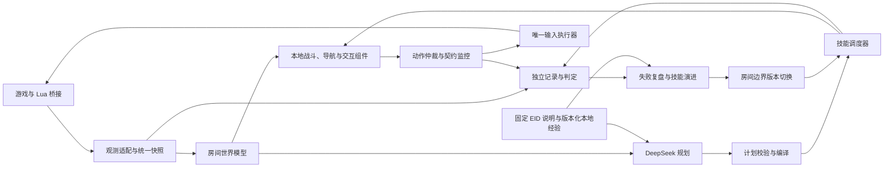

# 《以撒的结合：忏悔》分层智能体总体架构

日期：2026-10-25。面向游戏接口、控制算法、LLM 集成、测试和评测工程人员。

实现状态与扩展边界见 [第一阶段审查](phase-1-extensibility-review.zh-CN.md)；第二、三阶段的实施目标与提交顺序见 [首层至 Mom 计划](phase-2-3-roadmap.zh-CN.md)，首次遇见道具的知识存储与 DeepSeek 自动编程流程见 [道具与技能演进设计](item-knowledge-and-skill-evolution.zh-CN.md)。本总体架构包含尚未实现的能力，不作为已验收功能清单。

## 1. 目标、环境与设计原则

项目在 Windows 上的《以撒的结合：忏悔》原版 v1.7.9b.J835 中，使用全解锁存档和结构化实时状态，依次实现：单个战斗房间的高质量控制、完整单层、第一层正常开局至第六层正常击败 Mom。Mom 指第六层 Boss，不与 Mom's Heart、It Lives 或 Mother 混用。角色经正常移动、射击和游戏机制道具完成战斗；注入伤害、无敌、传送和改血只可用于训练场景初始化或排障。

开发使用固定种子复现问题；能力评测使用预先封存的随机种子。每次运行保留游戏、模组、存档、控制器、组件和提示词版本。随机种子的成功率、生命资源消耗和耗时分别统计；单房成绩不能代替完整通关成绩。

系统采用 **结构化观测 → 本地实时控制 → 可中断技能调度 → DeepSeek 规划与技能维护 → 独立记录和评测**。LLM 在入房、清房后、构筑改变及策略失效时参与战术选择和组件维护；移动、射击、避险的时序闭环在本地运行。房间战斗中 LLM 异步工作，不能阻塞逐帧控制。

入房及清房后允许暂停规划和更新组件；规划、检索和组件开发均设置墙钟期限、请求次数与费用预算，超时和无进展必须能终止并回退。游戏内暂停时间与真实墙钟时间均记录。当前房间的内部敌人状态、攻击计时器及碰撞信息按桥接实际可观测能力使用；不能把近似预测称作精确物理。未探索房间内容和未来随机数不属于默认权限。

已有实机控制探针证明：模组能够连接、采集状态、驱动正常移动与射击、停发释放输入、经真实门口换房，并在断线后恢复键盘控制。这些事实不构成战斗胜率、暂停控制或长局能力的证明。第一阶段的可执行实施计划见 [首房战斗控制器计划](phase-1-combat-controller.zh-CN.md)。

## 2. 系统层次与数据流

| 层 | 责任 | 更新方式 | 禁止事项 |
|---|---|---|---|
| 游戏桥接 | 采集实体与事件，执行正常输入，失效释放 | 游戏更新帧、事件和暂停期间轻量心跳 | 不把控制台调试命令暴露给正式控制器 |
| 观测与世界模型 | 对齐时间、实体身份、地形、构筑及未来短期危险 | 有新快照时更新 | 不把缺失字段当作零或实体消失 |
| 本地控制 | 路径、站位、躲弹、瞄准、技能执行 | 每游戏更新帧 | 不等待 LLM 或网络读取 |
| 技能调度 | 组件配置、战术切换、抢占、恢复 | 事件与短周期检查 | 不由多个技能同时直接发输入 |
| LLM 与知识库 | 机制查询、组件选择、参数配置、经验总结、候选代码 | 入房、清房及重要变化时 | 不直接输出逐帧按键或跳过本地契约 |
| 记录与评测 | 保存证据、核对损失、独立判定成败 | 持续异步落盘 | 不依赖控制器自报胜利 |

单个完整快照引用会话、房间进入序号、游戏更新帧、单调时钟和每通道采集帧。角色、敌人、弹体、布局和库存使用各自的新鲜度阈值；跨房数据在房间进入序号变化时失效。动作带来源快照、版本和有效期。输入执行器每帧提交完整输入状态，并处理按住、触发与松开边沿；继续保留桥接的动作失效释放。

观测正确性优先于策略开发。原子战斗快照须保留暂时不可受伤的敌人、及时更新地形和危险物，并记录弹体归属及不确定性；扩展武器和效果时要继续检查这些约束。伤害尝试回调发生在伤害结果确认前，应与之后的生命结构、护盾和资源变化核对。实体身份不得仅依赖可复用的 `Index`。

## 3. 控制组件与局部决策

### 3.1 组件注册和执行边界

每个 `SkillSpec` 声明：组件 ID 与版本、适用武器和道具机制、所需观测、输入输出类型、参数 schema 与范围、资源预算、前置条件、终止条件、失败原因、最长持续时间及内部状态重置规则。

组件只计算候选、评分或状态变换；动作仲裁器拥有唯一输入提交权。LLM 选择已经注册的组件并填参数。后续新增代码须经独立验证，在允许暂停的房间边界以原子版本切换进入同一注册表。控制、安全、记录和评测内核不由运行中的 LLM 改写。

| 组件组 | 基本能力 | 关键输出 |
|---|---|---|
| 世界模型 | 位置和速度历史、敌人阶段、弹幕、激光、炸弹、地形与危险区域 | 预测轨迹、风险区及可信度 |
| 目标选择 | 威胁优先、可击杀优先、攻击窗口、切换抑制 | 目标排序与目标失效原因 |
| 站位 | 保持射程、拉扯、侧移、逼近、掩体利用 | 站位目标和移动评分 |
| 导航 | 静态 A*、动态绕行、门口对齐、无进展恢复 | 路点、可行路径与替代路径 |
| 攻击 | 直射、移动中提前量、甩弹、蓄力释放、爆炸范围 | 各攻击输入的预计收益与风险 |
| 避险 | 弹幕和接触伤害规避、爆炸撤离、地面危险绕行 | 各移动输入的损失估计 |
| 包围预判 | 可达安全区域、通道关闭时间、角落风险 | 逃生空间评分与脱困目标 |
| 地形解谜 | 开关、推物、破障、炸桥、锁门、定时陷阱 | 有前置条件的多步交互技能 |
| 拾取与资源 | 拾取价值、价格、路径风险、生命预算、消耗品时机 | 获取/延后/放弃决策及支出授权 |
| 故障控制 | 观测过期、输入失效、卡死、重规划超时 | 回退、重新规划或释放输入 |

状态机提供 `WAIT_READY → ASSESS → ENGAGE / SOLVE → VERIFY_CLEAR → LOOT → EXIT`；`EVADE`、`RECOVER` 和 `SAFE_STOP` 可抢占。战术与动作评分使用实数状态，不通过枚举每个坐标和敌人组合扩大状态机。

### 3.2 敌人、武器和道具的机制映射

敌人按具体实体 ID 关联到追踪、冲锋、定向射击、环形弹幕、跳跃、钻地、召唤、治疗、分裂、阶段无敌和 Boss 阶段等可组合行为族。机制档案包括触发条件、可伤窗口、预测方法、几何危险和已知反例。未认识的敌人先使用实测位置、速度及弹体做通用预测，再异步检索与补充；未知阶段不得假装已预测。

武器适配按普通泪弹、散射和连发、蓄力、激光、投掷刀、近战、爆炸、遥控、环绕与回旋等发射机制组织。追踪、穿透、反弹、分裂等作为弹道修饰组合；跟班和轨道物作为额外输出及站位影响。主动道具、卡牌和药丸由单独的时机与资源组件处理。

遇到未登记道具时，先读取固定版本 EID 说明和本地相关经验，识别效果、代价、触发条件和未知，再与当前完整构筑组合。若现有组件能表达，生成配置并在拾取后核对实际属性和弹体行为；需要校准时在安全检查通过的节点做有界测试，LLM 记忆只提供待验证假设。若需要新算法，在允许的暂停边界生成代码、执行离线检查，再以试用状态装载。离线回放不能证明新动作在实机一定成功，组件回滚也不能撤销道具效果。实验与证据准入见 [EID 与本地学习计划](eid-local-learning-plan.zh-CN.md)。

### 3.3 联合运动与攻击决策

静态 A* 使用按玩家碰撞体膨胀的地图。动态敌人、弹幕及激光由局部短时搜索处理，不永久写为墙。飞行、穿障和道具改变地图可通行规则，真实地形变化后重建局部图。

局部求解器联合比较不动与八方向移动，以及停火和四方向射击。普通泪弹预测包含角色移动带来的速度继承，计算敌人未来位置、墙体阻挡、有效射程与可能首次命中。复杂弹道改用离散模拟；机制或参数缺乏校准时扩大预测区间。

包围预判计算未来可达区域及离开当前区域所需时间。一个动作即使下一帧安全，只要会封闭后续逃生路线，也应提高代价。动作选择优先规避已知致命碰撞，再比较预计非主动失血、逃生空间、输出、站位进度和资源消耗。没有安全候选时选预计损失最小的动作，并留下证据。

地形解谜使用带前置条件和可观测结果的动作模板。任务必须经过该区域时搜索有限步技能序列，每一步以真实地形或门状态确认。可选谜题价值不足时允许放弃；不能使用训练期传送绕过正式任务。

### 3.4 拾取、生命和长局资源

拾取输出 `立即获取 / 战斗后获取 / 延后 / 放弃`。比较构筑收益、恢复价值、价格、拿取路径、携带上限、未来需求及不可逆性。无意拾取会改变构筑，寻路也应避开不想拿的道具与付费物品。

主动扣血行动必须事前记录用途、最大允许损失与退出条件；默认不允许致死支出。非主动失血单列惩罚，途中回血不能抵消历史受伤。资源评估同时记录毛支出与收益，避免只看净变化掩盖代价。

单层阶段加入藏宝房、商店、Boss 入口顺序与通关路径；长局阶段维护生命、构筑、钥匙、炸弹、金币、主动充能及预期后续风险。M1、M2、M3 的成功率和资源成本分别报告。

## 4. DeepSeek、暂停与技能演进

### 4.1 规划合同

LLM 的输入是带版本的 `PlanningContext`：玩家和武器、当前房间敌人及内部状态、地形、实时危险、计算出的威胁与安全区、可用资源、知识来源、合法组件目录和近期执行反馈。默认不发送无关的整局逐帧日志；需要细节时调用只读工具查询。

规划分两层：`BattleAssessment` 描述敌人机制、主要危险、地形限制、武器机会和未知项；`BattlePlan` 指定一个至三个战术配置、各组件及参数、切换条件、重规划事件与证据引用。另有跨房间的楼层计划和长期资源计划。LLM 返回完整声明式计划，不输出逐帧按键或可任意执行的脚本。

编译器检查组件是否存在、武器兼容、参数上下界、资源许可、需要的观测、房间/构筑/经验版本和战术切换谓词。非法或过期计划拒绝，并将明确错误交给 LLM 修复；最终失败则运行兼容的本地规则计划。模型请求、资料查询和日志写入均不得阻塞逐帧控制。

### 4.2 房间边界暂停和战中请求

入房及清房后可以暂停读取状态、查询机制、选择组件、调整参数和更新技能。暂停协调器通过游戏原生暂停菜单工作，并核实请求、房间稳定性和游戏更新计数；`IsPaused()` 单独为真也可能表示转场或动画。暂停期间 `MC_POST_UPDATE` 不运行，轻量心跳与协议维护需要与渲染回调分开处理。暂停失败则记录降级并使用已有本地计划。[Game API](https://wofsauge.github.io/IsaacDocs/rep/Game.html#ispaused)、[回调 API](https://wofsauge.github.io/IsaacDocs/rep/enums/ModCallbacks.html#mc_post_update)

战斗中遇到新机制、连续无进展、确认受伤、反复脱困或战术前置条件失效时，异步请求 DeepSeek 更新已有组件配置。控制器继续执行已装载计划；本地紧急避险立即行动。响应以会话、房间、构筑和组件目录版本校验，在帧边界切换，避免旧房间答案覆盖新局面。

### 4.3 候选代码的生命周期

技能演进按 `生成候选 → 语法和接口检查 → 资源与依赖检查 → 几何及契约测试 → 历史轨迹回放 → 边界原子装载 → 实战试用 → 保留或回退` 执行。候选代码在独立受限进程中运行，只能取得快照并返回建议；不持有游戏控制、控制台、密钥、评测器或日志修改权限。

同一对局只在入房与清房后的暂停边界切换代码。离线通过的新组件仍标记为试用，其真实表现须在后续房间评价；超预算、崩溃、前置条件失效或契约违反时退出该组件并恢复稳定版本。首次“出门并清一房”任务使用预注册组件，暂不以动态生成代码作为通过条件。

## 5. 记录、评测与实施顺序

### 5.1 运行记录与优化闭环

每次运行生成独立目录，边运行边保存环境清单、结构化轨迹、规划日志及独立判定结果。至少记录：种子与存档、观测字段和辅助档位、游戏帧和真实时间、所有动作、组件配置与切换、暂停、LLM 延迟、伤害前后生命结构、主动生命支出、库存与资源变化、房间事件、死亡/复活、断连和人工接管。异常退出保留已落盘轨迹，守护程序补写最小结果。

单房报告并列清房结果、非主动失血、主动生命支出、恢复量、剩余生命、炸弹/钥匙/金币与充能支出、输出机会、无效射击、耗时、包围预警、脱困、回退及能力缺口。失败按观测、机制理解、预测、目标/动作选择、输入执行和资源决策分类。优化先校准错误状态，再调参数，最后增加组件；同房收益还须用后续楼层结果检查，防止为眼前清房透支长局资源。

固定技能库与边界自适应分别评测。自适应模式的独立测试种子从相同初始技能库开始，允许本局内部更新，不能在测试种子之间共享新学到的内容。训练种子和回归种子可复用；正式随机种子在评测前封存，失败、断线、人工接管均进入分母。

### 5.2 工程里程碑

| 阶段 | 交付重点 | 判定重点 |
|---|---|---|
| A：观测与输入 | 快照对齐、实体身份、伤害核对、完整动作、暂停及日志 | 字段可校准；异常不会留下按键或重复消耗 |
| B：首房战斗 | 普通泪弹、目标、导航、站位、甩弹、躲避、包围和脱困 | 自主出门、入房规划、清房与生命损失可重建 |
| C：知识与道具 | EID 说明、经验检索、机制映射、安全节点实验、拾取与构筑核对 | 未登记道具可判断、校准并适配；未知和反例可追溯 |
| D：地形与资源 | 解谜、互动、主动道具、生命预算 | 必经通路可完成，资源支出有事前授权 |
| E：技能演进 | 边界代码更新、离线检查、实战试用与回退 | 新组件可用于本局后续房间，故障被隔离 |
| F：单层与 Mom | 路线、跨房构筑和资源管理、Boss 阶段 | 随机种子完整运行，逐次保留失败证据 |

测试同时覆盖纯算法、模拟 TCP 和实机：弹道交会、移动惯性、角落封锁、无敌阶段、召唤/分裂、友方弹体、动态地形、爆炸、低血量主动支出、构筑变化、LLM 超时和旧回复、暂停失败、代码崩溃、断连、换房、死亡与正常复活。首房任务的具体接口、参数、两阶段规划和验收步骤由 [第一阶段计划](phase-1-combat-controller.zh-CN.md) 定义；M1 随机单房、M2 单层和 M3 完整通关的正式分母与门槛由版本化任务契约定义。
