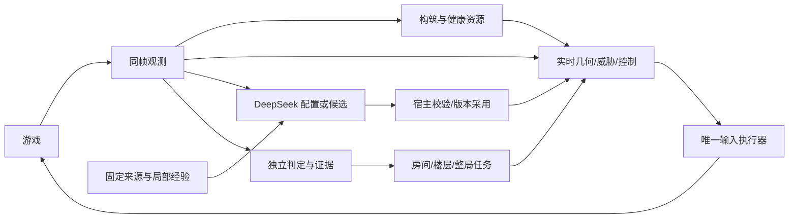

# 总体架构：分层时序控制与可验证扩展

本文维护长期职责与依赖方向，不充当当前功能清单。当前状态见 [准备审查](phase-2a-preparation.zh-CN.md)，实施见 [M2-A 计划](phase-2a-plan.zh-CN.md)，环境/辅助边界见 [任务契约](task-contract.zh-CN.md)。

## 1. 核心选择

系统采用结构化原子观测、本地实时控制、可中断任务状态机、DeepSeek 事件规划、独立证据判定。状态机管理任务阶段和控制权，数值算法处理连续位置、弹道和风险；不枚举每个敌人与坐标组合。

角色以正常移动、射击和获准的游戏交互完成目标。入房允许原生暂停，战中模型异步规划，本地控制持续工作。固定种子用于排障，随机可行性与统计评测分开；游戏时间、暂停和完整墙钟同时记录。

## 2. 稳定分层

| 层 | 责任与主要实现 | 扩展边界 |
|---|---|---|
| 游戏桥接 | Lua 原子采集、输入回调、回执、TTL、换房/断线释放、暂停心跳 | 正式控制不暴露任意控制台权限 |
| 观测与身份 | WorldSnapshot、run/floor/visit/实体身份、未知字段与新鲜度 | 缺失不当作零，临时无敌不当作死亡 |
| 构筑与账本 | BuildResolver、健康/资源状态、机制签名、校准与修订 | 实际面板优先；描述不重复加成；未知机制不伪装普通泪弹 |
| 实时控制 | geometry/motion/threats、七策略槽、联合动作求解、进展监督 | 纯计算与有限状态；不联网、不写知识库、不直接发键 |
| 执行与任务 | CombatSession 唯一发送者，RoomExecutor、FloorDirector；M3 增 RunDirector | 房间结束不结束连接；目标与动作分别管理 |
| 知识与规划 | 独立 EID SDK、智能体经验、DeepSeek 评估与 BattlePlan | 来源是数据，输出经宿主验证；知识缺失不阻塞逐帧控制 |
| 验证与演进 | 独立 Judge/记录、后续模型候选验证和发布 | 模型不修改成功标准、资源权限或安全内核 |

## 3. 战斗组件与机制替换

现有七槽位是 target、position、aim、fire、evade、escape、recovery，适合表达房间战术。道具映射到能力变化，敌人映射到行为与危险模型，不按“一道具一整套控制器”扩展。

下层职责逐步稳定为：Movement/Collision、攻击来源、WeaponTiming、Trajectory、HitEffect、AttackConsequence；不要求立即为每项建立框架或文件。当前普通泪弹最小实现不等于完整能力依赖图。新增武器应替换对应时序/弹道/后果，保留目标、躲避、任务与独立判定的通用部分。

局部控制联合比较移动和射击，先考虑已知致命碰撞、非主动损失、未来逃生余量，再比较输出与任务进度。静态路径与动态危险分开；飞行不等于免疫所有伤害，能穿墙的攻击不意味着玩家可穿墙。被包围预测看未来可达空间，不能只保证下一帧不碰撞。

攻击有预测时间窗、单位、目标/足迹、危险后果和未知范围。亡语、反射、自伤、TNT 等在攻击决策前纳入；释放型武器的输入释放可能产生攻击。工程保护不承诺未知机制绝对安全。具体 DTO/限额只在 [组件合同](component-contract.zh-CN.md) 维护。

## 4. 生命周期与版本

身份分为 run、floor generation、room key、room visit、entity instance；目录 ID 不能代替运行实例。状态按用途归属：地图在 floor，目标/危险历史在 visit，资源/费用在 run，经验在独立持久存储。无界调试原始记录写磁盘，逐帧内存有上限。

构筑变化执行：检测实际语义变化 → 释放/失效旧意图与异步计划 → 编译当前支持能力 → 重置受影响校准/几何/局部状态 → 发布修订 → 恢复。无关模块不应被全部重置；未知新武器无法回退到不兼容普通泪弹。

ContextRef 绑定 run/floor/visit/build/catalog/experience。计划模板可以复用，旧运行上下文和动作租约不能复用。来源包、经验、组件目录各自版本化；新资料或模型程序在安全边界采用，不能原地覆盖运行中的不可变版本。

伤害尝试与真实生命变化区分，存活不简化为红心+魂心大于零。主动生命支出须事前授权，回血不抵扣历史损失。资源毛消费与收益分开；每房、每层和整局指标不相互替代。

## 5. DeepSeek 的两类职责

运行时规划：读取当前状态、可用组件、局部知识与反馈，输出评估与有界 BattlePlan；宿主检查参数、能力、上下文和预算。入房可暂停，战中请求不阻塞实时控制；本地紧急避险不等待模型。API 修复/工具轮次都计入请求预算。

机制开发：M2-B 中，模型根据能力缺口输出真正的新程序，由独立宿主验证、限权运行、试用和发布。它与选择已有组件属于不同能力，作者证据分别记录；当前没有模型自动编程运行器。具体过程只在 [组件演进设计](item-knowledge-and-skill-evolution.zh-CN.md) 维护。

知识查询与学习也分工：独立项目拥有固定说明与来源，智能体拥有遭遇/测量/反例/技能。模型知识是待验证先验，被动测量优先，主动实验仅在依赖时启用。见 [知识接口](knowledge-project-interface-plan.zh-CN.md) 与 [学习机制](eid-local-learning-plan.zh-CN.md)。

## 6. 判定、扩展与非目标

控制器提出任务和动作，Judge 根据观测与证据决定结果。房间清空、Boss 完成、正常离层、恢复可行动是不同事件；不能靠导演自报 success 拼成通关。超时、卡死、人工接管和未支持机制明确报告。

M2-A 验证连续首层，M2-B 验证模型开发与复用，M3 才实现同一局到 Mom。现在无需通用分布式服务、全道具组合图或昂贵消融；复杂机制按实际缺口扩展。一次可行性不是稳定胜率、最优策略或人类竞速水平，长期研究指标和付费原则统一见 README。
