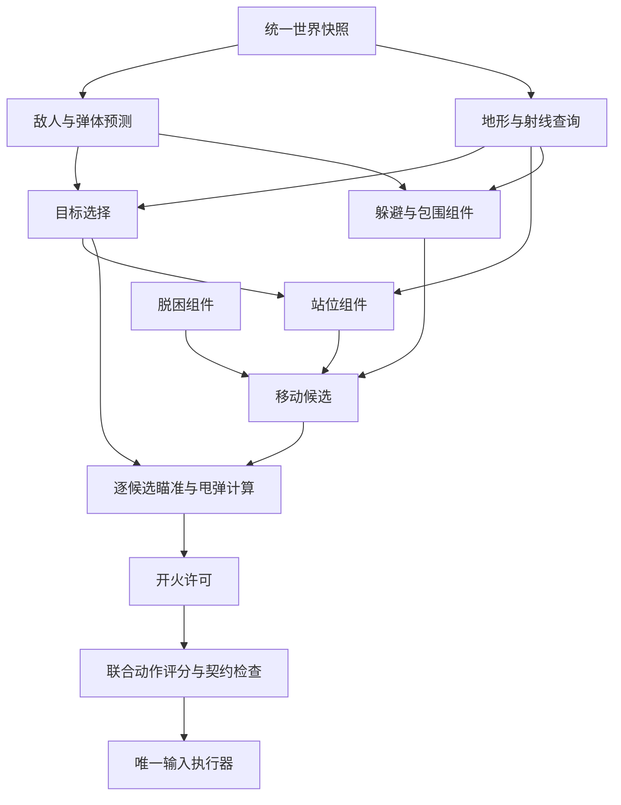

# 第一阶段计划：初始房间出门并清理首个战斗房

> 历史阶段资料；当前执行状态与已知缺陷以 [P0–P6 审查](../phase-2a-preparation.zh-CN.md) 和 [M2-A 计划](../phase-2a-plan.zh-CN.md) 为准。本文保留对应版本的设计或证据，不作为当前完成清单。

日期：2026-10-25。面向控制算法、游戏接口、LLM 集成和测试工程人员。

## 1. 任务与验收边界

在 Windows 上的《以撒的结合：忏悔》原版 v1.7.9b.J835 中，以普通难度、Isaac、全解锁存档正常开局。智能体从初始房间经游戏内正常移动穿门，进入首个战斗房；入房后暂停，分析当前局面并配置战斗组件；恢复游戏后靠正常移动和普通泪弹清房。

首轮验证 **LLM 选择预先注册的组件并填写参数**，以及战斗事件触发的异步重规划。运行中代码生成不属于本阶段验收。初始 D6 保留在角色身上，但不使用炸弹、主动道具、卡牌或药丸，也不主动拾取改变武器的道具。清房确认后任务结束。

如果经过的是空房，继续选择尚未探索的普通开门。选门只使用当前房间可读的门信息，优先最短可达路径，同距离按门槽位排序；不读取下一房间敌人或奖励。最多经过八个房间，仍未遇到战斗房则记录 `NO_COMBAT_ROOM_FOUND`，不计作清房成功。

| 结果 | 判定 |
|---|---|
| 成功 | 完成真实换房；目标房 `is_clear` 持续成立，阻塞清房的存活敌人已消失，角色仍可行动 |
| 失败 | 角色死亡、人工接管、断连、战斗超时、无法经正常输入换房，或无法确认清房 |
| 战斗超时 | 120 个游戏秒；暂停与网络等待另计，仍记录真实墙钟时间 |

完整的随机种子验收另遵循任务契约。本阶段的一次成功只证明链路可行，不能宣称单房稳定胜率。

## 2. 战斗控制组件架构

### 2.1 固定执行管线



组件提供预测、候选动作或评分；只有最终输入执行器发送移动和射击。LLM 输出声明式 `BattlePlan`，经校验编译为 `BattleRuntime`。组件连接顺序、输入释放、清房判定和记录逻辑固定，LLM 可选择组件、参数、目标优先级与战术切换条件。

### 2.2 不可省略的基础服务

| 服务 | 输入与输出 | 职责 |
|---|---|---|
| `SnapshotAssembler` | 桥接消息 → `WorldSnapshot` | 同帧去重，保留各字段采集帧；换房时清空旧实体 |
| `BuildResolver` | 属性、库存、实际泪弹 → `BuildProfile` | 校准发射间隔、有效射程、速度继承及碰撞体 |
| `MotionPredictor` | 实体历史、机制档案 → 预测轨迹 | 输出轨迹与可信范围，不把未知阶段解释成已知攻击 |
| `GeometryService` | 房间网格、门、角色能力 → 通行图与射线查询 | 区分角色通行与泪弹通行 |
| `JointActionSolver` | 所有组件的候选与评分 → `ActionFrame` | 同时比较走位和开火，并处理冲突 |
| `CombatJudge` | 只读游戏状态与事件 → 房间结果 | 独立确认清房、死亡、真实失血和超时 |

入房前必须修正观测缺口：保留暂时无敌和钻地的敌人；稳定识别实体生成实例；核对弹体敌我归属；活动炸弹、激光与地面危险高频更新；地形改变后刷新布局；伤害回调只记作伤害尝试，下一次有效观测再核实生命变化。缺失字段不可按零处理，暂时空列表不可按清房处理。

### 2.3 可选组件目录

一份 `TacticProfile` 必须填满下列槽位。目录为每项组件声明输入字段、适用武器、参数 schema 与范围、内部状态、终止和失败条件；不能通过自由文本增加组件。

| 槽位 | 首批组件 | 产物与区别 |
|---|---|---|
| 目标选择 | `target.threat_first`、`target.finish_first`、`target.weighted` | 根据威胁、可击杀程度和接近代价排序；目标不可伤时仍保留威胁跟踪 |
| 站位 | `position.keep_range`、`position.kite`、`position.strafe` | 分别偏向保持输出距离、后撤留路、横向走位 |
| 瞄准 | `aim.direct`、`aim.predictive` | 比较直射和考虑敌我运动的提前量、甩弹命中 |
| 开火 | `fire.normal_tears` | 判断射线、射程、敌人可伤阶段及开火收益 |
| 躲避偏好 | `evade.minimal_shift`、`evade.max_clearance` | 分别偏向最小位移和最大安全余量；固定碰撞检查始终启用 |
| 逃生空间 | `escape.keep_routes` | 估计未来可达安全区域和通道关闭趋势 |
| 卡住恢复 | `recovery.local_repath` | 检测无位移或路径无进展，提出换路和短时脱困候选 |

首轮参数及类型由版本化目录定义：

| 参数 | 允许值 | 默认值 |
|---|---|---|
| `target.weighted` 三项权重 | 非负、和为 1，分别为威胁、可击杀程度、接近代价 | `0.5 / 0.3 / 0.2` |
| `switch_margin` | `0.05–0.5`，新目标评分必须超过旧目标的幅度 | `0.15` |
| `min_hold_ticks` | `0–30` 游戏更新帧 | `10` |
| `min_range_ratio`、`max_range_ratio` | 均为有效射程的 `0.2–0.95`，且前者小于后者 | `0.45 / 0.8` |
| `preferred_side`、`side_switch_ticks` | `auto / left / right`；`6–30` 帧 | `auto / 12` |
| `max_lead_ticks` | `3–24` 帧 | `12` |
| `movement_inheritance` | 布尔值 | `true` |
| `min_hit_score` | `0–0.8`，启发式评分而非命中概率 | `0.2` |
| `extra_margin_px` | 固定碰撞余量之外再加 `0–12` 像素 | `4` |
| `escape.horizon_ticks`、`min_safe_area_ratio` | `15–45` 帧；`0.1–0.5` | `30 / 0.25` |
| `stall_window_ticks`、`recovery_ticks` | `15–60` 帧；`3–12` 帧 | `30 / 6` |

固定安全余量由玩家和敌人的碰撞体、观测年龄及预测误差计算，LLM 不可减小。所有位置使用房间局部像素坐标，速度使用像素/游戏更新帧；属性面板速度和实测移动速度分开。

### 2.4 每帧动作搜索

首版联合枚举九种移动输入（不动及八方向）和五种射击输入（停火及四方向），得到 45 个候选。对候选预测未来 12 个游戏更新帧，只执行下一帧并重新计算。

泪弹轨迹模型为 `武器发射速度 + 玩家移动继承速度`。移动继承需由当前版本接口或真实泪弹轨迹校准。命中评分考虑首次交会、敌人碰撞体、墙体遮挡、有效射程和目标能否受伤；校准不足时扩大误差并降低评分可信度。

逃生组件判断的不只是下一帧碰撞，还包括未来可达区域是否缩小、出口是否早于角色逃离而关闭。动作求解器先淘汰已知碰撞和高致死风险，再比较输出、逃生空间、站位进度与动作切换代价。没有安全候选时，选预计损失最小的可执行动作并记下原因。

### 2.5 执行状态与战术切换

主状态为 `WAIT_READY → ROOM_PLAN → ENGAGE → VERIFY_CLEAR → DONE`。`EVADE` 和 `RECOVER` 可抢占战斗状态，`SAFE_STOP` 处理通信和控制故障。

战斗中每三帧评估一次 `TacticProfile` 切换，默认最短保持 15 帧；紧急避险不受保持时间限制。目标死亡、无法到达或身份失效时立即重选。切换配置时重置路径和相关计时，保留有效轨迹历史与武器校准；同一帧最多提交一次完整动作。

## 3. LLM 规划接口与多轮流程

### 3.1 LLM 输入：`PlanningContext`

每次请求使用冻结的上下文标识。LLM 阅读压缩后的事实与能力目录，按需通过只读工具查询细节。

| 内容 | 字段 |
|---|---|
| 标识 | `run_id`、`room_visit_id`、`snapshot_id`、游戏帧、构筑版本、目录版本 |
| 任务 | 清理当前房间、允许输入、禁用资源、战斗超时 |
| 玩家 | 位置、速度、生命结构、碰撞体、飞行和无敌状态 |
| 武器 | 当前武器族、伤害、实际发射间隔、泪弹速度、有效射程、速度继承及校准状态 |
| 敌人 | 稳定实体 ID、类型/变体、位置、速度、生命、碰撞体、可伤状态、内部状态及字段年龄 |
| 地形 | 房间形状、可走区域、障碍、坑洞、危险地形、门与坐标转换 |
| 危险 | 当前弹幕、激光、炸弹和地面危险摘要；预计接触时间及不确定性 |
| 派生特征 | 射击线、可达区域、安全站位、逃生通道、候选目标击杀代价 |
| 机制知识 | 敌人阶段解释与打法，知识来源、适用版本和验证状态 |
| 目录 | 合法组件、契约、参数范围和可组合规则 |
| 反馈 | 当前计划、最近受伤、输出、位移、卡住、回退和触发原因 |

初入房尚无历史时，历史字段为空，不能虚构敌人运动趋势。内部状态数值只有在机制知识已验证时才解释为攻击阶段。LLM 不承担逐帧几何计算。

只读工具为 `lookup_enemy_mechanics`、`lookup_player_mechanics`、`get_component_specs`、`inspect_room_region`、`inspect_entity` 和 `preview_plan`。`preview_plan` 返回校验结果和基于当前模型的候选动作；它不是可验证胜率的真实试跑。Wiki 内容只作为机制证据，不允许充当系统指令。

### 3.2 两阶段输出

第一阶段 `BattleAssessment` 回答“这是什么战斗”：

```text
context_ref
enemy_groups[] {mechanism, entity_refs[], confidence, evidence_refs[]}
primary_dangers[] {kind, evidence_refs[]}
terrain_constraints[]
weapon_opportunities[]
recommended_tactics[]
unknowns[]
```

第二阶段 `BattlePlan` 回答“如何配置组件”：

```text
schema_version
context_ref {run_id, room_visit_id, snapshot_id, build_revision, catalog_revision}
default_profile
profiles {profile_name: {target, position, aim, fire, evade, escape, recovery}}
switch_rules[] {when: bounded_predicate, use_profile: profile_name}
replan_on[]
rationale {summary, evidence_refs[]}
```

每个槽位写 `{component, params}`。允许一至三个战术配置。切换条件只能组合登记的谓词，包括敌人组是否仍存在、可攻击敌人数、生命比例、目标射程关系和本地风险等级。规则按顺序匹配，未匹配时使用默认配置；不能使用自由文本条件或动态执行 Python。

配置引用敌人族类和实时选择器，不锁死一个可能随时死亡的实体 ID。`snapshot_id` 表示计划的证据来源；战斗中游戏帧前进不自动使计划失效，房间、构筑、目录或计划版本冲突则拒绝旧结果。

以下为虚构追踪型敌人房间的完整输出示例；标识仅演示字段关系，不代表实际游戏快照：

```json
{
  "schema_version": 1,
  "context_ref": {
    "run_id": "demo-run",
    "room_visit_id": "floor1-room84-visit1",
    "snapshot_id": "snapshot-42",
    "build_revision": 1,
    "catalog_revision": 1
  },
  "default_profile": "kite",
  "profiles": {
    "kite": {
      "target": {
        "component": "target.weighted",
        "params": {
          "threat_weight": 0.6,
          "finish_weight": 0.3,
          "approach_cost_weight": 0.1,
          "switch_margin": 0.15,
          "min_hold_ticks": 10
        }
      },
      "position": {
        "component": "position.kite",
        "params": {"min_range_ratio": 0.5, "max_range_ratio": 0.8}
      },
      "aim": {
        "component": "aim.predictive",
        "params": {"max_lead_ticks": 12, "movement_inheritance": true}
      },
      "fire": {
        "component": "fire.normal_tears",
        "params": {"min_hit_score": 0.2}
      },
      "evade": {
        "component": "evade.max_clearance",
        "params": {"extra_margin_px": 4}
      },
      "escape": {
        "component": "escape.keep_routes",
        "params": {"horizon_ticks": 30, "min_safe_area_ratio": 0.25}
      },
      "recovery": {
        "component": "recovery.local_repath",
        "params": {"stall_window_ticks": 30, "recovery_ticks": 6}
      }
    }
  },
  "switch_rules": [],
  "replan_on": [
    "confirmed_damage",
    "no_progress",
    "new_enemy_mechanism",
    "repeated_recovery"
  ],
  "rationale": {
    "summary": "优先处理接近最快的敌人，保持射程并保留逃生空间。",
    "evidence_refs": ["assessment.enemy_groups.chasers"]
  }
}
```

### 3.3 入房规划与错误修复

1. 经门入房，释放旧动作，取得完整快照，核实游戏已真正暂停。
2. 本地构建 `PlanningContext` 和派生几何特征。
3. DeepSeek 分析阶段按需查询机制，输出 `BattleAssessment`。
4. DeepSeek 配置阶段依据分析和目录输出完整 `BattlePlan`。
5. 本地校验组件存在性、武器兼容性、参数范围与关系、切换谓词、数据前置条件和初始几何可行性。
6. 校验失败时返回带 JSON 字段路径与允许值的错误，最多修复两轮。
7. 装载计划，恢复游戏，取得新鲜快照后开始控制。

请求无响应、结果为空、修复失败或暂停失效时，使用本地预置配置：`threat_first + kite + predictive + normal_tears + max_clearance + keep_routes + local_repath`。错误要写日志；不能静默接受半份计划。

### 3.4 战斗中异步重规划

| 触发事件 | 首轮条件 | 本地即时行为 |
|---|---|---|
| `confirmed_damage` | 真实生命/护盾变化经核对 | 立即避险，保留受伤前后候选动作 |
| `no_progress` | 90 帧无有效伤害或击杀，且不处在已知等待阶段 | 重新寻找射击线和站位 |
| `new_enemy_mechanism` | 出现未纳入分析的机制 | 使用通用预测并增加误差余量 |
| `repeated_recovery` | 150 帧内两次脱困 | 换路径与站位目标 |
| `invalid_profile` | 组件前置条件持续不成立 | 本地切回预置配置 |

同房同一时间最多一个待处理规划请求；多个触发事件合并。常规请求间隔至少 90 个游戏更新帧。本地控制不中断：已有机制仍成立时直接重配；出现新机制时先补充分析再重配。响应返回后重新核对房间、构筑、组件目录和计划版本，在更新帧边界原子切换。

## 4. 接口、暂停与记录

公共类型为 `WorldSnapshot`、`BuildProfile`、`EnemyForecast`、`ComponentSpec`、`BattleAssessment`、`BattlePlan`、`TacticProfile`、`ActionFrame`、`ActionReceipt` 和 `RoomReport`。每个对象拥有明确的版本、单位和有效期。规划接口只消费只读快照；组件只有评分与候选输出；输入执行器拥有唯一发送权限。

当前模组的 `MC_POST_UPDATE` 在游戏暂停时停止，暂停期间的轻量通信与心跳需由渲染回调处理。`IsPaused()` 也可能表示转场或动画；暂停协调器必须同时检查本次暂停请求、房间稳定性和更新计数。入房暂停会有实际延迟，记录到帧；不预设零帧暂停。[ModCallbacks 文档](https://wofsauge.github.io/IsaacDocs/rep/enums/ModCallbacks.html#mc_post_update)、[Game 文档](https://wofsauge.github.io/IsaacDocs/rep/Game.html#ispaused)

输入消息每帧包含完整移动和射击状态，显式释放旧方向；桥接保留三游戏更新帧的失效释放。行动记录区分发送成功、游戏接受以及实际效果。观测超过两个更新帧时不开始新的高风险动作；断线、死亡和换房立即废弃房间计划并释放输入；失焦不视为故障（见任务契约的运行环境约束）。

每次运行在 `artifacts/runs/<run_id>/` 保存 manifest、轨迹、规划日志和独立结果。逐帧保存最终动作、活动配置和关键评分；完整候选集保留环形缓冲，在受伤、脱困、重规划和故障时写出前后窗口。房间报告包括非主动失血、主动支出、剩余生命、输出、无效射击、战斗与暂停耗时、脱困、回退及日志完整性。途中回血不能抵消已经发生的受伤记录。

## 5. 实施次序与测试

| 顺序 | 交付 | 完成标准 |
|---|---|---|
| 1 | 桥接观测和完整动作修正 | 敌人、弹体、地形、生命及动作边沿数据可在模拟客户端和实机核对 |
| 2 | 出门与暂停协调 | 从初始房间正常经门；入房快照与暂停状态一致；异常时可释放控制 |
| 3 | 组件目录与本地默认打法 | 不依赖 LLM 能完成基本目标选择、走位、射击和故障退回 |
| 4 | 两阶段 DeepSeek 规划与编译器 | 输入、分析、计划、修复和降级链路可复现 |
| 5 | 联合动作求解与战中重配 | 走位与射击联合评分；异步响应不会阻塞、覆盖过期房间或重复发动作 |
| 6 | 独立记录与实机闭环 | 能从日志重建计划、动作、受伤、清房判据和实际代价 |

测试覆盖：静止与横移目标、甩弹、墙体阻挡、坑洞可射不可走、角落包围、目标死亡、暂时无敌、友方弹体、缺失字段、多消息同帧、暂停/恢复、LLM 无响应、非法参数、旧规划响应、重复脱困、断线及人工接管。

首个里程碑为至少一次完整实机成功：正常出门、入房暂停配置、恢复后自主清房，且日志可还原 LLM 选择、参数、执行和生命代价。随后运行十个预先固定的随机种子，逐次报告结果和失败原因，用于决定下一批敌人机制与组件；这十次不构成稳定性声明。

工程验收及同种子对照结果见 [第一阶段实机验收](../evidence/phase-1-live-validation.zh-CN.md)。首房闭环通过，后续 M1 稳定性评测使用独立留出样本。
