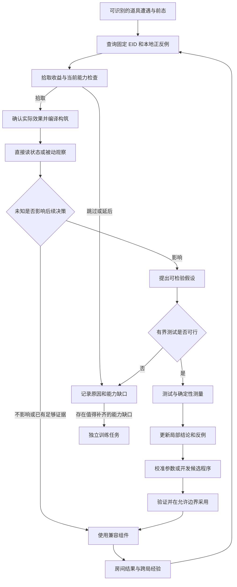

# EID 与本地学习：道具决策、能力适配及组件演进计划

日期：2026-10-26。目标：忏悔原版 `1.7.9b.J835`，先支持第一层通关，再扩展到 Mom 长局。状态：固定 EID SDK、遭遇/拾取数据库和被动经验已接入；本地闭环与 J835 属性道具拾取后清房见 [准备准入报告](phase-2a-preparation-validation.zh-CN.md)。主动实验关闭，DeepSeek 自动开发组件仍属 M2-B。本文描述完整目标，不能将后续机制视为已实现。

## 1. 推荐方案与目标

采用“固定版本 EID 说明包＋实际游戏观测＋本地经验库＋DeepSeek 按需推理/编程”。知识库独立维护来源与查询接口，智能体拥有遭遇、实验、策略和组件；首版用本地 Python SDK 与 SQLite，不需要常驻服务或 Wiki 爬虫。

目标是在遇见一个道具时，能解释是否拾取；拾取后能识别能力变化；存在影响控制的未知时，选择被动观察、有限测试或独立训练；将结果保存并用于后续房间和后续对局。确实缺少算法时，DeepSeek 应编写新机制程序，不能把选择预制组件冒充自动开发。

设计遵循四个优先级：保持有效控制与限制非主动损失；完成当前通关任务；在安全前提下提高速度；利用值得付出的学习机会。学习不是每拿一件道具都暂停做实验，也不是训练 DeepSeek 权重。

| 决策 | 推荐 | 原因与代价 |
|---|---|---|
| 外部知识来源 | 固定 EID 数据，运行时只查本地 | 避免网页结构和反爬依赖；动态条件、敌人知识仍可能缺失 |
| 道具适配单位 | 能力/机制组合，保留物品到机制的映射 | 避免每个道具一套状态机；仍须处理协同与优先级 |
| 学习顺序 | 直接读状态 → 复用经验 → 被动测量 → 主动测试 → 生成程序 | 先用便宜且可靠的信息，减少模型费用与局内暂停 |
| 新逻辑载体 | 最小类型化受限程序，按真实缺口增加原语 | 让 DeepSeek 能创造逻辑，同时限制执行范围；不先设计全游戏通用语言 |
| 数据隔离 | 固定说明包与增量经验库分开 | 来源说明不被一次观测覆盖，支持复现和追溯 |
| 验收方式 | 少量完整闭环及关键失败场景 | 先证明可行；不据此宣称高胜率、全道具覆盖或 SOTA |

## 2. 必须分清的概念与现有前置问题

### 2.1 四种学习成果

| 成果 | 回答的问题 | 合法证据 | 不能据此推出 |
|---|---|---|---|
| 机制知识 | 在什么条件下可能发生什么？ | EID 声明、带适用范围的观测、明确标记的模型假设 | 当前构筑一定会发生、控制器一定支持 |
| 参数辨识/校准 | 当前构筑的发射间隔、弹速等是多少？ | 实际状态与带单位的轨迹测量 | 所有组合都使用同一参数 |
| 策略学习 | 什么情况下选哪个组件、设置哪些参数？ | 房间结果、错误案例、局部比较 | 单次胜利证明策略更优 |
| 程序开发 | 现有组件不能表达的行为如何实现？ | 候选程序、独立检查及实际行为 | 编译通过等于游戏语义正确 |

参数辨识可以理解为“测当前系统如何响应输入”，不要求让 LLM 猜所有数值。LLM 擅长提出解释、设计测试和编写逻辑；能由结构化状态或确定性计算得到的量，优先直接获取。

“EID 描述很好所以应该拿”“空房一定能安全测试”“模型解释通顺所以已经学会”都不是有效推论。一次测试没有出现罕见效果，也不能证明这个效果不存在。

### 2.2 实施前必须解除的阻断

第一阶段已有普通泪弹、单房间控制基础，但尚不能直接承接任意道具。现有审查记录了 `BUILD_CHANGED` 退出、武器识别范围有限、部分生命结构判定和组件输出校验缺口。详见 [第一阶段扩展性审查](phase-1-extensibility-review.zh-CN.md)。

实施顺序必须先保证：可观测实际拾取和构筑变化、健康账本能表示生命类型、组件输出有边界检查、换构筑后能选择兼容控制或明确失败。知识文本再丰富也不能弥补观测和执行接口缺失。

数据库/API/受限程序均属于后续新增能力。当前 DeepSeek 的配置输出不等于已具备程序开发能力。

## 3. EID 来源层与项目边界

### 3.1 说明包

EID V5.25 的官方发布记录列有 Repentance 1.7.9b 支持，作为首个兼容性候选；对 J835、语言和桥接组合仍需本地验证。固定提交与内容哈希，不跟随运行中的 master。[发布记录](https://github.com/wofsauge/External-Item-Descriptions/releases)

首版离线导入基础说明和原版 Repentance 覆盖，不要求安装完整 EID 显示模组。导入器支持所需数据格式，无法解释的 Lua 条件记录为 `partial/unknown`，不在宿主执行任意外部 Lua。不能把 `rep` 目录当完整数据，也不能混入 `rep+`、`rgon` 专属效果。

保留原始文本、规范化文本、标记含义、来源位置、语言、版本、解析器版本及未解析部分。EID 标记可能承载生命类型、警告和物品引用，不能全部删除。[标记文档](https://github.com/wofsauge/External-Item-Descriptions/wiki/Markup)

需要当前构筑条件描述时，可增设游戏内 EID 导出适配器：基础说明与条件展开后的说明分别存储，后者绑定角色、构筑、帧和配置。具体 API 按固定版本源码核验，不把旧参考文档当兼容保证。[API 文档](https://github.com/wofsauge/External-Item-Descriptions/wiki/API-Documentation)

EID 包含多类物品说明，但不是完整敌人模型；详细错误道具效果依赖 REPENTOGON，原版不能假定可读。[项目说明](https://github.com/wofsauge/External-Item-Descriptions)

### 3.2 所有权与交付

- `isaac-knowledge`：来源导入、静态身份、说明/机制线索、版本与缺口、不可变 SQLite 包、本地查询 SDK。
- 本项目：可见性规则、实际遭遇、构筑、拾取、实验、经验、策略和技能发布。实时控制不等待导入、数据库写入或联网。
- 外部接口采用 [Knowledge Contract 1.0](knowledge-project-interface-plan.zh-CN.md)，本地规划采用 `KnowledgeBundle v2`；不直接共享可写数据库。

内容署名和复用条件在导入与分发时确认，第三方全量说明不默认提交本项目 Git。当前范围没有网页爬虫或反爬问题；数据下载、版本兼容和条件解析仍需处理。

## 4. 从遭遇到复用的运行流程



图中“无法测试”不代表可以停止控制：有兼容组件就继续保守执行；没有兼容组件则进入有时限的恢复/失败路径。不能把无限暂停、无限避险或反复请求模型算成正常学习。

| 模块 | 输出与职责 | 不承担的职责 |
|---|---|---|
| `EIDAdapter / KnowledgeGateway` | 按可见身份和版本返回说明、条件、缺口 | 决定按键、把模型先验写成来源事实 |
| `BuildCompiler` | 实际能力图、临时状态、修订及不确定项 | 猜测未观测的武器参数 |
| `ExperienceRetriever` | 返回适用结论、反例、失效条件与支持限制 | 仅按名称匹配、只挑成功案例 |
| `PickupEvaluator` | `take/skip/defer`、依据、能力缺口 | 绕过支付条件或无期限等待 |
| `ExperimentPlanner` | 假设、区分判据、步骤和预算 | 自行批准实验安全性 |
| `ExperimentGate / Supervisor` | 本地准入、意图期限、抢占和累计预算 | 以实验名义关闭防卡死或输入 TTL |
| `ExperimentRunner / MeasurementExtractor` | 唯一执行通道、原始证据、确定性指标 | 独立发送竞争输入或凭文本宣布成功 |
| `EvidenceEvaluator` | 有范围的结论、冲突和下一步 | 自动扩大到所有构筑 |
| `SkillDeveloper / Publisher` | DeepSeek 候选、验证、发布、隔离与回退 | 修改实时安全内核或评判自身正确性 |

这些是职责边界，不要求部署九个服务。首版按模块组织于现有进程，慢任务与实时控制隔离。

## 5. 拾取决策与学习机会选择

### 5.1 拾取前

保存遭遇时的房间访问、实体身份、前态、价格、可见性和备选路径。未识别药丸、被遮蔽物品按现有信息权限保留未知；隐藏 ID 是否可用由独立辅助配置决定。

宿主先检查能否支付、已知即时后果、组件支持、适配路径与当前生命/资源约束。LLM 再结合说明和经验分析收益、协同、机会成本及未知。纯属性变化和已覆盖规则可本地处理，无需每次调用模型。

| 物品情况 | 默认处理 |
|---|---|
| 可观测属性变化，现有算法覆盖 | 按收益决定，拾取后读实际属性，不额外测试 |
| 已知能力组合，存在兼容组件 | 复用组件及有效经验，必要时局部校准 |
| 存在未知，但行为仍在可信动作/危险边界内 | 允许有界适配；不要求每个物品已有手工组件 |
| 不可逆武器变化，没有兼容控制或可行学习路径 | 拾取前延后/跳过，登记独立训练任务 |
| 未知主动、自伤、全局重置或程序生成效果 | 不把正常局当盲试环境；只做允许范围内的被动观测 |

`PickupDecision` 至少包含 `encounter_id`、上下文、`decision`、`reason_codes`、`evidence_refs`、预期收益、成本、未知、所需能力、支持状态及适配计划引用。`defer` 必须带重评条件和截止边界，例如完成当前房间/获得指定兼容模块；到期转为明确决策。

### 5.2 什么问题值得实验

按“信息是否可能改变下一步行动”选择实验，这是信息价值原则。首版不伪造精确收益概率，使用可解释的准入问题：

1. 未知是什么？不同答案会改变哪个组件、参数或拾取/路线决定？
2. 现有观测能区分答案吗？若缺少发射源身份，测试可能无法区分角色泪弹和跟班弹体。
3. 能否先从实际状态、缓存或自然战斗获得答案？
4. 动作后果、耗时、资源是否能约束？结果无论如何是否都有可执行后续？

若测试没有决策价值、无法区分答案或无法约束成本，就不启动；能够通过已有状态或自然行为获得答案时，优先使用这些证据。不为“数据库还没有一条记录”启动实验，也不为不影响当前策略的未知反复调用模型。

长期跳过未知会造成覆盖停滞。因此每次跳过都区分“物品收益不足”和“智能体能力不足”。独立训练优先处理高遭遇频率、阻断通关、可复用到多个道具的能力缺口；积累的是通用机制组件，不是为每个 ID 写脚本。

## 6. 测试模式、安全边界与时序

| 模式 | 行为 | 能证明什么 |
|---|---|---|
| 被动观测 | 记录实际属性、自然射击与正常房间事件 | 当时条件下的参数或现象；未发生不等于不可能 |
| 局内低风险测试 | 在可观测安全边界内短射击、已知蓄力/释放或有限移动 | 当前构筑下的发射时序、轨迹和运动响应 |
| 独立训练 | 初始化目标构筑和环境，允许专门验证危险或敌人相关交互 | 指定场景的机制/组件能力；不算正常局连续通关 |

暂停用于规划、分析和发布。执行测试必须确认游戏已恢复更新；计划完成后释放输入并继续观察残留效果，再按需暂停。游戏更新帧与墙钟时间同时记录，不能把暂停期间的静止当有效样本。

局内准入至少检查：同房新鲜快照、实际构筑匹配、无已知敌人/待生成威胁、无危险在途弹体/炸弹/残留、避开 TNT/火/机关/出入口及未决定拾取物、动作和攻击后果保留安全余量、测量字段存在。`is_clear=true` 只是其中一项。

未知效果没有可证明的后果边界时，空房也不能称为安全。新的控制逻辑可以在已知安全攻击家族内学习；未知爆炸、自伤、传送等能力先转独立训练，不能先射击再讨论安全距离。

首版建议每个构筑学习事件最多两个短探针，总计最多 90 个游戏更新帧，动作部分不超过 60 帧。秒数由实际更新率换算，不把渲染帧当更新帧。已知长蓄力需要更长预算时，提前制定对应机制合同，不能超时后循环续期。

默认主动道具、炸弹、卡牌、药丸和其他资源消耗预算为零，主动生命支出为零；有明确目标用途的资源行为另设合同。实验帧、墙钟、模型请求和资源均有宿主累计预算；切换 experiment ID、临时构筑状态或重试不能重置整局上限。具体墙钟和费用上限在配置中必填，超限停止学习并执行兼容策略或明确失败。

以下事件强制抢占：新威胁、意外伤害尝试、危险范围超界、未预期生命变化/传送、观测过期、房间/构筑变化、死亡、断线和预算到期。停止发输入不能撤销已发弹体；后续撤离仍由安全控制负责，部分结果保存为 `aborted/unsafe/inconclusive`。

实验中的等待使用宿主签发、绑定步骤且有到期时间的意图。只豁免预期的有限静止，不关闭危险监测、连接释放和输入 TTL；新战斗抢占后恢复普通防卡死监督。没有进展的等待必须有终点。

空房不能验证实战 DPS、敌人命中率、反射、追踪、亡语或罕见触发概率。测试协议必须说明其不能覆盖的内容。

## 7. DeepSeek 输入、输出与闭环

### 7.1 输入范围

`KnowledgeBundle v2` 提供来源说明、条件、`local_claims`、`hypotheses`、`counterexamples`、`support_limits`、`experience_revision`；另提供当前能力图、所需观测 schema、组件合同、允许原语、预算和最小失败样本。优先只送与当前能力缺口相关的内容，避免整库和逐帧日志挤占上下文。

LLM 自身知识标为 `model_prior`，可以指导假设与程序设计，不能伪装成 EID 原文或已测事实。来源文本按数据处理，不能获得工具、路径或执行权限。

### 7.2 假设与实验合同

`Hypothesis` 包含问题、适用条件、来源/模型先验、竞争解释、预期与反证现象、混杂因素和可测试性。`ExperimentPlan` 包含上下文、动作原语、测量、预算、终止和不确定结果处理；宿主补充不可删的硬约束。

下面仅示例已确认非爆炸普通泪弹的速度测量，不是任意新武器的测试模板：

```json
{
  "schema_version": 1,
  "experiment_id": "exp-example-1",
  "hypothesis_id": "hyp-example-1",
  "context_ref": {
    "run_id": "run-example",
    "floor_instance_id": "floor-example-1",
    "room_visit_id": "visit-3",
    "snapshot_id": "visit-3:120",
    "build_revision": 4,
    "catalog_revision": "catalog-1"
  },
  "experience_revision": 2,
  "mode": "in_run_low_risk",
  "goal": "measure_launch_velocity",
  "preconditions": ["fresh_observation", "known_safe_attack_family", "clear_observed_lane"],
  "steps": [
    {"primitive": "hold_input", "move": [0, 0], "shoot": [1, 0], "max_update_frames": 15},
    {"primitive": "release_and_observe", "max_update_frames": 30}
  ],
  "measurements": ["projectile_spawn_and_owner", "near_origin_velocity", "player_velocity"],
  "budget": {"max_update_frames": 45, "max_wall_seconds": 5, "max_active_uses": 0, "max_bombs": 0, "voluntary_health_spend": 0},
  "abort_on": ["new_threat", "room_change", "build_change", "damage_attempt", "stale_observation"],
  "result_contract": "valid_samples_or_explicit_inconclusive"
}
```

这是第二阶段 DTO 草案；扩展 ContextRef 必须迁移当前严格模型。实际允许的所有资源都有显式限额，省略不代表无限；预算示例不覆盖整局上限。

### 7.3 证据处理

先由本地提取器保存动作确认、前后态和原始样本，再计算带单位的指标、样本数和测量误差。缺数据返回未知，不补零；少量样本不能包装成可靠统计置信区间。移动继承、临时 Buff、跟班、随机性和协同都可能混淆解释。

结论状态使用 `observed_in_scope / contradicted / inconclusive`。一次拾取前后比较通常只能支持当前完整构筑下的关联，不能隔离所有因果效应。保留完整库存以追溯，用相关能力签名检索；泛化到其他组合必须有适用规则及证据。

“测得参数”和“组件能有效作战”分别记账，不用一个 `learned=true` 代替。参数采用前检查有限数、单位、合法范围与构筑匹配，并在允许边界更新；不直接将模型给出的数值写入实时配置。发现反例后限制相关结论，触发依赖该结论的策略/技能重新检查；不把整个经验库一并作废。

### 7.4 新程序开发与发布

优先校准和组合；存在真实表达能力缺口时，DeepSeek 根据来源、合同及反例生成受限程序。首个程序必须包含此前不存在的条件、局部状态或控制逻辑，产生可说明的行为变化。

沿用 [组件开发设计](item-knowledge-and-skill-evolution.zh-CN.md) 的类型化 AST、有限原语、指令/内存/输出预算和独立检查。首版只实现目标机制需要的表达能力；不得直接将模型返回的 Python `exec/import` 进控制进程。普通子进程或异常捕获不能替代权限隔离。

宿主维护独立夹具和判定，模型自写测试作补充。经解析、能力匹配、预算、输出范围、失败回退和受控行为验证，才在已确认入房/清房暂停边界采用。战斗中允许请求分析或生成候选，执行仍用已发布模块；不热替换未验证源码。

回滚程序不会撤销拾取的道具。旧组件必须与新构筑兼容才能回退；否则只能有限避险并报告不支持，不能无限等待或假装恢复普通泪弹。记录 DeepSeek 的真实产物与作者；工程侧代写不能算模型自主扩展。

## 8. 存储、查询与版本一致性

| 数据 | 必要内容 |
|---|---|
| 固定 EID 包 | 静态身份、来源/提交/哈希、语言、版本覆盖、原文及解析缺口 |
| `encounter / pickup_decision` | 遭遇/拾取前后态、可见性、成本、决定及实际结果 |
| `build_snapshot` | 完整库存、有效能力、临时状态、能力签名和修订 |
| `mechanic_hypothesis / local_claim` | 假设或结论、来源、范围、反例、状态、依赖与失效关系 |
| `experiment / measurement` | 计划、准入、动作确认、原始引用、指标/单位、预算、结果和提取器版本 |
| `capability_support / strategy_revision` | 组件/参数/程序版本、作者、验证级别、限制、采用和回退 |
| `learning_task` | 缺口、遭遇次数、阻断范围、预计验证途径、状态及优先级理由 |

经验库使用 SQLite，写入队列和事务负责事件完整性；大轨迹及程序产物按哈希另存。实时控制读内存快照，不同步等待落盘。失败、崩溃和中止的实验仍可恢复到 `incomplete`，不能丢弃后只留下成功摘要。

标识至少区分游戏构建、EID dataset、解析/测试协议、角色、相关能力组合和临时状态。错误道具使用 run-local 实例身份；同一个负数 ID、名称或外观不构成跨局效果等价证据。无法读取效果时保存未知和事件轨迹，不自动补全。

EID dataset 每局固定，本地经验允许增长；只有被采纳的结论或限制改变才发布新的 `experience_revision`，不是每个观测帧都升级。计划采用固定经验快照；异步结果核对 run、floor、room visit、build、catalog 和经验版本。过期结果可以保存，但须重新绑定和验证，不能直接执行。

本项目接口建议保持小规模：`decide_pickup(context)`、`retrieve_experience(signature)`、`propose_experiment(context, hypothesis)`、`validate_experiment(plan)`、`execute_experiment(validated_plan)`、`summarize_evidence(experiment_id)`。验证结果绑定计划哈希、上下文、预算和有效期；执行前及执行中仍重新检查环境，不能凭一次准入长期通行。

外部 API 1.0 不暴露实验执行或组件发布。说明与本地证据冲突时保留双方，检查版本、条件和传感器；局部校准可用于当前构筑，但不能无声覆盖通用机制声明。

## 9. 对局指标、费用与学习模式

正常对局允许在线适配，记录起始经验/组件版本及所有采用记录。实验暂停、模型等待、测量耗时、意外失血和资源消耗全部计入整局，同时分项报告。生命容器变化与受击由健康账本区分；实验受伤不能事后改成“主动牺牲”来逃避惩罚。

独立训练使用固定场景/种子复现，并明确标记初始化方式；不假定复制存档能还原全部瞬时状态和 RNG。正式通关使用既定随机规则，不把训练场或重置后的胜利拼成连续对局。

费用策略：缓存有效说明、假设和组件；首次新机制尽量合并拾取分析/假设/测试设计为一次请求。普通学习事件最多两次模型请求；组件开发另有最多两次修复的上限，但共同受整局请求数、费用和墙钟预算约束。预算不足则延后，不能反复改名开启新事件。

验收关注：决定及理由、能力支持缺口、测试/中止/未知比例、学习时间与费用、测量残差、非主动损失、清房耗时、组件行为变化和下次复用。只做达到可行性目标所需的检查；冻结学习后的对比、消融、统计胜率和跨角色泛化作为后续实验，不默认消耗付费 API。

## 10. 实施步骤与 Git 提交边界

每步形成可单独审查的提交；运行产物留本地，只提交必要的脱敏夹具、代码与证据摘要。不要把一次计划提交称为功能已交付。

本表 A–F 是道具学习步骤，与通关里程碑 M2-A/M2-B 不同。基础能力和学习功能的依赖、含道具组件接口以及首层开发准入见 [M2-A 前置准备](phase-2a-preparation.zh-CN.md)：被动经验先接通，主动实验在使用前验收，完整程序开发归 M2-B。

| 步骤 | 交付与建议提交主题 | 验收边界 |
|---|---|---|
| A | `feat: add pinned EID lookup and encounter records`：知识项目导入/SDK，本项目 Gateway 和遭遇库分别提交 | 小样本验证基础/覆盖、版本缺失、未知标记、条件不可解析；不要求全库结构化理解 |
| B | `fix: support observed build transitions and health accounting`：观测、拾取确认、构筑/健康账本和输出校验 | 拾取不再仅因库存变化退出；不支持明确报告；临时效果、过期结果和非法输出不能误执行 |
| C | `feat: add item decisions and scoped passive learning`：拾取门槛、经验检索和被动测量 | 同一说明在不同资源/组件支持下有合理决定；无样本保持未知，保存反例 |
| D | `feat: add bounded item experiments`：准入、执行、抢占、预算与记录 | 本地模拟覆盖暂停/恢复、断线、换房、新威胁、过期批准、残留危险和预算耗尽 |
| E | `feat: add scoped calibration reuse`：一次实机学习闭环 | 正常拾取 → 测量 → 校准 → 下一房使用 → 后续启动检索复用，保留完整成本 |
| F | `feat: add DeepSeek mechanism program development`：最小程序运行器、独立校验和发布 | 一个非平凡模型程序实际改变行为；非法程序不发布，兼容回退可解释 |

A–E 优先形成最小纵向闭环，不先开发通用采集平台、全道具本体或大型语言运行时。F 使用一个真实缺口驱动设计，并计入第二阶段自动扩展验收；仅完成 E 不能声称 DeepSeek 已会开发组件。

阶段对接：第二阶段第一层通关和自动扩展目标见 [二、三阶段路线](phase-2-3-roadmap.zh-CN.md)。第三阶段复用同一套能力/经验接口，重点补长局资源、跨层上下文、临时状态失效和组合交互，不能将“第一层可用”直接外推到 Mom 全程。

## 11. 最小可行性验收与明确限制

只需选择少量明确场景，不启动大规模付费回归：

1. 一个纯属性变化：通过实际状态更新组件参数，无额外实验和不必要模型请求。
2. 一个受控发射/蓄力机制：形成有范围的假设、测量与参数更新，在下一房使用并跨次启动复用；缺少样本时正确返回未知。
3. 一个危险或不可观测机制：能拒绝局内盲试、记录具体原因并进入独立训练待办，不静默忽略或无期限卡住。
4. 一个真正缺少控制逻辑的机制：DeepSeek 编写、修复或组合出非平凡程序，经过独立验证和实机使用；保留作者、程序哈希、行为与成本证据。

具体物品依据固定 EID 版本、传感器和可控环境选择。离线夹具先验证边界，实机只补无法离线证明的控制效果。任一环节失败保留原始记录，不通过换标签或删除失败来宣称通过。

该方案的优势是以少量工程内核支撑数据驱动的广泛适配，并使 LLM 开发结果成为可追溯、可复用的资产。主要限制是部分可观测性、机制组合爆炸、不可逆拾取和程序语义错误；EID、测试及受限执行分别降低部分风险，任何单项都不能保证不死或稳定通关。后续扩展应由实际失败推动，而不是预先为所有可能道具堆叠状态机。
