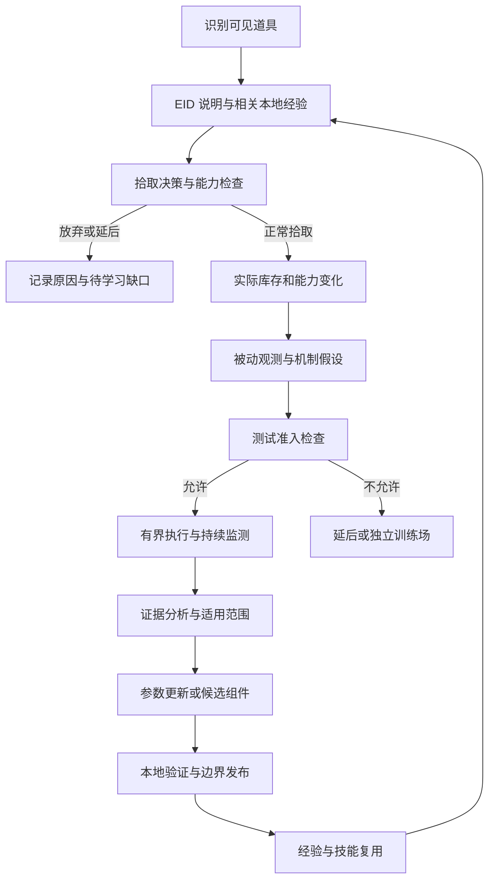

# EID 与本地经验驱动的道具决策和学习计划

日期：2026-10-26。目标环境：忏悔原版 `1.7.9b.J835`。状态：方案评估与实施计划；尚未安装 EID、实现数据库或执行道具实验。

## 1. 结论与数据边界

**采用 EID 作为外部道具说明来源，结合本地结构化观测、有限实验与 DeepSeek 推理形成持续学习闭环。** 这个范围足以作为第二阶段道具能力的工程路线，无需先完成通用 Wiki 采集项目。

EID 提供机制先验；游戏提供实际状态；LLM 把两者整理成可检验的假设、策略和候选组件。本地学习指数据库、校准参数与技能库更新，不涉及在线训练 DeepSeek 权重。

有三项不能成立的假设：

- “EID 说这个道具好，所以当前智能体应该拿”：收益取决于构筑、资源、当前模块能力和拾取本身的后果。
- “拿完在空房测试就安全”：射击、主动使用、延迟触发、传送、爆炸和地图变化均可能带来不可逆结果。
- “LLM 解释了现象就学会了机制”：解释只能作为假设；一次观察只支持当时条件下的有限结论。

默认不启用 Wiki 抓取，不因资料缺口自动接入新来源。EID 未覆盖的敌人机制仍由已有控制组件、本地观测和独立验证处理；EID 不是完整的敌人行为数据库。

## 2. EID 接入的可行性

EID 官方发布页列出 V5.25 对 Repentance 1.7.9b 的兼容说明，可作为首个待验证版本；运行前仍须验证当前 J835、语言、配置和桥接组合。版本固定到提交和文件哈希，不能每局读取变化的 master。[发布记录](https://github.com/wofsauge/External-Item-Descriptions/releases)

EID 覆盖收藏品、饰品、卡牌、药丸等说明，并提供扩展 API；详细错误道具效果依赖 REPENTOGON，不能假定原版已经可读。[项目说明](https://github.com/wofsauge/External-Item-Descriptions)

| 接入方式 | 作用 | 决策 |
|---|---|---|
| 固定 EID 源码/导出包的离线说明 | 基础说明、语言、已有协同线索、版本覆盖 | 首版优先；不要求游戏安装完整显示模组 |
| 已安装 EID 的上下文描述导出 | 获取当前角色/构筑条件下实际生成的说明 | 可选增强，增加模组后验证输入、性能、隐藏信息及版本兼容 |
| 截图/OCR 读取说明 | 降级访问 | 不作为默认；已有机器可读数据时没有必要引入图像误差 |

离线导入必须按 EID 的基础数据和 Repentance 覆盖规则解析；不能把 `rep+`、`rgon` 条目混入原版。条件性说明可能需要运行时逻辑；不能把每个条件分支都当作当前生效。无法解析的部分保存说明并标注缺失，禁止在宿主中执行外部 Lua 来求值。

保留 EID 原始标记和规范化文本，例如图标、警告、条件和物品引用；不能简单删除所有花括号而损失生命类型或协同含义。[Markup](https://github.com/wofsauge/External-Item-Descriptions/wiki/Markup)

动态导出若启用，分别保存基础说明和渲染后说明，附 player、build_revision、帧、EID 配置与修饰器范围。官方 API 文档列有条件与协同描述机制，具体调用以固定版本源码核验，不能把仓库内旧参考文档当成当前可执行 API 保证。[API 文档](https://github.com/wofsauge/External-Item-Descriptions/wiki/API-Documentation)

来源署名与内容复用条件仍须在导入/分发时明确，不默认把 EID 全库提交本项目 Git。此方案不需要部署爬虫、远程服务或向量数据库。

## 3. 学习闭环与模块职责



| 模块 | 责任 |
|---|---|
| `EIDAdapter` | ID、语言和版本解析，输出说明/机制线索，标注缺失与上下文 |
| `ExperienceRetriever` | 按能力签名检索支持结论、反例、未解决假设，不只按物品 ID 匹配 |
| `PickupEvaluator` | 评估收益、成本、风险、模块支持与测试可行性；输出拿/不拿/延后 |
| `BuildCompiler` | 拾取、主动使用和临时效果变化后更新能力图，实际面板优先 |
| `ExperimentPlanner` | DeepSeek 生成可区分机制的测试假设、预期现象和停止条件 |
| `ExperimentGate` | 本地确定性规则判断允许动作、预算和环境；模型不能自签“安全” |
| `ExperimentRunner` | 通过唯一输入执行器提交有界动作；任何危险抢占并保存部分结果 |
| `EvidenceEvaluator` | 先确定性提取指标，再用 LLM 解释异常；区分机制支持和控制器支持 |
| `SkillDeveloper/Publisher` | 需要新逻辑时由 DeepSeek 编写候选，独立验证后发布；复用现有组件优先 |

数据库从首次遭遇前就可建立 EID 身份索引；首次遭遇只需解析相关条目和检索经验。不要等到已经拾取才记录前态，也不必让 LLM 预读整个 EID 数据库。

## 4. 拾取决策

先检查是否可辨识、能否支付、是否存在已知不可接受后果、是否有可用组件或有界适配路径，再比较增益与机会成本。LLM 输出理由和证据，宿主执行实际门槛。

建议 `PickupDecision` 字段：`decision=take/skip/defer`、item/encounter ID、build_revision、EID 与经验引用、expected_benefits、known_costs、unknowns、required_capabilities、support_state、test_required、test_plan_ref、reason_codes。不得只输出一个无法解释的评分。

| 情况 | 默认策略 |
|---|---|
| 纯属性变化，通用模块已覆盖 | 正常收益决策，拾取后读面板；无需专门调用模型测试 |
| 已知机制、已有兼容模块 | 拿取后核对能力与参数，按需短校准 |
| 机制未校准，但能先确认低风险并表达新逻辑 | 可以拿取并进入有预算的学习；不要求所有道具预先人工实现 |
| 不可逆武器替换且没有兼容回退/可行测试 | 暂缓或跳过；需要在训练场先补适配 |
| 未知主动、随机自伤、全局重置或程序错误道具 | 不在正式局中盲用来试错；记录为学习任务 |

高品质不等于对当前智能体高价值。拾取前还要检查即时效果；“拾取后再判断”不能保护一次已经发生的不可逆改变。学习收益可以影响开发场景的取舍，不能压过正式局的明确安全/资源约束。

## 5. 安全节点与三类学习

**暂停是规划/分析节点，测试动作必须恢复游戏更新后才有意义。** 原生暂停时不能从未生成泪弹推断武器失效。测试前确认解暂停，测试后释放输入并继续观察残留效果；需要分析时再确认暂停。

| 等级 | 内容 | 可学到的东西 | 限制 |
|---|---|---|---|
| L0 被动观测 | 库存、实际面板、自然射击、正常清房事件 | 属性变化、行为偏差、暂时/永久变化线索 | 默认开启，不能从未出现事件推断事件不可能 |
| L1 局内低风险测试 | 在安全检查通过后短射击、已知蓄力/释放、可控移动校准 | 发射时序、弹速、数量、轨迹、移动继承等 | 不主动扣血；不使用未知主动、传送或重置；全部耗时计入本局 |
| L2 独立训练场实验 | 针对高风险、敌人相关和复杂协同的可复现场景 | 命中、伤害、追踪、反射、爆炸、Boss 交互等 | 与正常通关分开；初始化可注入道具，不能把重置/读档后的结果算作同一正常通关 |

L1 的准入条件由本地规则核查：新鲜同房快照、无战斗/待出现敌人的已知迹象、无在途危险弹体/炸弹/残留爆炸、避开 TNT/火/机关/门/陷阱门/未决定拾取物、动作轨迹及可能攻击后果有安全余量、观测字段足够、能力和预算一致。`is_clear=true` 只是一项证据。

这些条件只能排除已知风险。未知效果可能击穿预测，因此不能对任意新物品宣称“安全测试”。无法建立攻击后果的可信边界时，只被动观测并转 L2；不能先射出未知自伤弹再寻找安全距离。

默认 L1 预算：每次构筑变化最多两个短探针；总计最多 90 个游戏更新帧（含动作和观察，约三秒），动作部分不超过 60 帧。需要更长的已知蓄力/观察窗口时，重新签发有具体机制依据的有界计划，不循环追加预算。主动道具、炸弹、钥匙、金币、卡牌、药丸默认消费预算为零；确有目标用途时单独制定明确的成本合同。不会因用户允许测试而自动授权主动生命支出。

每帧重检：新敌人、意外伤害尝试/生命结构变化、未知自伤或传送、危险范围超界、观测过期、换房、构筑变化、预算耗尽均可中止。释放输入不等于撤销已发弹体，必须处理后续撤离；暂停也不能抹去危险。未完成实验记录 `aborted/unsafe/inconclusive`，不记成成功。

测试期间的有意停火/静止由宿主签发有到期帧的实验意图，使用 ExperimentSupervisor 检查步骤进展，不按普通战斗无操作重复请求 LLM。该意图只允许已批准步骤的有限等待，不关闭危险、断线和输入 TTL；超时不能靠更换 experiment_id 重置同一构筑的总预算。新战斗立即抢占，恢复常规防卡死监督。

空房可测发射和运动，**不能验证实际敌人命中率、实战 DPS、追踪表现、反射、亡语或低概率触发率**。是否需要测试应由一个具体问题决定，而不是每拿一件道具都运行固定仪式。

## 6. LLM 如何提出与更新假设

输入为 EID 原文/规范化说明、当前实际构筑、已有正反例、观测能力和可用动作原语。LLM 自身记忆允许作为 `model_prior` 使用，始终标为推断，并记录模型与上下文；不能补写成 EID 原文或本地已测事实。

一个 Hypothesis 至少包含：`question`、mechanic、applicability（构建/角色/能力/组合/状态）、evidence_refs、assumptions、expected_observations、disconfirming_observations、confounders、testability。测试计划必须包含本地可执行的判据，而不只是“看看射击是否正常”。

ExperimentPlan 使用本项目新增的独立 DTO，不修改外部查询协议：

```json
{
  "schema_version": 1,
  "experiment_id": "exp-example-1",
  "hypothesis_id": "hyp-example-1",
  "context_ref": {"run_id": "run-example", "room_visit_id": "visit-3", "build_revision": 4},
  "mode": "in_run_low_risk",
  "goal": "measure_launch_velocity_for_supported_nonexplosive_tears",
  "preconditions": ["fresh_observation", "known_safe_attack_family", "clear_observed_lane"],
  "steps": [
    {"primitive": "hold_input", "move": [0, 0], "shoot": [1, 0], "max_update_frames": 15},
    {"primitive": "release_and_observe", "max_update_frames": 30}
  ],
  "measurements": ["projectile_spawn", "near_origin_velocity", "player_velocity"],
  "budget": {"max_update_frames": 45, "max_active_uses": 0, "max_bombs": 0, "voluntary_health_spend": 0},
  "abort_on": ["new_threat", "room_change", "build_change", "damage_attempt", "stale_observation"],
  "expected_result": "velocity_samples_or_explicit_inconclusive"
}
```

这是已确认非爆炸泪弹的形状示例，不是对所有新武器的测试模板。宿主额外强制死亡、断线、超时和危险边界，模型不能删掉必要条件；实际允许的资源种类全部有显式限额。

处理结果顺序：

1. 保存动作前态、原始轨迹、实际执行确认、后态及不完整原因。
2. 本地代码提取样本与误差区间；缺字段/缺事件属于 inconclusive，不能填零。
3. 检查移动速度继承、临时 Buff、额外发射器、其他道具及环境等混杂因素。
4. 更新 `hypothesis → observed_in_scope / contradicted / inconclusive`；需要更大适用范围时追加独立证据，不靠模型改措辞扩大。
5. 参数校准通过范围检查后可供当前构筑使用；新算法进入既有组件验证发布流程。

一次拾取前后比较不能隔离所有协同效应；记录当前完整构筑及相关机制签名，结论先限定在该签名。不同随机场景的房间损失也不能直接证明道具因果收益。已有反例必须随经验检索返回，不能让总结过程只保留成功。

“本构筑下测得弹速”与“此组件能在实战可靠使用该武器”分别记录。程序校验、短探针成功和一次实战成功各有不同含义，不能合成一个含糊的 learned=true。

## 7. 数据库与本项目接口

保留简单的双层存储：固定 EID 说明包只读，本地经验库增量写入。首版使用 SQLite 和按哈希保存的轨迹/候选产物，不增加向量服务。

| 本地表/记录 | 必要内容 |
|---|---|
| `eid_description_ref` | dataset/commit、语言、内容哈希、基础/上下文说明、构建及解析范围 |
| `encounter` / `pickup_decision` | 看到与拾取时身份、前态、价格、拿/不拿及原因、实际结果 |
| `mechanic_hypothesis` | 假设、模型先验、适用条件、支持证据、反例、未知与状态 |
| `experiment` | 计划、准入判定、上下文、实际动作、预算、终止原因与模式 |
| `measurement` | 原始引用、指标、单位、样本量、误差/区间、提取器版本与混杂条件 |
| `local_claim` | 结构化结论、支持范围、来源、反例、有效性、替代/失效关系 |
| `capability_support` | 能力签名、组件版本、配置/离线/探针/实战支持等级、限制 |
| `strategy_revision` | 参数/候选程序、作者、验证、采用与回退记录 |

知识检索身份不只用 item ID：至少绑定 game build、EID 内容版本、角色、相关能力组合、临时状态和测试协议；保留完整库存快照用于追溯，匹配时按相关机制检索以避免组合表爆炸。错误道具用 run-local 实例身份，不能跨局按负数 ID 复用效果。

本项目 API 建议为 `decide_pickup(context)`、`propose_experiment(context, hypothesis)`、`validate_experiment(plan)`、`execute_experiment(plan)`、`summarize_evidence(experiment_id)`、`retrieve_experience(capability_signature)`。执行接口不暴露给外部知识库；所有动作仍经过唯一执行器。

外部知识合同保持 1.0，EID 作为 provider。本地规划/开发采用 **KnowledgeBundle v2**：在现有字段上增加 `experience_revision`、`local_claims`、`hypotheses`、`counterexamples`、`support_limits`；原 EID records 保留来源和原义，不被新经验覆盖。

EID dataset 每局固定；本局经验可以增长，计划采用时固定 experience_revision。明确安全边界才能采用新的配置/组件；旧异步结果需要同时检查房间、构筑、组件目录和经验版本。持续观测无需每帧递增发布版本，只有被接纳的结论/限制改变才发布新经验快照。

局内测得的当前物理参数可作为 BuildCompiler 的校准输入，附测量范围与有限数检查；不等于把局部观测提升为外部知识包的普遍事实。EID 与本地观测冲突时保留两者，限制受影响动作、检查适用条件和传感器；不能简单采用最后写入者。

## 8. 正常对局、训练与费用

正式局中的实验耗时、意外失血、充能和其他消费计入完整对局指标；可单列实验阶段成本，但不能从总耗时/损失中删除。实验中意外受伤仍为非主动伤害，不能事后改记为“学习成本所以不惩罚”。生命容器/形态变化由健康账本判别，不把所有数值下降都算作受击。

独立训练场允许按场景初始化道具和敌人，使用固定种子复现；具体环境必须有可复现证据，不能假定复制存档就保存了所有瞬时状态与 RNG。训练数据的 source_mode 单独记录，不能宣称它来自正常完整通关。

DeepSeek 仅在新机制、重要冲突、可执行能力缺口或失败复盘时调用。普通属性变化和已适配道具走本地流程；第一次解析和测试结果按版本/能力缓存。一次新机制学习可合并拾取理由、假设和测试设计为一次请求；只有失败需要解释或修复时追加，建议首版一个学习事件最多两次模型请求，超过则延后。组件代码生成使用单独但共享整局上限的预算，不能叠加绕过费用限制。

不要求每件道具重复若干轮实验；足以支撑当前决策就停止。罕见机制与收益消融进入待办，不默认触发批量付费评测。

## 9. 实施顺序与可行性验收

| 顺序 | 交付 | 最小验证 |
|---|---|---|
| 1 | 固定 EID 基础说明适配、身份/版本/标记、局内记录库 | 正常条目、缺失、版本覆盖、未解析条件、未知标记有明确结果；无游戏或模型调用 |
| 2 | 构筑变化、实际拾取确认、健康账本与能力回退 | 先消除第一阶段 BUILD_CHANGED 退出和新武器/生命判定阻断 |
| 3 | 本地拾取决策门槛＋DeepSeek 可选分析 | 同一说明随构筑/资源/组件支持不同产生可解释结果 |
| 4 | 被动测量、经验检索、上下文范围与反例 | 一次观测不被写成全局定律；无样本为 unknown |
| 5 | 安全准入、实验 Runner、强制终止与成本记录 | 暂停/恢复、突发敌人、断线、换房、非法计划、残留危险用本地模拟验证 |
| 6 | 少量实机低风险探针＋DeepSeek 假设更新 | 一次拾取→测试→校准→下一房使用→后续运行检索复用的完整证据 |
| 7 | 一个非平凡新机制的模型编程 | DeepSeek 产出候选、独立验证、实机适用范围；无需改动实时安全内核 |

初次验收可选：一个纯属性道具证明无需过度测试，一个已知可控的发射/蓄力变化证明学习闭环，一个高风险或未知主动证明能正确拒绝实验。具体道具由固定 EID 内容与当前传感器能力决定，不先强制任意随机样本都可测试。

记录指标：拾取决策覆盖与拒绝原因、实验次数/中止、学习耗时与费用、实际能力变化、预测残差、适用范围、组件更新、后续房间损失和经验复用。该验收证明机制可行，不证明策略收益或稳定胜率优于已有控制器。

当前优先级是低成本获取可用说明、正确感知构筑变化、完成一个可追溯学习闭环。通用采集平台、全道具实验、自动微调和大规模消融均不属于首版必要条件。
