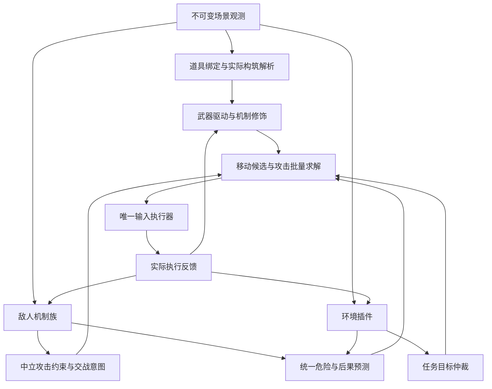

# 玩法模块架构契约 v1：道具、敌人与环境

状态：**目标架构契约，尚未完成代码迁移**。本文规定机制模块如何归类、组合、替换和验收；当前已经运行的 DTO、AST/QuickJS 接缝及限额仍见[当前组件合同](component-contract.zh-CN.md)，实际能力见[进度](progress.zh-CN.md)。本文不启动运行时重构、付费生成或新的游戏验收。

## 1. 目标与核心决策

目标是让同一机制族复用一份算法，使新增道具、敌人或局部行为通常只需要新增映射、参数或一个局部模块，不需要修改主求解器。不同武器仍能攻击同一类敌人，不同敌人仍使用同一套移动、资源和任务系统。

采用**机制族实现 + 数据绑定 + 显式装配**，不用互斥的“一个 ID 属于一个类别”模型：

- 同一道具可以同时改变属性、武器、移动和攻击后果；一个道具绑定多个能力变化。
- 同一敌人可以同时拥有追击运动、方向护甲和亡语；一个敌人装配多个职责，但同一职责只有一个有效实现。
- 真正共享机制的对象复用代码；只有外观或名称相似，不足以强行复用。新机制可以新增模块，不要求用参数表达一切。
- 一个机制族可以在一个文件内提供若干紧密相关的钩子，不要求每个钩子建立类、进程或继承层级。
- 解谜暂不制定穷尽分类，只固定环境事实、局部目标和任务控制权的接口。

“可替换”包括接口、输入语义、状态、参数、校准和版本的兼容，不能仅靠同名函数或相同类名判断。模型编写的模块与人工模块使用相同玩法接口；运行权限和加载方式由宿主管理。

## 2. 模块边界与依赖方向



| 边界 | 负责什么 | 不负责什么 |
|---|---|---|
| 道具与构筑 | ID 到能力的映射、实际属性、武器行为及修饰 | 怪物专用打法、购买发键、真实资源消费 |
| 敌人 | 阶段解释、危险预测、受击规则、接敌建议 | 武器私有时序、全局路线、真实输入 |
| 效果 | 弹体、爆炸、亡语及持续危险的独立预测 | 代替来源实体判定死亡、重复计算同一危险 |
| 环境 | 地形约束、机关状态、无怪局部通路与交互目标 | 房间运营优先级、商店购买、击败 Boss 的判定 |
| 装配与求解 | 选择实现、合并事实与提案、比较联合动作 | 内嵌具体道具或怪物的机制分支 |
| 执行与记录 | 输入、回执、TTL、预算、日志、健康账本、Judge | 用预测结果冒充实际扣血、命中或清房 |

依赖规则：机制实现只依赖公共合同及只读计算服务。道具、敌人、环境实现之间禁止直接导入彼此的具体类；通过中立 DTO 交流。共享几何、运动和效果算法放公共服务，不复制三份。注册器可以读取各模块声明，实时总控不导入具体机制类。

七个既有战术槽 `target/position/aim/fire/evade/escape/recovery` 保留为**策略层**。它们消费下述机制数据，决定偏好和优先级；不是道具族或敌人族的第二份实现。宿主输入及独立判定的权限边界保留；敌人运动、攻击收益和危险预测属于可替换玩法逻辑，不因当前写在 Python 就永久固定。

## 3. 目标代码组织

以下是逻辑目标目录，不表示这些文件已经存在。迁移时复用现有 `combat/` 的基础设施，不建立第二套求解器。

```text
SocketBridge/python/gameplay/
  contracts/                  # 中立 DTO、协议、单位和版本
  registry.py                 # 读取清单、匹配职责，不实现机制
  resolver.py                 # 生成构筑与实体装配方案
  bindings.py                 # 活跃 BindingSet、生命周期、版本切换
  items/
    bindings.json             # 道具/武器标志 -> 能力与参数
    families/
      panel_stats.py
      normal_tears.py
      charged_tears.py
      knife.py
  enemies/
    bindings.json             # 实体选择条件 -> 机制族和参数
    families/
      generic_contact.py
      pursuer.py
      closed_shooter.py
      directional_armor.py
  effects/                    # 独立弹体、亡语及持续危险模型
  environment/
    plugins/                  # 先接入现有踏板、定时地形算法
  adapters/                   # 现有 Python、AST、JS 的接口包装
```

已发布模型产物继续保存在现有不可变技能目录，目录中的 `knife.py` 等负责包装接口，不把模型原文复制成人工维护的另一份算法。映射使用 JSON，沿用现有依赖；不引入新的插件框架或服务。

## 4. 清单、匹配与装配

### 4.1 模块包

每个模块版本提供以下清单；参数和输出使用可验证的类型，不能只给任意字典。

| 字段 | 约束 |
|---|---|
| `module_id / version / content_hash` | 稳定机制身份、不可变版本、代码及声明摘要 |
| `contract_version / runtime` | 合同版本；可信 Python、已有 AST 或隔离 JS |
| `provides` | 提供的职责及各自接口版本 |
| `requires` | 必需观测、服务、能力、适用武器或效果；可选输入单独列出 |
| `parameter_schema / defaults` | 参数类型、单位、范围、默认值；缺失必填参数不能激活 |
| `state_schema / scope / dependencies` | 状态格式、实例范围、重置所依据的机制签名 |
| `compatibility / fallback` | 适用与明确不适用条件、兼容回退实现或无回退 |
| `provenance / evidence_refs` | 人工/模型来源、请求或产物引用、实际验证范围 |

绑定引用确切版本或已解析为确切版本的选择规则；运行中的版本不随目录更新静默改变。源码路径由包加载器解析，绑定数据不能要求执行任意导入路径。

### 4.2 映射与职责所有权

- 敌人选择条件可以使用 `Type/Variant/SubType`、明确的引擎标志及状态条件；道具使用 ID、实际武器和效果标志。编码值只存在于边界解码和所属族的配置中。
- 匹配先比较明确声明的条件包含关系：精确子类覆盖其通配父类。两个不可比较且争用同一职责的匹配，必须配置显式优先级或报装配冲突，不能取决于文件顺序。
- 每个实体的每个职责、每个攻击通道的武器驱动只有一个有效所有者。通用实现填补未覆盖职责，专用实现覆盖对应职责；不会再额外叠加一次通用接触伤害。
- 独立效果可以并存，但必须声明合并方式及稳定顺序。效果的 `source_key` 用于去重，不能因两个模块都看到了同一弹体就预测两份伤害。
- 已知协同用显式组合配方声明覆盖和消耗的修饰，不能在主循环不断增加 `if item_a and item_b`。
- 未知、部分支持、待短测和已验证分别记录。兼容准入不等于效果已完整建模；目前的 248 个被动/跟班 ID 不能全部标成“纯属性”或“逐项验证”。

例如，伤害道具绑定通用面板适配；带飞行的道具还改变碰撞能力；一个方向护甲追击怪分别绑定运动和受击规则。三者都不需要复制完整控制器。

一个目标绑定记录示例（格式示意，尚非现有加载器输入）：

```json
{
  "binding_id": "host.normal",
  "selector": {"type": 27, "variant": 0},
  "module": {"id": "enemy.closed_shooter", "version": "1.0.0"},
  "roles": ["enemy.interpret", "enemy.threat", "enemy.engage"],
  "parameters": {"phase_profile": "host.normal.j835"},
  "fallback_roles": {"enemy.attack_gate": "enemy.generic_attack_gate@1.0.0"}
}
```

`phase_profile` 是包内受版本管理的数据引用，包含已核实的状态映射；不是模型随意填写的字符串逻辑。以后改 Host 接敌算法只发布该模块新版本；增加共享机制的变体只增加绑定和差异参数。绑定、模块、状态配置和校准均有独立身份，但装配时一起解析成确定版本。

## 5. 道具与武器合同

### 5.1 实际构筑与能力配方

`BuildFacts` 只保存实际观测：库存、当前武器/效果标志、面板、体型、飞行、碰撞和生命状态，保留缺失字段。EID 和模型知识用于解释及提出候选配方，不对面板重复加成。

`BuildRecipe` 从事实生成：攻击通道、基础驱动、机制修饰、移动/碰撞能力、校准引用、未支持或待验证能力。拾取前可以生成预测配方；拾取后必须根据真实构筑重新装配。未知道具不能仅因面板改变就被认定为纯属性，也不能把未观察到的副作用写成不存在。

v1 主攻击通道只激活一个驱动，独立跟班/弹体可作为实际攻击来源观测；未实现的多通道控制明确留空，不靠重复调用主驱动假装支持。

### 5.2 武器驱动与修饰

| 接口职责 | 输入与输出 | 状态所有权 |
|---|---|---|
| `WeaponDriver` | 批量评估移动/瞄准候选，输出输入方向、攻击足迹、时间窗、目标收益及攻击后果 | 保持、释放、冷却、回收等武器时序 |
| `AttackModifier` | 在声明的阶段变换轨迹、命中规则或后果，不直接发输入 | 仅自身必要状态，不重复维护驱动的蓄力计数 |
| `CapabilityAdapter` | 从实际观测生成属性、移动/碰撞和交互能力 | 必要校准及依赖签名 |

修饰顺序固定为：**驱动生成基础攻击 → 轨迹修饰 → 命中规则修饰 → 命中/攻击后果 → 收益汇总**。同阶段多个不交换的变换必须声明顺序或专用组合规则；检测循环及未知次序时不静默任选顺序。普通属性不作为额外伤害乘数再执行一次。

`AttackOption` 使用通用输入和物理语义，至少含攻击通道、移动候选引用、射击方向、起效/持续时间、足迹、涉及目标、累计伤害估计、危险后果及不确定项。驱动私有的 `hold/release/recall` 可以作为诊断意图，不能成为所有武器都必须实现的枚举。

首批复用已有线段/宽度表达及必要查询；新增足迹类型需要显式合同版本和消费端支持，不把任意 JS 对象交给 Python 猜含义。敌人的受击限制通过第 6 节的中立查询施加，普通泪弹或菜刀不能导入某种怪物的实现。

### 5.3 现有构筑的装配示例

| 构筑 | 装配方式 | 扩展边界 |
|---|---|---|
| 普通泪弹 + 已知属性 | 普通驱动 + 实际面板 | 新增已确认纯属性 ID 通常只改映射 |
| 69 + 属性 | 蓄力驱动包装已有 AST；读取适用校准和实际属性 | 攻击签名改变使相关校准失效，移速变化不重复攻击校准 |
| 114 + 属性 | 菜刀驱动包装已有 JS；属性参数独立注入 | 新算法换驱动版本，目标、移动和敌人规则不重写 |
| 69 + 114 | 明确不支持，直到有可执行的联合机制配方 | 不把两个互斥主驱动同时挂上后声称完成组合 |

程序身份与校准身份分开。校准依赖声明包含会影响实验结果的属性、机制版本和构筑特征；不能只用道具 ID 作为缓存键。

## 6. 敌人合同

一个族可以实现下表多个职责；同一职责接口一致，允许单独替换。状态机负责阶段，数值模型负责运动和收益，不把所有位置情况枚举成状态。

| 职责 | 输出 | 必须避免 |
|---|---|---|
| `EnemyInterpreter` | 阶段、碰撞/可攻击性、朝向、来源/分组关系及未知项 | 将暂时缩头、潜地或不可见直接当死亡 |
| `ThreatProvider` | 接触、突进、落地、预警和攻击后果的时空预测 | 通过目标优先级过滤全房危险 |
| `AttackGate` | 给定攻击查询，返回可受击、阻挡或未知及依据 | 在每种武器里复制护甲/无敌判断 |
| `EngagementPolicy` | 站位、绕侧、等待、退出、重试等交战意图 | 直接写按键，或用原因字符串操纵总控分支 |

`AttackQuery` 至少包含：目标实例、攻击来源/方向、命中时间窗、足迹、伤害类型和已确认攻击特征。`AttackGate` 可返回方向修正、条件或未知原因；未知不是必然免伤，也不是必然能打。算法可作估计试用，但不得把未知命中计作已证实收益。

`EngagementIntent` 包含目标、候选站位/路径偏好、阶段、期望进展、截止帧、放弃或重试条件及证据。总控只识别通用状态，如 `approach/attack/wait/withdraw/blocked/complete`；具体开盖判据和重试规则留在族内。等待要有重新评估条件和期限，不能无限阻止进攻或其它任务。

示例：

- Host 和 Red Host 优先复用 `closed_shooter`，开闭状态、危险参数和差异由配置表达；连续路线、等待和重试状态归该交战实例。
- Knight 的方向护甲归 `directional_armor`；不同武器通过同一 `AttackQuery` 查询。未护甲变体不因 Type 相同而继承护甲。
- 追击怪的速度和接触范围可复用 `pursuer`；具有跳跃或特殊落点机制时增加/替换对应职责，不强塞入追击参数。
- Boss 部件只有在观测或明确机制配置支持时共享 `group_id` 和组状态。不同实体 HP 相同不证明共享血量；收益汇总避免同一共享生命池重复计算。

弹体、激光、炸弹、移动陷阱及亡语效果按自身实例继续跟踪，来源怪物死亡不自动移除危险。死亡前预测的后果与死亡后实际生成的实体需要关联去重；无法关联时保留不确定范围，不能相加冒充精确损失。低 HP、零接触伤害或未被选作目标均不意味着实体安全。

## 7. 公共数据、单位与调用接口

### 7.1 中立数据

| DTO | 必要语义 |
|---|---|
| `ContextRef` | run、floor instance、room visit、snapshot/game update、build revision、binding revision、已采用知识版本 |
| `SceneView` | 玩家、实体身份及 Type/Variant/State、弹体/效果、地形、实际构筑、观测完整性和只读查询服务 |
| `EntityView` | 稳定实例键、位置/速度/尺寸、阶段原始字段、碰撞/可攻击信息、所有者；缺失显式未知 |
| `ThreatPrediction` | 来源键、时空范围、强度/伤害单位、依据、预测窗、不确定性及是否来自实际观测 |
| `AttackOption / EngagementIntent` | 候选引用、目标、时间窗、收益/进展、后果、有效期和版本 |
| `EnvironmentIntent` | 局部目标或等待、所需交互、进展/完成条件、截止帧和中断条件 |
| `ExecutedFeedback` | 已选择动作、发送、接受、可获得的应用证据、实际状态变化；没有应用证据时不能标作已应用 |

坐标为游戏世界像素，x 向右、y 向下；运动速度为像素/游戏更新。预测时长显式以 `game_update` 计，墙钟耗时以毫秒计，不混用渲染帧。引擎原始计时字段保留原单位，经适配器确认后才转换。玩家损失用半心，敌人 HP 和攻击伤害用游戏伤害单位，不能混算。

`expected_damage` 沿用当前语义：明确预测窗内的累计伤害估计，不是 DPS、单发伤害或经统计校准的概率。不同候选使用可比较的窗；无数据保留未知，不能用零替代。证据分别标注观测、测量/先验和预测，不给所有输出伪造置信概率。

`SceneView` 显式标记实体集合是否完整、过滤范围及截断数量。为了攻击性能取 Top-K 目标，不得同时截掉宿主危险场中的其余实体。已缓存状态不算本帧实际观察到该实体。

### 7.2 生命周期

所有机制遵守以下语义；可信 Python 可使用等价方法名，适配器负责规范化：

```text
init(binding, initialView) -> state
observe(view, executedFeedback, state) -> nextState
evaluateBatch(context, candidates, state) -> typedProposals
```

- `observe` 每个实例、每个游戏更新至多推进一次；同一快照重复求解不能重复增加保持计数或冷却。
- `evaluateBatch` 为只读评估，可多次调用，不提交状态。候选没有被选择、发送或应用时，不得当作已经移动、蓄力或命中。
- 武器状态按攻击通道和相关构筑签名隔离；敌人状态按 room visit + entity instance 隔离；共享 Boss 状态按明确组实例隔离。不能用模块全局变量共享所有同类怪物的 FSM。
- 状态依赖和提案有效性分开：无关参数变化不重置武器蓄力，但所有旧提案都因装配修订失效，重新求解后才能发送。
- 实体消失、换房、死亡和断线分别处理。环境/敌人局部意图到期不带入新 visit；持久经验与当前实时状态不混存。

JS 延续常驻 worker 与上下文复用，一次更新最多一次跨边界批量调用，内部可分派多个机制；禁止逐敌人、逐移动候选建立进程或往返通信。沿用当前 64 KiB 源码、32 MiB 内存、10 ms CPU/20 ms 宿主等待等初始限制，**CPU/等待按整批计，不按模块数量成倍扩大**；详细限额由[当前组件合同](component-contract.zh-CN.md)维护。可信 Python 不具备同样的抢占能力，不能把任意模型 Python 直接放进控制线程。

## 8. 一次更新的装配与求解顺序

1. 宿主生成同帧快照，核对新鲜度、真实构筑和实体身份；到达采用边界时发布装配修订。同时按几何可达性准备基础移动候选及公共查询数据。
2. 各实例消费实际执行反馈，通过 `observe` 更新状态；解释敌人阶段与环境状态。
3. 汇总敌人、弹体和地形危险，获取交战意图与环境目标。任务仲裁选择本次主目标，其他危险仍参与求解。
4. 武器驱动及修饰批量评估基础移动候选的射击、时序、足迹和输出；敌人受击规则检查相应攻击查询。交战目标和危险影响候选评分，不要求先选出唯一移动再评估攻击。
5. 联合求解器比较损失、退路余量、有效输出和进度，选择一个动作。意图等待不能被误当成无操作异常，但必须满足期限和进展监督。
6. 唯一执行器校验版本、有效期和交互授权并发送；下一次观察形成真实反馈和账本记录。

交战模块需要射程或发射站位时，查询中立 `WeaponCapabilities`/宿主准备的几何服务，不导入武器类。武器需要目标受击条件时使用 `AttackQuery`，不递归调用完整交战规划，防止循环求解。

上述是逻辑顺序，不要求每个钩子跨运行器调用一次。跨 JS 的输入一次包含快照、基础候选及公共数据，JS 内完成相关 `observe`、敌人解释、攻击查询和批量评估，返回各职责结果，Python 再做最终仲裁。v1 复用现有九种基础移动输入，交战站位用于路线/进度评分；需要新增候选类型时升级批量输入合同。只读几何查询在 worker 内使用已传入的紧凑网格或预计算结果，不进行逐目标同步 RPC；缺数据则明确缺失或由后续更新补充，不能为满足一次调用暗用旧快照。

评分权重可以由策略配置；致命预判、运动模型和收益算法可以按职责替换。宿主只固定真实输入权限、数据/输出格式、预算、物理事实的约束和独立记录，不固定“某个怪必须永远躲多远”等战术结论。预测风险为零不能抹掉实际观测到的障碍或危险。

## 9. 环境与解谜的保留边界

暂不按房间 ID 或房间外观建立分类树。环境插件统一提供两部分：

```text
assess(scene, state) -> applicability + observedConstraints
planStep(scene, taskGoal, state) -> EnvironmentIntent | noProposal
```

- `applicability` 为适用、不适用或信息不足，附依据；多个插件可提供独立地形约束，但主交互目标经任务仲裁后只有一个。
- 实际危险、动态通路和机关状态在战斗中也生效；只有局部解谜目标的执行需要取得任务控制权。
- 现有踏板和定时地形算法先作为插件包装。使用全房地形及实体实例建立通路/状态依赖，不以“仅支持某个房间 ID”代替算法适用条件。
- 计划可以多步：安全等待、通过阶段通路、触发机关、复核通路，再走下一段。每步给出可观测完成条件、期限及失败原因，不把“到达预计坐标”当作机关已生效。
- 新敌人出现时，局部环境目标可中断，战斗优先；继续时根据真实机关状态重规划，不假定中断前动作成功，也不清零整个房间损失或总期限。
- `room.is_clear` 不等于地形安全、解谜完成或允许下楼。门、楼梯和资源交互继续通过现有任务授权及执行器，插件只能提出需求。

新型解谜的分类、搜索状态表达和复杂依赖图留待具体场景确定。此边界保证环境算法可独立替换，不要求先实现通用解谜引擎。

## 10. 版本替换与故障处理

### 10.1 活跃装配

`BindingSet` 是唯一活跃装配引用，包含所有职责的确切程序版本、配置摘要、校准引用和依赖。候选安装流程：

1. 用 `base_binding_revision` 创建候选，检查接口、必需观测、职责冲突及状态/校准兼容。
2. 在活跃控制路径之外准备候选运行器，完成必要的加载检查；保留当前实例。
3. 在暂停或既有安全采用边界核对真实构筑及基础修订，显式执行状态迁移或初始化。
4. 一次发布新 `BindingSet`，执行器和各求解模块通过它访问实例；不分别更新几个对象成员来模拟原子替换。
5. 记录采用帧、前后版本和状态处理，失效旧提案；发布成功并解除引用后才关闭旧运行器。

旧版本在“准备候选”期间仍可用，候选失败不能提前关闭它。状态迁移必须是声明版本的纯变换，无迁移函数则按生命周期初始化。释放型武器的中断/恢复有真实攻击后果，需要通过执行器的有界交接流程处理；不能宣称切版本或发送零输入绝对无风险。

换进程复用需要一起加载程序、适用配置、校准及激活记录，不能仅保存 JS 文本。游戏道具和已发生损失无法回退；已不兼容当前构筑的旧程序不能作为虚假回退。

### 10.2 局部失败与退化

非法输出、超时或异常定位到模块、职责和版本，隔离相应实例，兼容时使用该职责的通用/旧实现；不能让一个敌人的交战异常清空全房危险。新鲜度、输入租约、断线释放、费用和独立 Judge 始终由宿主管理。

没有兼容攻击驱动时，不把菜刀构筑按普通泪弹发射器继续运行：保留独立移动/避险，进入有期限的诊断或明确失败。未知敌人可使用通用接触/已观测弹体和有限试探，保留受击规则未知；未知环境不能无限等待。

预测不准、受伤和收益低进入反馈，不等于模块必须被拒绝。可试用性与已证明有效分开记录，评价同时看清房、损失、输出和耗时，不能靠持续停火获得“安全优化”。

## 11. 缓存、记录与模型开发边界

缓存键包含实际依赖：地形与权限修订、实体实例和机制状态、相关属性、模块版本及参数摘要；不能只看敌人种类集合或道具 ID。运动预测缓存要随位置/速度或快照修订更新。环形缓冲、状态和批量输入有容量上限，截断明确记录。

每次运行保存实际绑定表；决策记录引用其修订，并保留关键阶段、候选/最终动作、否决原因及责任职责、发送/回执/应用证据和异常。程序原文、EID 说明、测量、模型解释与开发审核分别保存。模块不能改写历史损失或通过改变日志让自己看起来成功。

后续让 DeepSeek 编写模块时，输入只需相关机制说明、实际观测样本、该职责的 SDK、参数和反馈；允许改机制算法、FSM、局部状态及参数，禁止修改执行器、凭据、费用账本和 Judge。它可以替换现有预测，不局限于调一个保守系数；不能通过字符串字段获得真实 IO。

本契约只定义可写范围和加载边界，不宣称模型不会犯错，也不在本轮实现自动生成、短测和修订闭环。算法采用门槛应依赖对应机制的最小行为验证，避免每个属性道具都调用 API 或重跑全部实机矩阵。

## 12. 迁移落点与完成判据

### 12.1 现有实现如何归位

| 现有位置 | 目标职责 | 迁移时保留的边界 |
|---|---|---|
| `combat/item_capabilities.py`、`builds.py` | 绑定数据、实际构筑与能力装配 | 准入/试用/验证状态；实际面板不重复加成 |
| 普通泪弹、`mechanisms/weapon.py`、`mechanisms/knife.py` | 武器驱动、修饰、AST/JS 包装 | 历史模型源码和作者证据不改写 |
| `combat/threats.py` 中敌人专用分支 | 敌人危险职责或独立效果族 | 通用危险场只聚合，不识别特定怪物 ID |
| `engagement.py`、方向护甲及阶段解释 | 敌人族的交战/阶段/受击职责 | 删除武器里的怪物特判，避免阶段解释多份漂移 |
| `projectile_effects.py` | 独立效果注册与预测 | 来源关联、实体消失后的持续危险 |
| `environment.py`、`TimedTerrainPuzzle` | 环境插件 | 真实机关状态、全房通路、期限及战斗中断 |
| catalog、JointActionSolver、任务/执行器 | 策略选择、通用仲裁与真实执行 | 不复制玩法实现；损失账本和 Judge 保持独立 |

迁移按一个纵向切片进行：先固定合同和包装器，再迁移一个道具族与一个敌人族，验证后迁移其余实现。禁止一次性改完所有模块才首次验证。已有接口可经适配器过渡，但同一职责只有一个事实/状态所有者，不能长期维护新旧两份机制。

### 12.2 可扩展性验收

下列是未来代码重构的验收，不是本文档已经完成的功能：

| 场景 | 允许修改 | 不应修改 |
|---|---|---|
| 新增已确认纯属性道具 | 绑定数据、相应能力测试 | 主求解器、敌人、环境代码 |
| 新增已知机制的敌人变体 | 选择器及阶段/数值参数 | 各武器实现、主循环 |
| 修改缩头怪开盖接敌策略 | 对应敌人族/职责与测试 | 所有射击算法、房间导演 |
| 更换菜刀时序/攻击算法 | 驱动包、适用配置和必要校准 | 怪物族、移动基础设施、Judge |
| 新增方向防御机制 | 敌人受击规则与必要中立字段 | 每一种武器分别添加怪物判断 |
| 新增一种真实新机制 | 新族/效果与绑定；必要时显式升级合同 | 为所有现有道具/怪物复制控制器 |
| 替换局部机关算法 | 一个环境插件与配置 | 道具、敌人、输入执行器 |

针对性测试至少覆盖：匹配歧义和角色冲突、修饰顺序/重复应用、多个同类实体状态隔离、无伤害/不可攻击/未知的区别、亡语持续与危险去重、候选未执行时状态不推进、相关校准失效、无关变化不重置时序、旧提案过期、候选加载失败保留兼容旧实例、采用后所有引用一致、换进程复用。新增角色只测其关键路径及相关既有代表场景，不默认开展付费消融和批量胜率实验。

代码审查还需检查：协调层是否新增具体道具/敌人 ID、族名或原因字符串的行为分支；同一机制是否分散在武器、危险场和交战器里各写一遍。发现这种情况应将机制移回所属模块，不能靠增加更多注册表掩盖耦合。

本轮文档交付完成条件：职责、公共语义、组合冲突、状态和替换流程均有唯一约定；道具与敌人的常见扩展能定位到明确模块；解谜仅保留独立边界。运行时是否满足本契约，必须在迁移后另行验证，不能用既有通关结果代替模块化验收。
