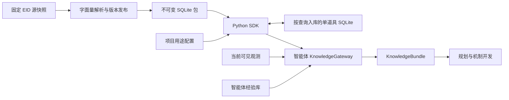

# 独立知识库接口与本项目 Gateway

协议：Isaac Knowledge Contract 1.0 的本地最小子集。代码：[knowledge_project](../knowledge_project/README.md)。本文维护数据所有权、实际查询格式与扩展边界；学习算法见 [EID 学习机制](eid-local-learning-plan.zh-CN.md)，运行状态见[当前进度](progress.zh-CN.md)。

## 1. 项目层级与依赖



isaac-knowledge 独立安装，目前放在本仓库子目录，可以迁到独立仓库；不导入游戏控制器，不发按键、不决定拾取、不写智能体经验。它负责来源、身份、版本、说明、覆盖与溯源。

智能体负责可见性、当前构筑、遭遇、成本/能力判定、测量、反例和技能。控制代码只调用 SDK，不依赖知识库 SQLite 表布局。运行时查询没有网络副作用；原始数据下载只发生在显式准备脚本中。

## 2. 数据包与身份

当前包固定 EID commit `8b59d00c6828e333294639ad2b2b6875eae821cb`，目标 original Repentance `1.7.9b.J835`、Windows、无扩展；导入 ab+/rep 的 en_us/zh_cn 四个文件。解析器只读字面量行，不执行 Lua 条件或函数，不导入 rep+/REPENTOGON 语义。

包包含 manifest.json、knowledge.sqlite 和 lookup-request.schema.json。manifest 保存 dataset_id、API/存储/本体版本、game_target、语言、源提交与文件哈希、解析器版本、数据库哈希、来源使用策略和覆盖限制。dataset_id 绑定影响语义的输入；构建拒绝覆盖现有目录。SDK 打开时检查库哈希和 manifest 语义身份，查询使用只读连接。

静态物品使用 `(kind,id)`；敌人身份使用 type/variant/subtype；通用机制使用 key。负 ID 或无法解释的动态物品属于智能体 run-local 对象，不能伪造一个跨局稳定静态知识 ID。运行实例 ID、道具目录 ID 与来源 record_id 互不替代。

## 3. 实际 SDK 请求与响应

Pydantic DTO 与生成 schema 是实际字段约束的权威。目标、语言等在 Python SDK 中有默认值；跨项目导出建议显式填写，避免把默认 J835 套到其他构建。

```json
{
  "api_version": "1.0",
  "request_id": "room-visit-item-1",
  "dataset_id": "eid-16b584b65a6e506666e0cf71",
  "target": {"game": "binding_of_isaac", "edition": "repentance", "build": "1.7.9b.J835", "platform": "windows", "extensions": []},
  "subjects": [{"kind": "collectible", "id": 1}],
  "facets": ["identity", "effects"],
  "language": "zh-CN",
  "purpose": "display",
  "policy": {"version_match": "exact_only", "include_unreviewed": true, "include_evidence_text": false},
  "page": {"limit": 32, "cursor": null}
}
```

实际支持对象为 collectible/trinket/card/pill_effect 的静态说明；其他 DTO 类型存在不代表资料已导入。单请求 subjects 上限 32，游标绑定查询内容；不匹配游标返回 CURSOR_MISMATCH。中文缺失可回退英文，响应明确标记。目标与数据集不匹配返回 DATASET_INCOMPATIBLE，读取损坏返回 DATASET_CORRUPT。

| 方法 | 实际行为 |
|---|---|
| describe | 声明版本、数据集、操作、语言、目标和限额 |
| lookup | 返回 results，每项含 subject/status/records/missing_facets/reason_codes；顶部含 warnings/errors/page |
| lookup_interactions | 接受 participants 的 subject，返回 interactions 空集合、exhaustive=false 和未知覆盖；不是已实现的协同推理 |
| get_evidence | 根据 evidence_ids 返回源提交/定位/哈希等元数据；正文 excerpt 为空 |

KnowledgeRecord 保存 record_id、身份/标签、knowledge_state、summary、claims、coverage、conflict_groups、source_evidence、parser_complete/truncated。SourceEvidence 包含 provider、仓库定位、revision、源文件哈希、解析器、目标范围和使用策略。当前 claim 是未审核的文本说明，unknown_conditions=true；字符串解析完整仅说明字面量能读出，不说明游戏条件或协同已穷尽。

状态 unknown 表示缺资料，partial 表示有部分资料，error 表示查询失败；不能把任何一种解释为“该物品没有效果”。未实现搜索、HTTP、异步 enrichment、反馈写接口或版本兼容推理。policy 中的 exact_or_reviewed_compatible 目前不会扩展实际匹配范围，include_evidence_text 不会让元数据接口返回正文；消费方应以 describe 和实际子集为准。

来源策略 unknown 时，默认 SDK 仅对 display 输出说明。宿主可在构造时传入绑定 provider/dataset 的 LocalUsagePolicy，明确本项目本地存储与 AI 用途；当前项目配置允许 display/planning/component_development。该配置与来源 rights 分开，不由 LookupRequest 自行授权，不修改来源身份；显式禁止仍不能放行。响应 local_usage_policy 保存策略身份、哈希和用途，source_evidence.rights 保留上游元数据。build_compilation 必须拒绝未审核声明，说明不能绕过实际构筑与能力检查。

## 4. 本项目接入合同

KnowledgeGateway 加载 `configs/knowledge/eid-package.json`，检查固定 dataset_id、项目用途及独立查询库路径，向调用方返回副本。它从当前可见地上物品构造 subject；隐藏身份不得用底层 ID 旁路查询。

首次命中来源的道具以 `(provider_id,dataset_id,kind,id,requested_language)` 为键，先写入 `artifacts/knowledge/queried-items.sqlite`，再返回记录；跨进程查询复用，跨用途重新渲染权限。该库保存单道具说明、源语言/文件哈希、记录完整性哈希和查询时间，不保存遭遇或测量。缺失 ID 不生成条目，中文缺失时回退英文并保留标记；损坏条目从固定来源修复，写库失败明确返回 LOCAL_KNOWLEDGE_UNAVAILABLE，不伪造成功。不同来源数据集分键，refresh 仅重读本地来源并更新同一条。原始包不可写，智能体经验库另行维护。

可选响应字段 local_knowledge 提供 SQLite 类型、schema_version、cache_hits/source_reads/saved_records/cache_repairs。机制开发的固定请求去掉这些易变运行计数，保留相同来源正文与项目策略身份，避免首次查询与随后命中改变任务上下文。

新机制开发请求若查询失败或没有说明正文，在创建模型客户端之前以 DEVELOPMENT_EID_TEXT_UNAVAILABLE 停止，不消耗付费请求。已完成任务继续返回历史产物，不重新生成或修改既有请求。

| KnowledgeBundle v2 字段组 | 语义 |
|---|---|
| bundle_schema_version/bundle_id | 智能体组合包格式与内容身份，区别于来源 dataset_id |
| dataset_id/knowledge_revision/experience_revision | 固定来源和已采用的局部经验版本；数据源 revision 与组件 catalog_revision 分开 |
| context_ref | run/floor/visit/snapshot/build/catalog/experience；只能对匹配上下文使用 |
| purpose/resolved_subjects/visibility_policy_id | 本次查询用途、身份和可见性依据 |
| local_usage_policy | 来源包之外的项目授权策略身份与用途，不提高声明的证据等级 |
| records/interactions/unknowns/evidence_refs | 来源记录与未知，当前 interactions 为空 |
| local_claims/counterexamples/hypotheses/support_limits | 智能体经验、反例、假设与范围；当前 hypotheses 预留为空 |
| truncated/usable_for_build_compilation | 上下文截断及可执行事实可用性；当前说明包不能编译机制 |

当前 Gateway 会检查数据库经验版本与 BuildProfile 已采用版本一致；M2-A 在安全边界采用经验，并让交给模型的经验遵守同样的来源模式和样本身份过滤。一个新测量写入数据库，不代表可以在控制循环中立即切换所有计划。

用途分流：实际面板进入 BuildResolver；来源说明和有范围的经验进入战术/开发输入；未知能力生成 learning_task；只有宿主已发布的能力映射进入实时控制。模型输出的“建议拿”必须再通过目标/成本/能力授权，不直接变成输入。

## 5. 发布、验证与后续接口

安装和复现命令只在 [SDK 使用说明](../knowledge_project/README.md) 维护。源文本、完整包及智能体状态保存在忽略目录，Git 保存固定配置、导入器、SDK、测试和必要证据摘要。来源更新显式准备新包、验证目标/哈希/解析覆盖，在运行边界切换；不在战中自动拉取最新 EID。

当前合同测试覆盖静态解析、覆盖顺序、标记/部分表达式、目标/语言/分页、只读访问、哈希损坏与缺资料。跨项目独立发布前应收紧未实现的 policy 选项并补严格响应 DTO；M2-A 只依赖现在已用的查询子集，不增加不必要的服务层。

后续按真实需求增加：审核后的机制事实与协同、enemy phase_model、来源缺口离线交换；这些操作都需要 describe 协商。需要远程共享时才添加 HTTP，复用 DTO 与同一套合同夹具；不为本地首层任务部署服务器或向量库。候选代码存储、测试与发布仍属于智能体，不能搬进知识服务使它获得执行权限。
