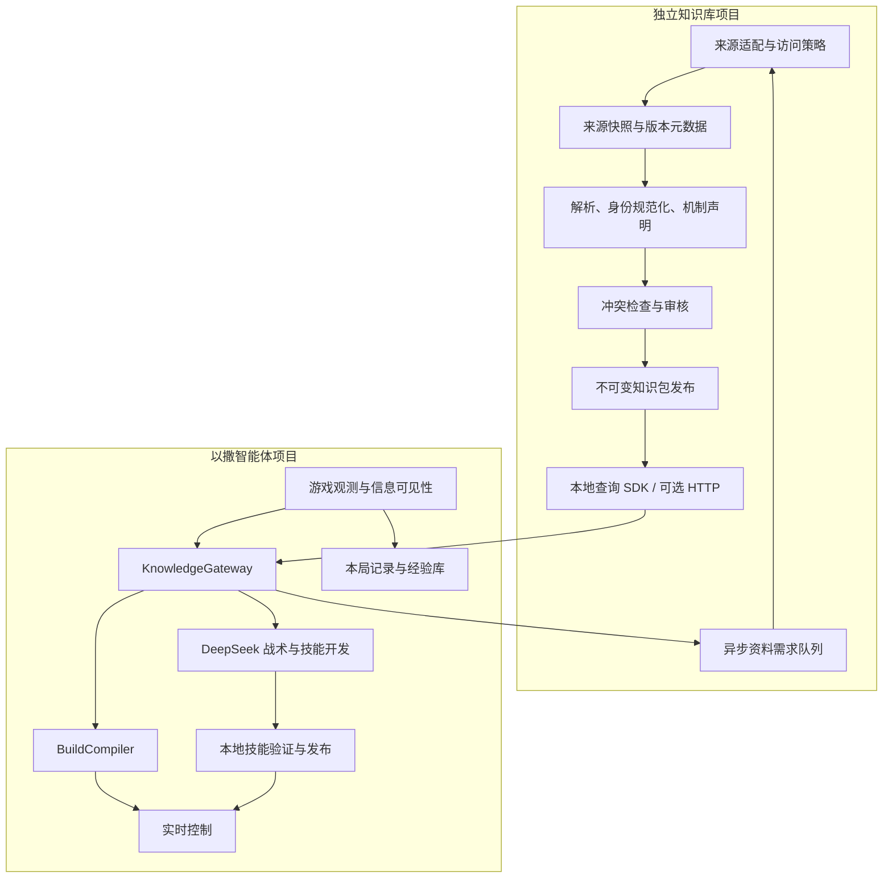

# 独立知识库项目：分层、数据合同与智能体接入计划

日期：2026-10-26。协议草案：`Isaac Knowledge Contract 1.0`。目标消费方为本项目的忏悔原版 `1.7.9b.J835` 控制器；数据结构允许增加其他构建。状态：接口设计，尚未创建独立仓库、实现 SDK、采集资料或连接服务。

## 1. 项目边界与首版交付

独立项目暂称 `isaac-knowledge`，负责来源接入、身份映射、机制整理、版本适用性、冲突与溯源、知识包发布和查询。爬虫是可替换的数据入口，也可以接入授权导出、资料仓库或人工整理。

本项目简称 `isaac-agent`，负责实际遭遇、信息可见性、能力编译、组件开发、战斗与路线、实测经验和独立判定。知识服务不决定按键、不安装技能、不替代真实游戏观测。

**首版选择：独立仓库＋不可变 SQLite 数据包＋本地 Python SDK。** HTTP 服务是后续可选传输层，复用同一套 DTO；首版游戏运行不依赖另一个常驻服务器。SQLite 的表布局属于知识库实现细节，消费者只调用 SDK，不自行拼 SQL。

首版交付包括：JSON Schema 合同、Python DTO/客户端协议、查询 SDK、发布包格式、异步需求导入/结果导出、合同测试夹具及接入示例。覆盖道具、敌人、机制和已收录协同；全文检索、向量搜索、用户系统与大型网络服务不作为首版前置条件。

## 2. 分层与依赖方向



| 层 | 输入 → 输出 | 边界 |
|---|---|---|
| L0 来源访问 | 已配置来源、访问政策、抓取任务 → 成功/阻塞/限流等结果 | 不接受模型指定任意 URL；不绕过访问限制 |
| L1 来源存储 | 内容及修订 → 来源记录、内容哈希、许可与适用版本线索 | 原始文本只按允许范围保存和导出 |
| L2 规范化 | 来源内容 → 稳定实体身份、别名、结构化机制声明 | 保留解析器版本；外部文本不得作为可执行代码 |
| L3 审核与知识组织 | 声明及证据 → 已审核声明、冲突组、覆盖说明 | 事实审核与适用构建审核分开，推断不能冒充实测 |
| L4 发布 | 一致性检查后的数据库 → 固定 dataset、manifest 和校验值 | 构建失败不覆盖已有版本 |
| L5 查询 | 版本固定的类型化请求 → 有来源的记录、缺口和错误 | 无联网副作用，不直接生成策略代码 |
| A1 本项目接入 | 观测身份与查询结果 → 受可见性约束的 KnowledgeBundle | 不把外部状态机、组件 ID 当成本地已注册组件 |
| A2 本地决策 | Bundle＋实际状态＋组件目录 → 构筑、计划或技能开发请求 | 实测属性优先；未知机制仍为未知 |

层级不是多个必须独立部署的微服务。知识库首版可为一个 Python 包和若干命令，目录按职责分开即可。

## 3. 数据所有权

| 数据 | 主存储 | 对另一项目提供的形式 |
|---|---|---|
| 物品/敌人身份、别名、机制本体 | 知识库 | 版本化查询记录 |
| Wiki/说明源、修订、许可、声明证据 | 知识库 | 允许导出的摘要、来源及定位信息 |
| 采集任务、限流、负缓存、解析失败 | 知识库 | 异步任务状态；不混入游戏胜负 |
| 实际遭遇、局内物品实体、隐藏信息 | 智能体 | 查询只发送获准的静态身份 |
| 构筑、健康资源账本、运行轨迹 | 智能体 | 默认不传出，反馈时只提交最小证据摘要 |
| 组件源码、验证、发布和回滚 | 智能体 | 不放入公共机制库 |
| 错误道具实例及其运行内效果 | 智能体 | 不能用负数 ID 查询成跨局通用静态道具 |
| 实测机制发现 | 智能体保留原始证据；知识库可收审核候选 | 显式反馈接口，未审核前不覆盖已有声明 |

两项目不共享可写 SQLite 文件。知识库工作数据库负责更新；发布包只读。本项目的 `agent-state.sqlite` 保存遭遇、资料需求发件箱及技能/经验索引。具体名字可配置，所有权不可混淆。

## 4. 合同基础类型

### 4.1 编码与版本

- JSON 使用 UTF-8；字段名 snake_case；时间为带 `Z` 的 UTC RFC 3339；距离/持续时间必须携带单位。
- 游戏更新帧与渲染帧不同。声明采用 `game_update` 时必须有 `tick_rate_hz` 的构建依据；不能把 Wiki 的“帧”无条件解释成 30 Hz。
- `null` 表示未知或不适用，具体由字段规定；空列表仅表示本次没有返回记录，不能推导“没有危险/协同”。禁止 NaN、Infinity 和字符串伪装布尔值。
- `api_version` 表示查询合同；`dataset_id` 表示不可变知识内容；`storage_schema_version` 表示 SQLite 内部结构；`ontology_version` 表示机制术语。四者不能合并为一个版本。
- v1 首版只实现 `api_version="1.0"`。未知主版本、必需能力或本体版本拒绝使用。未来增加可选展示字段可忽略；新的控制语义必须协商，不能被旧客户端当作已支持。
- 所有示例 ID、任务和哈希占位值均为接口说明，不是已经发布的知识或测试结果。实现时输出 JSON Schema 2020-12，并用相同夹具验证 SDK/HTTP 一致性。

### 4.2 GameTarget

| 字段 | 类型/约束 | 含义 |
|---|---|---|
| `game` | 固定 `binding_of_isaac` | 游戏身份 |
| `edition` | 枚举 `rebirth/afterbirth/afterbirth_plus/repentance/repentance_plus` | 不允许自动跨 DLC 降级 |
| `build` | 非空字符串 | 当前值 `1.7.9b.J835`，显式匹配而非字符串大小比较 |
| `platform` | 枚举 `windows/linux/macos/console` | 当前为 windows |
| `extensions` | `{id, version}` 数组 | 默认 `[]`；REPENTOGON 等扩展有独立身份 |

实际可执行文件哈希、存档哈希、桥接哈希保存在本项目运行 manifest。知识库无需拿到存档；`build` 对应关系由本项目启动检查确认。

### 4.3 SubjectRef 与身份层级

`SubjectRef` 是带 `kind` 的联合类型，ID 不跨 kind 复用：

| kind | 必填身份字段 | 示例/限制 |
|---|---|---|
| `collectible/trinket/card/pill_effect/character` | `id: integer >= 0` | 收藏品 481 与卡牌 481 是不同身份；合法范围由目标版本身份表检查 |
| `enemy` | `type, variant, subtype: integer >= 0` | 查询具体实体；未知 subtype 不自动当成 0 |
| `mechanic` | `key: string` | 例如 `weapon.charge_release`，来自本体目录 |
| `room_type/grid_entity` | `type`，其余标识由类别 schema 约束 | 后续阶段启用，首版 capability 未声明时返回不支持 |

名称只是多语言标签。为同一基础条目提供 `subject_key`，例如 `collectible:481`、`enemy:10:0:0`，与 GameTarget 共同定位资料。允许的通用敌人知识以 `applies_to={type, variants, subtypes}` 显式描述；范围字段的 `any` 是明确枚举，不能用缺失字段暗示全适用。

本体按 `identity → mechanic → effect/trigger/condition → interaction` 组织。武器、属性、移动、生命、资源、地图、死亡后果、敌人阶段为首批分类。知识库返回机制标签，不依赖本项目的 `fire.normal_tears` 等内部组件名。

**未知/被遮蔽身份、药丸外观、程序生成道具实例不发送为静态 SubjectRef。** 药丸的外观到效果映射属于局内状态；没有获准识别的 effect ID 时只能查询通用机制。错误道具只查询 `procedural_item` 通用机制，具体效果保留运行内记录。

### 4.4 KnowledgeRecord、Claim 与 SourceEvidence

记录通过结构化 `claims` 和人工可读摘要表达知识。摘要不能代替构筑编译所需的类型化声明。

| KnowledgeRecord 字段 | 类型/规则 |
|---|---|
| `record_id, subject_key` | 非空稳定 ID；record_id 包含记录修订含义，同一 dataset 内唯一 |
| `subject` | SubjectRef |
| `labels` | 语言代码到名称的映射；没有中文可回退英文并报告实际语言 |
| `knowledge_state` | `documented/partial/unknown/conflicting`；documented 只针对声明覆盖范围 |
| `summary` | `{language, text, claim_refs}`；推导摘要必须引用返回的 claim |
| `claims` | Claim 数组 |
| `coverage` | 按 requested facet 返回 `covered/partial/unknown/not_applicable`、原因与限制 |
| `conflict_groups` | `{id, claim_refs, resolution}`；未解决为 `unresolved` |
| `source_evidence` | 该响应引用的 SourceEvidence 集合，不能有悬空引用 |

Claim 必填 `claim_id, subject, predicate, value, scope, conditions, applicability, evidence, source_refs`。可选 `conflict_group_id` 与明确标为推断的 `derived_from`。

- `predicate` 属于本体枚举，例如 `item.effect`, `weapon.trajectory_modifier`, `enemy.attack_phase`, `enemy.death_effect`；未知谓词可以展示，不能参与确定性编译。
- `value` 是类型化联合：`boolean`、`number`、`range`、`enum`、`entity_ref`、`effect_spec` 或 `text`。数值/范围必须带 unit；无法结构化时用 text，不能伪造精确数字。
- `scope` 为 `permanent/while_held/room/floor/timed/event/unknown`，timed 值有持续时间与单位。
- `conditions` 是数据条件树，仅允许 `all/any/not/compare/has_subject`；compare 只引用已登记属性和 `eq/ne/lt/le/gt/ge/in`。无条件为 `all:[]`，未知前提用 `unknown_conditions:true` 单独标识，不能用空树掩盖。最大深度 8、节点 64，不允许表达式字符串执行。
- `applicability` 包含 edition、明确 build 集合或已审核的兼容组、platform、extensions、`match=exact/compatible/unknown/incompatible`。发布时间不是构建匹配证据。
- `evidence` 为 `{kind, review_state, verification_refs}`：kind 使用 `source_statement/inference/local_observation`；review_state 使用 `unreviewed/reviewed`。本地观测并不自动比机制说明全面，审核也不等于实机验证。v1 不提供未经校准的数字置信概率。

SourceEvidence 至少含 `source_id, provider_id, locator, revision, retrieved_at, content_sha256, parser_version, declared_game_scope, rights, verification_refs`。`locator` 为 URL/仓库文件/授权离线资源身份加段落定位；无法取得修订时 revision=null，但不能缺少已获内容的哈希。只有链接没有内容时内容哈希也为 null，并标记证据不足。

`rights` 对 `store_text/redistribute_text/ai_input` 分别记录 `allowed/denied/unknown` 及依据引用；这只是接入配置和审核结果，不是从 robots 或“网页可读”自动推断的授权。AI 输入不明或被拒绝时不得把该源正文传给 DeepSeek；可以返回访问状态和允许保存的元信息。

applicability 的范围是持久数据，match 是针对当前请求 target 计算的响应字段，不能把针对一个版本的匹配结论复用到另一个版本。effect_spec 的 v1 最小字段为 `trigger, operation, affected_domain, arguments, unknown_parameters`：trigger/operation 使用本体枚举，arguments 的每个值仍使用上述类型化 value，未知参数明确列出。未收录的复杂机制先用 text 返回，禁止解析器擅自发明可执行 operation。

以下是**纯夹具** Claim 的形状示例，用来验证条件与单位，不是敌人 10 的真实机制：

```json
{
  "claim_id": "claim-fixture-001",
  "subject": {"kind": "enemy", "type": 10, "variant": 0, "subtype": 0},
  "predicate": "enemy.death_effect",
  "value": {
    "type": "effect_spec",
    "data": {
      "trigger": "entity_death",
      "operation": "area_damage",
      "affected_domain": "combat",
      "arguments": {"radius": {"type": "number", "value": 20, "unit": "game_pixel"}},
      "unknown_parameters": ["damage"]
    }
  },
  "scope": "event",
  "conditions": {"all": []},
  "unknown_conditions": true,
  "applicability": {
    "edition": "repentance",
    "builds": [],
    "platforms": ["windows"],
    "extensions": [],
    "match": "unknown"
  },
  "evidence": {"kind": "inference", "review_state": "unreviewed", "verification_refs": []},
  "source_refs": ["source-fixture-001"]
}
```

完整响应必须同时提供 source-fixture-001 对应的夹具证据；夹具包独立标记，禁止发布到生产知识包。此声明由于版本、前提与伤害量未知，不可进入 BuildCompiler。

### 4.5 协同关系

InteractionRecord 使用独立 `interaction_id`，包含参与 SubjectRef、数量约束、装备/使用顺序条件、受影响机制、效果 Claim、来源及版本。

请求携带完整已知参与集合与数量，服务匹配其已收录子集规则；结果提供 `matched_participants`、未满足/未知条件和检索覆盖。多件协同不能只拆成所有二元组合后宣称覆盖完整。

找不到协同返回 `unknown` 与 `coverage=not_exhaustive`，不返回“无冲突”。服务不知道角色、道具数量或使用顺序时，返回条件性规则，由本项目结合实际状态判断。

## 5. 查询接口：SDK 与未来 HTTP 共用 DTO

### 5.1 方法表

| SDK 方法 | 后续 HTTP 映射 | 语义 |
|---|---|---|
| `describe()` | `GET /v1/info` | 支持的 API、ontology、操作、语言、数据包与限制 |
| `lookup(request)` | `POST /v1/lookup` | 批量精确查询静态实体与机制，无采集副作用 |
| `lookup_interactions(request)` | `POST /v1/interactions/query` | 查询已收录的条件性协同 |
| `search(request)` | `POST /v1/search` | 按名称/别名找候选；结果必须再 resolve，不自动选第一条 |
| `get_evidence(request)` | `POST /v1/evidence/query` | 按 dataset 内 evidence ID 获取允许返回的证据 |
| `submit_enrichment(request)` | `POST /v1/enrichment-jobs` | 独立写接口，提交资料缺口；不保证能抓取成功 |
| `get_job(job_id)` | `GET /v1/enrichment-jobs/{id}` | 查询状态与发布结果 |
| `submit_feedback(request)` | `POST /v1/feedback` | 可选：提交脱敏反例，进入待审核区 |

首版实现 describe/lookup/interactions/evidence；search 可先使用精确别名；异步写接口由文件交换实现。便利方法 `lookup_item`、`lookup_enemy`、`lookup_mechanic` 只是 lookup 的类型化包装，不引入另一种响应格式。

辅助操作的最低合同如下；未实现的操作必须在 describe 中声明缺失，而非返回空数组假装成功：

| 操作 | 专用输入 | 专用输出 |
|---|---|---|
| describe | 无 | api_versions、operations、ontology_versions、dataset IDs、targets、languages、limits；禁止返回服务器目录 |
| search | 公共版本/目标字段＋query（1..128 字符）、kinds、language、page | candidates：subject、名称、matched_alias、match_kind、record_id；不自动 resolve |
| get_evidence | 公共版本/目标字段＋evidence_ids（最多 32）、purpose、include_text、page | evidence：来源元信息、允许的 excerpt、text_state、截断/分页状态；不接收 URL |
| get_job | job_id | JobResult；不存在返回 JOB_NOT_FOUND |
| submit_feedback | §6.3 的 FeedbackRequest | feedback_id、state（accepted/rejected）、reason_codes；accepted 只指接收待审核 |

公共版本/目标字段为 api_version、request_id、dataset_id、target。查询操作的 SDK/HTTP 响应均带 api_version、request_id、dataset_id、status、warnings、errors；分页操作都带 page。异步任务响应改用 job_id 与 base_dataset_id，不伪装成已有新 dataset 的查询响应。

### 5.2 LookupRequest 示例

```json
{
  "api_version": "1.0",
  "request_id": "req-demo-001",
  "dataset_id": "kb-demo-0001",
  "target": {
    "game": "binding_of_isaac",
    "edition": "repentance",
    "build": "1.7.9b.J835",
    "platform": "windows",
    "extensions": []
  },
  "subjects": [{"kind": "collectible", "id": 481}],
  "facets": ["identity", "effects", "activation", "hazards"],
  "language": "zh-CN",
  "purpose": "planning",
  "policy": {
    "version_match": "exact_or_reviewed_compatible",
    "include_unreviewed": true,
    "include_evidence_text": false
  },
  "page": {"limit": 32, "cursor": null}
}
```

必填：api_version、request_id、dataset_id、target、subjects、facets、language、purpose、policy、page。purpose 为 `planning/component_development/build_compilation/display`；不同用途使用不同的声明接纳策略。`build_compilation` 不允许消费未审核或版本未知的效果；规划/开发可查看有明确标记的未知与假设，不可自动信任。

facets v1 枚举为 `identity/effects/activation/hazards/conditions/phase_model`，必须非空且不重复；不支持某 facet 时返回明确缺口。version_match 支持 `exact_only/exact_or_reviewed_compatible`；不匹配的声明不混入可用 records，而以 VERSION_UNRESOLVED 或 VERSION_MISMATCH 标出缺口。purpose 为 build_compilation 且 include_unreviewed=true 时返回 INVALID_REQUEST。

每请求最多 32 个 subjects，分页 limit 1..100；cursor 为绑定 dataset、target、规范化查询和排序的不可解析游标，改变查询后复用游标返回 `CURSOR_MISMATCH`。记录按 subject_key、record_id 稳定排序。

缺省不会使用 latest；dataset_id 必须由运行启动时固定。运行正在进行时发布新包不改变当前请求结果。

### 5.3 LookupResponse 示例：查无充分资料

```json
{
  "api_version": "1.0",
  "request_id": "req-demo-001",
  "dataset_id": "kb-demo-0001",
  "status": "unknown",
  "results": [
    {
      "subject": {"kind": "collectible", "id": 481},
      "status": "unknown",
      "records": [],
      "missing_facets": ["identity", "effects", "activation", "hazards"],
      "reason_codes": ["NO_APPLICABLE_RECORD"]
    }
  ],
  "warnings": [],
  "errors": [],
  "page": {"next_cursor": null, "truncated": false}
}
```

这是**空示例数据包**的响应，不表示现实中的 481 没有说明。完整响应与此结构相同，在 records 填 KnowledgeRecord；请求中的每个 subject 都必须出现在本次结果或后续页，不能静默遗漏。

| status | 含义 |
|---|---|
| `ok` | 本次请求的记录/方面在所声明范围内可提供；不承诺全游戏机制完整 |
| `partial` | 至少有可用记录，同时存在缺方面、冲突、版本不明、被过滤或截断 |
| `unknown` | 请求有效，但没有适用且可返回的资料；不等于条目/效果不存在 |
| `error` | 协议、包完整性、读取或服务故障，无法可靠执行查询 |

汇总规则：有返回记录且任何 subject 非 ok 时为 partial；全无适用记录且无执行故障为 unknown；整次无法执行为 error。个别 subject 执行故障但其他有结果时为 partial，同时填写 errors。分页仅限制返回量，不改变知识判定；未读完不能据空结果判定无资料。

若没有可用记录且存在任何执行故障，汇总为 error，同时保留其余 subject 的 unknown 结果；不能用 unknown 掩盖文件损坏或读取失败。只有输入确实有效且查询成功完成时，NO_APPLICABLE_RECORD 才可返回。

errors 的元素为 `{code, message, subject, retryable}`，subject 可为 null。v1 代码包括 `INVALID_REQUEST`、`UNSUPPORTED_API`、`UNSUPPORTED_CAPABILITY`、`DATASET_NOT_FOUND`、`DATASET_INCOMPATIBLE`、`DATASET_CORRUPT`、`CURSOR_MISMATCH`、`DEADLINE_EXCEEDED`、`SERVICE_UNAVAILABLE`。SDK 为有效请求返回统一 envelope；Python 类型不合法等编程错误可抛合同异常，Gateway 必须转为记录和降级。

HTTP 200 可承载 ok/partial/unknown；输入错误用 400、缺数据包 404、不兼容 409、限流 429、暂时故障 503，响应仍保持 envelope。客户端不能只检查 HTTP 200 就认定知识可信。

单页序列化上限建议 256 KiB。记录太大时返回 identity、截断标记与证据 ID，再通过 evidence 接口分批取内容；不得把截断声明当完整机制提交 BuildCompiler。

### 5.4 协同查询的扩展字段

复用请求公共字段，将 subjects 换为 `participants:[{subject,count}]`，count 为正整数，最多 64 类参与物；增加 `known_context`，仅包含白名单角色/武器/事件信息，不发送整份 WorldSnapshot。

响应使用 `interactions` 数组和 `coverage:{exhaustive:false, searched_participants, unknown_conditions}`。v1 不提供 `exhaustive:true`。相同组合按 subject_key 排序和计数后计算缓存键；有使用顺序的条件必须单独保留，不能在排序时丢失顺序语义。

## 6. 异步补充接口与离线交换

### 6.1 EnrichmentRequest

```json
{
  "api_version": "1.0",
  "request_id": "enrich-demo-001",
  "idempotency_key": "agent-local:missing-481-demo",
  "base_dataset_id": "kb-demo-0001",
  "target": {
    "game": "binding_of_isaac",
    "edition": "repentance",
    "build": "1.7.9b.J835",
    "platform": "windows",
    "extensions": []
  },
  "subjects": [{"kind": "collectible", "id": 481}],
  "facets": ["effects", "activation", "hazards"],
  "reason": "first_identified_encounter",
  "priority": "normal",
  "allowed_provider_ids": ["configured-reference-source"],
  "budget": {"max_fetch_attempts": 2, "max_wall_seconds": 30},
  "consumer_ref": "local-encounter-demo-001"
}
```

priority 是建议值 `normal/high`，不允许客户端覆盖站点限流或任务总预算。provider ID 必须已由知识库运营者配置；不接收任意 URL、爬虫脚本、密钥或付费 LLM 参数。max_fetch_attempts 包含重试，零表示只用已存来源；外部提取若要使用付费模型，需知识库自身明确配置预算，不能借用游戏项目凭据。

同一客户端作用域下，幂等键相同、规范化请求体相同返回原 job；相同键不同内容返回 `IDEMPOTENCY_CONFLICT`。任务可按 subject/build/facets 合并，但保留每个请求的关联，不丢需求。

任务状态为 `queued/running/succeeded/partial/blocked/failed/cancelled`。succeeded 表示任务定义的资料整理完成，不等于资料均已验证或已经发布；必须附 `coverage`、`review_state` 和可为空的 `published_dataset_id`。blocked 用于禁止访问、验证码或许可未明确；failed 用于重试耗尽或解析失败。

JobResult 至少返回 `job_id, request_id, state, reason_codes, attempts, coverage, review_state, retry_after, published_dataset_id`。错误示例原因包括 `SOURCE_BLOCKED`、`RATE_LIMITED`、`RIGHTS_UNRESOLVED`、`SOURCE_UNAVAILABLE`、`PARSE_FAILED`、`VERSION_UNRESOLVED`。采集失败不是 lookup 的 `error`：旧的固定知识包仍可正常读取。

### 6.2 首版文件传输

- 本项目把每条需求写入本地事务性 outbox，然后导出 `exchange/requests/<request_id>.json`；先写临时文件，再原子改名。
- 独立项目显式运行 import 命令消费请求，校验合同、幂等和预算；不让游戏线程启动爬虫。重复导入不重复执行。
- 结果导出 `exchange/results/<job_id>.json`，客户端按 request_id 对应。需要新的来源信息时发布新的知识包。
- 本地日志可以使用 JSONL，但跨项目交接默认使用单条原子 JSON 文件，避免消费未写完的行。文件名只用宿主生成的安全 ID，不能将外部字符串当路径。
- 后续 HTTP 只替换传输，保持幂等、任务状态和 DTO 相同。

### 6.3 反馈接口

FeedbackRequest 包含 request_id、idempotency_key、target、dataset_id、claim_refs、`kind=contradiction/missing_mechanic/version_mismatch`、脱敏观测摘要、证据哈希和可选共享资源引用。

不默认上传原始轨迹、种子、存档、组件源码或用户目录。仅含本地文件路径的证据不会被服务器自动打开；未共享时只能标记“有待核查的外部证据”。审核通过后形成新声明和新数据包，不原地改写旧记录。

## 7. 发布包与固定版本

```text
releases/<dataset_id>/
  manifest.json
  knowledge.sqlite
  schemas/                 # DTO 与本体 schema
  attribution.json         # 可分发内容的来源与许可
  evidence/                # 可选，仅包含允许分发的内容
```

Manifest 必填字段：

| 字段 | 约束 |
|---|---|
| `package_format_version` | 首版 1 |
| `dataset_id` | 发布后不可复用到不同字节内容，发布标识与内容校验分开 |
| `api_versions, ontology_version, storage_schema_version` | 消费方兼容检查依据 |
| `targets` | 可支持的 GameTarget 集合/审核过的兼容组 |
| `created_at, producer_revision, parser_revisions` | 发布与解析实现溯源 |
| `files` | 相对路径、大小、SHA-256；不能有绝对路径或 `..` |
| `coverage` | 已收录身份/机制范围、缺口、冲突数；不以“条目数多”代替正确性 |
| `rights_manifest` | 指向包内 attribution.json |

打包前使 SQLite 完成 checkpoint 并关闭写连接，不能只拷贝主文件而遗漏 WAL。消费方验证所有文件哈希、数据库完整性、schema 与目标构建后只读打开；损坏包拒绝使用，保留上一个已验证版本。哈希用于完整性检查，不能单独证明发布者可信；首版由本地显式选包，未来远程分发再增加可信发布者验证。

files 不包含 manifest 自身，避免循环哈希；manifest 的 SHA-256 由消费方配置与运行日志固定。包格式拒绝符号链接和越界路径，导入过程只写候选目录，校验完成后切换目录引用，不覆盖正在使用的包。

**默认每局固定一个 dataset。** 新包供下一局使用。确需当前局使用新知识时，仅在已确认暂停的安全边界显式切换：校验新包→生成 knowledge_revision→废弃受影响的旧计划/候选技能上下文→记日志→继续。不能自动替换“latest”或在原 SQLite 上热写。

旧 dataset 和被引用的允许保存证据在对应运行保留期内不可清理，否则无法重现当时的模型输入。HTTP 服务器也必须按 dataset 提供同样的固定快照，不把老 ID 转到新内容。

## 8. 本项目的接入格式

### 8.1 KnowledgeGateway

新增本项目接口 `KnowledgeGateway`，依赖合同包与 `KnowledgeClient`，不依赖采集器。建议方法：

```python
class KnowledgeClient(Protocol):
    def describe(self) -> KnowledgeInfo: ...
    def lookup(self, request: LookupRequest) -> LookupResponse: ...
    def lookup_interactions(self, request: InteractionRequest) -> InteractionResponse: ...
    def get_evidence(self, request: EvidenceRequest) -> EvidenceResponse: ...

class KnowledgeGateway(Protocol):
    async def prepare_bundle(self, context, identified_subjects, purpose) -> KnowledgeBundle: ...
    async def enqueue_missing(self, bundle) -> list[str]: ...
```

同步本地 SDK 通过受限工作队列执行，不能阻塞 asyncio 的控制循环；游戏逐帧计算只读预先形成的内存 Bundle。HTTP 客户端同样在此边界外工作，不进入运动求解。

### 8.2 KnowledgeBundle 示例

```json
{
  "bundle_schema_version": 1,
  "bundle_id": "bundle-demo-001",
  "dataset_id": "kb-demo-0001",
  "knowledge_revision": 1,
  "context_ref": {
    "run_id": "run-demo",
    "floor_instance_id": "floor-demo-1",
    "room_visit_id": "visit-demo-3",
    "snapshot_id": "visit-demo-3:120",
    "build_revision": 4,
    "catalog_revision": "catalog-demo-1"
  },
  "purpose": "component_development",
  "resolved_subjects": [{"kind": "collectible", "id": 481}],
  "records": [],
  "interactions": [],
  "unknowns": [
    {
      "subject": {"kind": "collectible", "id": 481},
      "facets": ["effects"],
      "reason": "NO_APPLICABLE_RECORD"
    }
  ],
  "evidence_refs": [],
  "source_request_ids": ["req-demo-001"],
  "visibility_policy_id": "identified_current_and_observed_inventory",
  "usable_for_build_compilation": false,
  "truncated": false
}
```

context_ref 属于本项目，**不随普通查询传给独立知识服务**。它绑定异步结果：房间/构筑/目录变化后结果可以缓存，但不安装到过期计划。示例中的 floor_instance_id、动态 catalog_revision 属于第二阶段 ContextRef 扩展，不能不经迁移塞入当前第一阶段严格模型。

records/interactions 复用合同 DTO；不再把结构化结果扁平化为只有 `text` 的网页摘要。`usable_for_build_compilation` 由本地策略计算，要求相关声明版本匹配、已审核、条件可解释、无未解决冲突、数据完整且所需能力可实现；它不是知识服务的“保证可用”标志。

### 8.3 消费者分流

| 消费者 | 接收内容 | 决策限制 |
|---|---|---|
| `BuildCompiler` | 白名单谓词、适用且已审核的结构化声明＋实际面板/弹体 | 不执行文本公式；未知/冲突效果留下能力缺口 |
| 战术 Planner | 精简机制摘要、风险、未知、来源与适用性 | 只能选择已经发布的组件，不能把 Wiki 内容当指令 |
| `SkillDeveloper` | 完整允许使用的证据、条件、SDK 合同、能力缺口 | 可生成候选程序，但发布由独立本地验证器决定 |
| `EncounterRecorder` | subject、请求/包 ID、获取/放弃决策、查询状态 | 保存未知情况，不把查不到当成没有效果 |

LLM 上下文优先返回与当前决策相关的声明，初始上限建议 24 条、12,000 字符；实际 token 仍按模型预算核算。超过限制时保留未知/冲突提示与证据 ID，允许模型有界读取详情。截断必须显式标记，不能删掉危险警告后返回“完整”。文本、网页和摘要始终作为不可信事实资料传入，不拼接为系统指令。

DeepSeek 工具名称可保留 `lookup_enemy_mechanics` 和 `lookup_player_mechanics`，新增 `lookup_item_mechanics`、`lookup_item_interactions`、`get_knowledge_evidence`。敌人查询使用本地 entity instance ID 映射 type/variant/subtype，物品查询只接受当前获准可见/库存身份；模型不能通过遍历 ID 获得隐藏物品信息。

### 8.4 首次遇见流程

1. 观测得到拾取实体，生成 encounter_id；先核对可见性和静态身份，错误道具走局内实例分支。
2. 以 target、dataset、subject、facets、purpose、语言和策略为键查本地缓存；同一请求去重。
3. 命中适用知识则构建 Bundle；缺失则立即返回 unknown/partial，同时将需求写入 outbox。
4. 当前房间使用已有组件与明确未知策略；可选道具可延后或拒绝，不能无限等采集器。
5. 新包发布后默认下局使用；当前局显式边界切换才可消费，计划和技能开发上下文随之失效。
6. 遭遇、查询、资料缺口、技能开发需求和最终操作建立关联，保证能追查一次拾取用了哪版资料。

只读 lookup 的未知缓存可保持到 dataset 改变；来源任务的 blocked/限流状态则按工作队列的退避规则恢复。两种缓存不能混为一谈。没有配置数据包时 Gateway 返回 `KNOWLEDGE_UNAVAILABLE`，首房普通泪弹可继续本地规则；需要新机制的动作不能假装已获得知识。

## 9. 现有代码迁移与配置

当前 `combat/planner.py:KnowledgeStore.lookup` 会按 URL 直接抓 HTML，且敌人索引只有 type。接入顺序：

1. 新增合同 DTO 与 `LocalPackageKnowledgeClient`；使用手写许可明确的最小夹具包验证格式，不先写大爬虫。
2. 新增 Gateway，在房间准备/技能开发流程调用；本地全程禁用网络也应能工作。
3. 将现有 lookup 工具改为调用 Gateway；保留工具名兼容，返回统一结构化结果。移除运行时网页抓取路径，采集职责放在独立项目。
4. 在观测 V2 和 ContextRef 迁移到位后，接入道具、敌人具体变体、构筑版本与首次遇见记录。
5. 加入异步 outbox 和数据包选择；最后按需实现 HTTP 传输，不改变 Planner/BuildCompiler 合同。

建议本项目新增 `configs/knowledge/client.json`，下面是规划格式，不表示文件已存在：

```json
{
  "schema_version": 1,
  "backend": "local_package",
  "package_dir": "data/knowledge/kb-demo-0001",
  "expected_dataset_id": "kb-demo-0001",
  "expected_manifest_sha256": null,
  "network_in_lookup": false,
  "dataset_switch": "run_boundary",
  "enrichment_transport": "local_outbox",
  "outbox_dir": "artifacts/knowledge-outbox",
  "lookup_deadline_ms": 100,
  "allow_hidden_item_identity": false
}
```

null 的 manifest 哈希只用于本地开发示例；正式运行必须固定哈希并校验。路径相对项目根解析；凭据不在配置和日志中。运行 manifest 记录 dataset、manifest 哈希、合同/SDK/本体版本、Gateway 策略版本。数据包和原始来源默认不入本项目 Git，只提交小型合同夹具和允许公开的元数据。

100 ms 是后台本地查询的初始期限目标，不是允许逐帧阻塞 100 ms。队列拥堵或超时返回降级；原子快照、输入 TTL 和本地避险保持独立。

若启用 HTTP，默认仅绑定本机地址；查询与资料补充使用不同权限，远程部署另设鉴权与传输保护。游戏配置中的服务地址由宿主指定，模型不得修改；服务器不暴露“执行抓取脚本”或“读取任意文件”接口。

## 10. 实施包、提交与验收

| 提交包 | 所属项目 | 交付与完成条件 |
|---|---|---|
| K1 合同与夹具 | 知识库 | Schema、DTO、版本/身份/错误语义；示例全部可解析，字段和枚举一致 |
| K2 来源与工作库 | 知识库 | 来源注册、快照、解析、访问状态、声明审核；许可未明不导出正文 |
| K3 数据包与 SDK | 知识库 | 一致性发布、哈希核验、lookup/interactions/evidence；断网可查、损坏拒绝、旧包仍可读 |
| A1 Gateway 迁移 | 智能体 | 用固定包替换旧 HTML 获取；模拟房间规划不依赖采集进程、不阻塞战斗 |
| A2 遭遇与需求队列 | 智能体＋知识库 | 首次遭遇入库、重复去重、未知不丢、任务状态可关联、包切换有边界 |
| A3 组件开发消费 | 智能体 | 有来源的 Bundle 进入 DeepSeek 开发输入，不能绕过本地组件发布 |
| K4 HTTP/反馈 | 可选后续 | SDK 与 HTTP 同夹具结果一致；最小授权与脱敏反馈，不作为首层前置条件 |

合同测试重点：不同 DLC 同 ID 不串数据；敌人变体不误合并；未知不等于 false；没有协同记录不等于安全；不允许的正文不进入模型；来源冲突保留；403 不重试刷站；超时不阻塞控制；包更新不改变进行中的查询；相同幂等键不同内容拒绝；局内动态 ID 不污染公共库。

本项目回归重点：无知识包仍能执行已知首房策略；房间/构筑变化后迟到 Bundle 不安装；新增查询不触发任意网络或 API；保存的 request、response、dataset 能重建模型当时读取的资料。通过本地夹具即可验收合同，不默认启动付费 DeepSeek 批次或全站抓取。

## 11. 首版保留的扩展点

来源适配器可增加，不能改变消费者 DTO；游戏版本增加靠身份/适用性数据，不在控制器里写 Wiki 域名判断。知识本体可增加机制，但未知术语始终降级为描述，不能静默执行。

需要更多检索能力时可增加本地全文/语义索引，它们只负责找候选，最终精确查询仍固定 dataset、subject 和证据。知识库可接收审核后的实测机制，但技能收益、通关率和运行时策略仍由本项目独立评估。

与本计划配套的功能边界见 [道具知识与组件演进](item-knowledge-and-skill-evolution.zh-CN.md)，整体开发顺序见 [第二、三阶段计划](phase-2-3-roadmap.zh-CN.md)。来源可用性核查沿用其中的资料记录；本接口设计不承诺任何站点当前可抓取。
