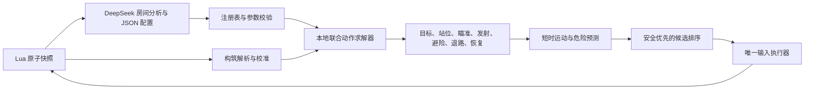

# 第一阶段实现审查与扩展准入

审查日期：2026-10-26。仓库基线 `0488fec`，运行时代码基线 `50eb92a`。范围为当前源码、既有实机证据、本地测试和离线边界探针；没有新增实机游戏或付费 DeepSeek 调用。

## 1. 审查结论

**保留首房普通泪弹的工程可行性验收；尚不能认定满足任意道具、整层、长局或模型自动开发组件的扩展要求。** 现有分层方向可复用，不需要推倒重来，但不能通过给 `CombatSession.run()` 外面加循环就获得整层能力。

本次重新运行 207 项本地测试，全部通过，用时 46.793 秒。测试覆盖范围内未发现使原验收失效的新回归。针对扩展边界的五个离线探针则暴露了明确缺口，见 [探针结果](../artifacts/architecture-review-20261026/boundary-probes.json)。测试通过与扩展完整性是两项不同判断。

既有实机结果仍按 [优化验收报告](phase-1-optimization-validation.zh-CN.md)解释：规则 50 次中 49 次清房，DeepSeek 12 次中 11 次清房；两组同一特殊房间导航失败保留。它们不证明整层胜率或任意构筑支持。

## 2. 当前战斗系统实际如何工作

| 部分 | 当前实现与边界 |
|---|---|
| 组件注册 | `components.py` 的工厂注册表和 `catalog.py` 的参数目录；七个策略槽位，组件可以替换 |
| 目标 | 威胁优先、残血优先、加权排序；保留目标切换抑制 |
| 站位 | 保持距离、拉扯、侧移；借助寻路寻找有效射击通道 |
| 瞄准与武器 | 直接/预测瞄准、移动速度继承；实机实现仅普通四向泪弹 |
| 局部求解 | 九种移动输入，武器通常最多四个射击提案；短时轨迹、碰撞、余量和收益共同比较 |
| 威胁 | 通用运动近似，以及若干追踪、跳跃、爆炸、亡语适配器；未知机制不等于已经掌握 |
| 防卡死 | 无操作、阻塞、无进展、反复恢复等监督；本地恢复、异步诊断、有界失败 |
| 环境 | 普通压力板、普通可破坏障碍、爆炸撤离等有限支持，不是完整地形解谜器 |
| LLM | 入房暂停后先分析、再生成 `BattlePlan`；战中异步诊断；不能直接写文件或发逐帧按键 |
| 记录与安全 | 原始快照、动作、计划、耗时、损失、失败、释放输入；Lua TTL、断线和换房释放独立存在 |

DeepSeek 当前交付的是**分析 JSON、组件 ID、参数和切换条件，运行组件源码为零**。`planner.py` 明确禁止 `code_execution`，工具只有查询敌人/角色机制、读组件规格、检查局部状态和预览计划。当前知识索引只有角色泪弹页与五类敌人页，没有道具查询工具、道具数据库、代码生成器、验证发布器或技能版本库。

换句话说，当前已证明“LLM 配置控制器”可行，尚未实现“LLM 扩展控制器”。后者是 [知识与组件演进设计](item-knowledge-and-skill-evolution.zh-CN.md)的新增交付目标。

## 3. 扩展阻断项

下表的优先级针对进入第二阶段：P1 表示在依赖该能力之前必须修复；不表示普通泪弹首房已经普遍失效。

| 编号 | 优先级 | 源码证据与触发条件 | 后果及修复要求 |
|---|---|---|---|
| R1 | P1 | `controller.py:NormalTearsBuild.update` 限定 Isaac，任何收藏品计数变化触发 `BUILD_CHANGED`；`BuildResolver` 不允许途中换武器 | 普通拾取也会结束流程。改为构筑版本事务：识别变化、废弃旧计划、重新解析能力、确认新组件后恢复 |
| R2 | P1 | `main.lua:PLAYER_STATS` 把武器压成普通泪弹 `1`/其他 `-1`；库存只遍历 `1..733`；`COMBAT_FRAME` 没有地上拾取物集合 | 无法表达复合武器、动态错误道具和拾取前决策。增加能力集合、实体级拾取状态、临时效果与库存未知项，不能只扩大整数上限 |
| R3 | P1 | `controller.py:select_profile` 对非普通泪弹低血量抛 `UNSUPPORTED_EMERGENCY_PROFILE`；`resilient_component` 默认回退普通泪弹 | “新武器插件测试通过”不等于新武器全生命周期可用。应急和故障回退必须按能力匹配，缺少兼容发射器时停止发射并保留独立避险 |
| R4 | P1 | `AttackProposal` 是无运行时约束的 dataclass；求解器信任返回集合；异常包装器只捕获调用中抛出的异常 | 空提案使求解器崩溃；非法方向可通过求解器。增加数量、有限数、方向、几何大小、版本和期限校验，所有失败进入兼容回退 |
| R5 | P1 | 组件运行在控制线程内；`max_duration_frames`、`state_scope` 仅作为目录元数据导出 | `try/except` 不能阻止死循环、无限分配、篡改共享观测或阻塞。未可信代码不得直接进程内注册；需要受限执行与硬预算 |
| R6 | P1 | `WorldSnapshot.hp` 仅红心加魂心；`CombatJudge` 和 `runtime.on_message` 把 `hp<=0` 认作死亡并锁存 | 空骨心仍活着时会被误判；正常复活也没有完整生命周期。分开生存状态、生命结构、实际伤害、容器变动、复活；不能仅修一个判定点 |
| R7 | P1 | `navigate()` 从初始房开始，最多八次换房；搜索只走普通门；`run()` 清一房后收尾 | Boss 门、宝箱房、商店、陷阱门和持续探索缺失。抽出房间执行器，增加整层编排器、门与转换策略及独立整层判定 |
| R8 | P1 | `RoomExplorer` 用单个 `room_idx` 作键；求解器/判定器有房间状态；应答集合与泪弹去重集合持续增长 | 直接复用到跨层会有索引碰撞、旧危险/旧恢复状态污染和长局资源增长。定义运行、楼层实例、房间实例、进入次数四级作用域与有界保留 |
| R9 | P2 | `KnowledgeStore` 缓存键只有 URL，HTML 纯文本截取，不区分补丁/来源修订；失败缺少持久负缓存 | 不能充当版本化道具知识库。增加来源适配、版本证据、内容哈希、冲突状态、失败退避与 SQLite |
| R10 | P2 | `AttackProposal.expected_damage` 未进入当前最终效用，主要使用 `hit_score*6`；射击输出缺少统一的蓄力/边沿协议 | 更换为慢速高伤、持续激光、近战等后，攻击收益与输入时序不再适配。使用统一时间窗收益，定义按下/保持/释放与代价契约 |

环境一致性：实际源码 SHA-256 为 `0e28f9f574ea21bf233d3da2dd0f1045e26fcf02fc05d58e57929b05349ed815`，任务契约与机器配置使用该验收基线。后续修改桥接后必须重新记录源码与已安装模组哈希，不能沿用旧环境声明。

## 4. 离线探针的直接结果

| 输入 | 当前结果 | 判断 |
|---|---|---|
| 建立普通泪弹构筑后增加一个收藏品 | `BUILD_CHANGED` | 是阶段一主动限制，也是第二阶段必须消除的阻断 |
| `dead=false`，红心和魂心为零，骨心容器为一 | `DEAD` | 生命判定不能推广到合法骨心构筑 |
| 注册的发射组件返回 `[]` | `min() iterable argument is empty` | 包装器未将输出错误转换为组件故障 |
| 发射组件返回方向 `(99,0)` | 求解器返回该方向，故障列表为空 | 证明求解器边界未校验；未向真实游戏发送该动作 |
| 自定义武器进入低血量应急 | `UNSUPPORTED_EMERGENCY_PROFILE` | 扩展测试只覆盖正常路径，没有覆盖应急路径 |

这些探针只使用本地合成快照，不证明对应问题已在实机出现。前两个涉及状态语义，后三个涉及未来插件边界；均应成为有针对性的回归，而不是启动新的付费批次。

## 5. 可复用部分与必要重构

保留：原子观测思路、唯一输入写入者、TTL、暂停握手、日志、联合求解器、几何缓存、敌人适配接口、严格计划 schema、异步 LLM 超时和进展监督。

重构边界：

1. 将 `CombatSession` 拆为连接生命周期与 `RoomExecutor`。房间清理返回结果，不关闭整个桥接服务。
2. 增加 `BuildCompiler` 与不可变 `CapabilityGraph`，每次拾取、重置、临时状态切换都产生版本事件；过期动作和异步结果同时失效。
3. 把组件函数从“可信 Python 对象”升级为“有类型、预算、状态作用域和输出校验的模块”。参数策略仍可使用当前注册表。
4. 增加 `HealthLedger`、`ResourceLedger`、`FloorGraph`；逐帧控制不承担整层计划和知识请求。
5. 区分战术规划器和技能开发器。战术规划只引用已发布模块；候选源码先走验证发布流程。

二阶段最小扩展准入用例：新发射组件在不改求解器的条件下，能正常运行、进入低血量应急、超时回退、处理构筑切换和换房；返回空值/非法值也不能破坏核心控制。若必须针对每种道具修改 `runtime.py` 或 `controller.py`，则本次扩展没有达标。

完整实施顺序与验收见 [第二、三阶段实施计划](phase-2-3-roadmap.zh-CN.md)。本审查交付计划与证据，不宣称上述重构已经完成。
