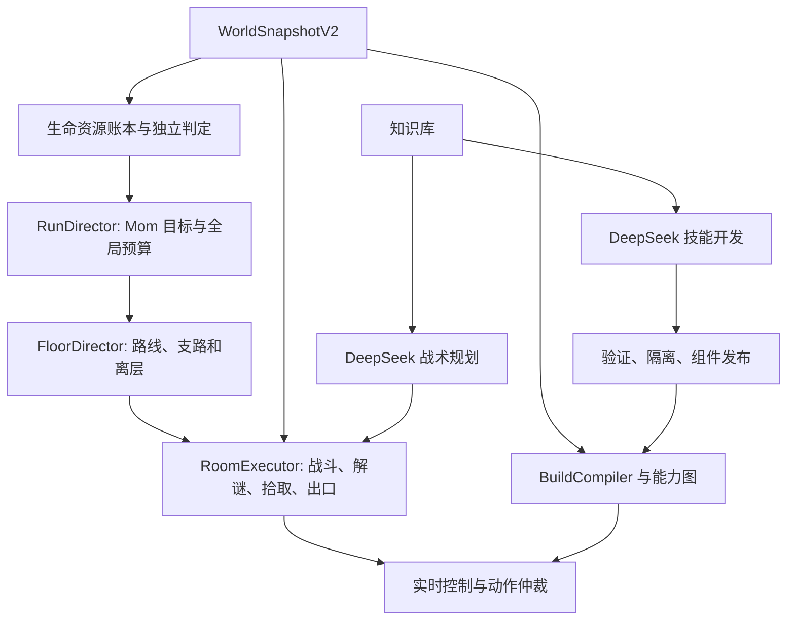

# 第二、三阶段实施计划：首层与连续推进至 Mom

日期：2026-10-26。状态：可执行设计，尚未实施或验收。前置审查见 [第一阶段扩展审查](phase-1-extensibility-review.zh-CN.md)，知识和模型编程协议见 [道具知识与组件演进](item-knowledge-and-skill-evolution.zh-CN.md)。本计划不把既有单房成绩转换为整层成绩，也不自动启动付费评测。

## 1. 目标与默认决策

| 维度 | 决策 |
|---|---|
| 环境 | 忏悔原版 `1.7.9b.J835`，普通难度，全解锁槽 1；暂不引入 Repentance+ 或 REPENTOGON |
| 主线角色 | 保留 Isaac；普通 Eden 用于独立的构筑泛化测试，不替换主线角色；Tainted Eden 不在当前范围 |
| 第二阶段 | 正常从第一层起点开始，探索、战斗、选择拾取、击败该层 Boss，通过真实出口进入下一合法楼层并恢复可行动状态 |
| 第三阶段 | 同一局正常连续推进，击败主线 Mom；不等同于 Mom's Heart、Mother 或通关所有结局 |
| 清层含义 | 完成层目标和正常离层，不要求清理所有支路、购买全部物品或拾取全部道具 |
| 信息 | 当前房间、已探索房间、合法已揭示地图信息；不读取未探索房间的敌人和掉落，不预读未来随机数 |
| 道具 | 使用固定 EID 说明＋本地经验决定拾取；安全节点进行有界测试；允许拒绝不利/未知道具，记录理由和能力缺口 |
| LLM 职责 | 战术选择与参数规划；另行承担新道具模块的候选实现与修复，工程内核不全部包办道具策略 |
| 验证 | 本地测试、离线证据、少量针对性实机；大样本、配对和消融暂缓，遵循 README |

道具学习的采集范围、实验准入、预算和经验发布采用 [EID 与本地经验学习计划](eid-local-learning-plan.zh-CN.md)。当前不建设通用 Wiki 爬虫；外部 EID 说明与本地实测证据保留各自来源。

进入 M2-A 开发前的统一工作队列、含道具组件职责与准入用例见 [M2-A 前置准备](phase-2a-preparation.zh-CN.md)。完成 P1–P6 基础能力后进入首层编排；有界主动实验仅在实际使用前要求验收，完整模型编程归 M2-B，不将全部道具学习功能变成首层开发前置。

“第一层应该很容易”只对**在较窄装备范围内打通一次**比较合理。工程难点已经从单房走位转为状态连续性：生命、构筑、门、资源和组件版本在整个流程中必须一致。六层问题更大，因为每次小失误都可能累积，且成长决策改变之后的全部战斗。

## 2. 目标层级与成功事件

### 2.1 第二阶段拆成两个验收包

**M2-A：首层连续流程。** 先支持普通泪弹及已验证的简单属性/飞行变化，能识别拾取物并选择获取或拒绝，正常探索到 Boss、击败 Boss、离层。复杂装备可跳过，但不能因为一个正常拾取使进程退出。初始主动道具可以暂不使用，仍须正确读取槽位和充能。

**M2-B：道具驱动的真实扩展。** 至少一次由 DeepSeek 根据版本资料独立产出一个非平凡道具适配模块，通过验证后使用；至少在另一次启动中从数据库和技能库复用，不重新生成。必须实际改变攻击时序、弹道预测、风险模型或交互决策，只有数值调参不算代码扩展成功。

完整第二阶段包括 M2-A 与 M2-B；M2-A 成功不能被表述为“模型自动扩展已实现”。首个代码生成案例建议选单一弹道修饰或简单蓄力机制，在兼容性分析后确定具体道具；不从错误道具或全局重置类开始。

首层可行性先覆盖一个明确记录的非 XL 场景；之后增加至少一个不同首层场景和必要的 Boss 行为案例。正式随机首层支持范围必须说明 Basement、Cellar、Burning Basement 及诅咒覆盖情况。遇到 XL 不得假装下一层必定是 `stage=2`：该地图可能对应两层进度和两个 Boss 房，应另行验证合法出口与进度变化。若首版尚不支持，输出显式失败/不支持，不能在看到结果后从随机分母中删除。

**成功必须同时有独立观测证据：**

1. 从有效初态开始，没有中途控制台杀敌、改血或传送。
2. 观测到本层目标 Boss 战及其完成，而非只看普通房 `is_clear`。
3. 通过正常出口产生合法楼层进度变化；排除道具传送到特殊房或错误入口造成的伪完成。
4. 玩家存活或正常复活已完成，收到新鲜状态，控制可继续并最终安全释放。
5. 全部生命与资源变动、未知道具、回退和 API 调用有记录。

### 2.2 第三阶段递进

| 子目标 | 新增能力 | 必须保留的结果 |
|---|---|---|
| M3-A：第一、二层连续 | 跨层上下文重建、地图实例隔离、Boss 奖励后构筑更新、商店与钥匙预算 | 两层连续轨迹，不是两个独立楼层结果拼接 |
| M3-B：推进至主线第四层完成 | 新敌人机制、复杂地形、较大房间、装备组合、长期生命/资源预算 | 每层耗时、非主动伤害、消费、版本变化与失败原因 |
| M3-C：第一层至 Mom | 主线第五/六层和 Mom 专属机制、终点识别、全局路线收敛 | 同一 run 的终点证据，Mom 实体/阶段与清理信号、存活/复活后状态 |

楼层身份采用游戏进度与主线路径，不能依赖“已换层六次”。XL 等因素会改变实际地图数量。默认不走 Mother 替代路线、Home、Boss Rush 等偏离目标的路径；它们的入口也必须被识别为非当前目标。

第三阶段不要求先实现每个道具。要求能力组合可靠、未知效果能被发现、关键资源不会被误用，并能在不支持的机制下诚实降级或失败。Mom 的踩踏预警、门口攻击、身体部件与召唤物等必须使用该构建的实测状态建立适配器，不能将通用直线运动预测当作 Boss 已支持。

## 3. 实现模块与边界

| 模块 | 输入 → 输出 | 不负责的事项 |
|---|---|---|
| `WorldSnapshotV2` | 同帧实体、生命、库存、道具、门与出口 → 带版本快照与事件 | 不推断未知道具一定安全 |
| `BuildCompiler` | 已观察状态 + 适用的机制与校准 → 能力图、变化原因和版本 | 不靠说明或模型记忆覆盖实际面板值 |
| `RoomExecutor` | 房间目标 + 构筑 + 策略 → 房间结果、资源变动、出口候选 | 不决定整局结束、不关闭复用连接 |
| `FloorDirector` | 已知房间图 + 资源预算 → 下个房间/拾取/离层目标 | 不在逐帧循环查网络、不预读未知地图 |
| `RunDirector` | 当前层与目标路线 + 长期预算 → 楼层任务、偏航处理、终点决定 | 不直接发按键 |
| `InteractionExecutor` | 已授权交互意图 → 按下/保持/释放序列与观察确认 | 不以发送成功代替消费/效果确认 |
| `HealthLedger` / `ResourceLedger` | 伤害尝试、后续生命结构、交易和库存事件 → 事实账本 | 不把回血抵扣先前伤害、不事后改称主动扣血 |
| `SkillDeveloper` / `Publisher` | 能力缺口 + 来源证据 + 契约 → 候选/可试用/已发布模块 | 不修改安全、评分、验收或宿主权限 |

建议代码布局：保留 `combat/` 的实时算法；新增 `campaign/` 放整层/整局编排，`knowledge/` 仅放知识客户端、Gateway 和本地遭遇/需求记录，`skills/` 放开发与发布工具，`interaction/` 放物品/门/出口动作协议。来源采集与知识包发布归独立知识库项目，合同见 [知识库接口计划](knowledge-project-interface-plan.zh-CN.md)。目录名称不是强制，依赖方向是强制：实时控制不依赖外部知识服务。

### 状态与版本

- `run_id`：整局身份；中途重新开局不能继续累计成功。
- `floor_instance_id`：同一局中每次生成/重建的地图实例，包含 stage、stage type、维度和生成序号等证据；仅 `stage` 不足以表示重置层。
- `room_key`：楼层实例、维度、房间索引；`room_visit_id` 记录每次进入。
- `build_revision`：库存、有效临时效果、武器能力、生命语义等相关变化后递增。
- `catalog_revision`：发布组件清单的不可变哈希/版本，不能继续用最大值为 2 的固定整数约束表示动态库。
- `RoomExecutor` 结束时重置目标、危险历史、局部恢复、校准去重；整局只保留应保留的路线和经验。清理事件需幂等，回房不重复领“首次清房收益”。
- 组件发布和构筑变化使旧异步计划失效；执行前再次检查上下文、能力、预算和来源版本。

### 道具拾取和动作事务

`看到道具 → 身份/遮蔽检查 → 查知识 → 能力与价值分析 → 获得/放弃/延后 → 接近 → 拾取确认 → 构筑更新 → 新组件校验 → 恢复任务`。

拾取本身通过移动完成。主动、炸弹、卡牌、药丸需独立意图 ID、输入边沿、槽位、成本授权与确认；延迟应答不得导致重复消费。错误王冠等轮换底座不能把第一次看到的 ID 当成实际拾取结果；拾取后必须核验库存和有效能力。

拾取物即使“不拿”也要进局部路径约束；否则绕行途中会意外获得不兼容物品。爆炸连锁、跟班主动捡物、磁吸等可改变可避免性，需记录能力缺口。

### 房间与资源规划

采用已观察房间图上的增量探索和回溯。普通战斗房、Boss 房、宝箱房和商店先支持；献祭、诅咒、挑战、镜面、传送和未知门分别建进入条件，不能一律当普通门。通过门的实际落点与预期不一致时，依据新观测修正图并记录；不把 Maze 或合法传送一律当程序崩溃。

支路价值考虑预期成长、恢复、钥匙/金币/炸弹代价、路径长度和失血风险。前期采用可解释的打分及硬预算，LLM 只调整有界偏好。保留关键钥匙/健康储备，但不要提前假设第一层所有门都需要钥匙；以观测锁状态决定。

Boss 死亡与房间安全是两个事件。捡奖励、穿门和踩陷阱门前继续处理残留弹体、炸弹、亡语和新敌人。Boss 出口、商店地下入口、传送口必须有不同交互语义。

## 4. 危险边界与时间预算

保留阶段一基于游戏更新帧的监督：无正当理由约一秒无操作先本地恢复，约两秒持续无操作触发诊断；卡死、观测过期和超时作为失败，不能通过延长计时掩盖。

扩展时加入以下边界：

| 边界 | 处理 |
|---|---|
| 新能力未映射或武器在战中重置 | 当前能力的保守兼容策略；无法保证攻击语义时停止攻击、继续避险、发诊断；不盲用旧泪弹组件 |
| 已知蓄力、Boss 暂时无敌 | 由本地状态证据签发有期限等待凭证；LLM 不能凭文字无限续期；无攻击不代表没有战术进展 |
| 计划反复选择同一支路/道具、资源扣除未确认 | 幂等事务与目标冷却，限制重试，转新目标或失败 |
| EID 说明缺失/开发器不可用 | 已知模块复用、被动观测、未知物品拒绝或显式不支持；不将“等待资料”变成无限暂停 |
| 房间/楼层/构筑变化 | 中止旧交互、释放输入、失效旧计划，再读取新状态 |
| 未知错误道具效果 | 扩大观测、抑制可疑主动动作、继续已确认安全行为；无法控制则记录失败，不承诺能够撤销拾取 |
| 临近资源耗尽或无法避伤 | 保守目标和撤离优先；不存在安全候选时选择预计最小损失，不能宣称必然无伤 |

普通战斗房初始沿用 120 游戏秒上限，首层 Boss 暂设 180 秒作为可调整实现预算，层级初始总预算建议 900 游戏秒；都不是水平指标。已知机制等待需独立计时、记录依据；无进展的局部硬失败仍存在。完整墙钟时间另设预算，覆盖启动、暂停、检索与组件开发。

付费预算同时限制请求数、输入/输出 token 和实际费用；重试、修复、工具后再请求均计入，不能只数“规划次数”。优先缓存复用，已有策略适用时不强制每房两轮对话。危险诊断留出专用额度；额度耗尽必须记录本地降级或失败，不能偷偷继续收费。

建议首次 M2 演示配置最多四次常规推理请求、两次危险诊断请求；组件开发另设一次候选生成和最多两次修复。预算在启动前显示并记录，实际模型费率由配置提供；本计划不触发这些调用。更长 M3 先根据真实事件密度设预算，不能按房间数机械扩大。

## 5. 实施顺序与 Git 交付

各提交应可独立测试，尽量保持现有首房入口可用；不在一个提交里同时改桥接、路径策略、数据库和模型提示词。

| 顺序/建议提交主题 | 具体交付 | 验证方式 |
|---|---|---|
| 1 `fix: validate component results and compatible recovery` | 修复 R3/R4；统一提案输出与默认回退，非法输出/空候选/低血量测试 | 本地故障注入；不需要 API |
| 2 `feat: version world and build observations` | 快照 V2、拾取物、武器能力、动态未知库存、构筑事务、健康结构；旧协议兼容 | Lua + Python 快照契约、库存/临时效果/骨心/复活用例 |
| 3 `refactor: separate room execution from run lifecycle` | 提取 RoomExecutor，连接持续，作用域重置，有界记录缓存 | 模拟连续三房、回房、断线、迟到计划 |
| 4 `feat: integrate versioned knowledge packages` | 本地包客户端、Gateway、首次遇见、需求 outbox、版本和来源状态；采集由独立项目实现 | 固定资料包、未知/阻塞状态、离线、冲突与重复查询；不爬全站 |
| 5 `feat: compile item capabilities and execute interactions` | 简单成长/飞行、拾取与主动边沿事务、资源账本、无法支持时拒绝 | 针对性本地模拟和必要实机机制验证 |
| 5a `feat: learn item behavior with bounded probes` | 被动测量与经验复用先完成；主动实验为可关闭扩展，使用前实现安全准入与抢占，不阻塞不依赖它的首层开发 | 被动链路本地验证；启用主动实验时验证完整低风险链路、危险计划拒绝与突发事件中止，耗时和损失计入本局 |
| 6 `feat: navigate and finish the first floor` | 已探索图、Boss 门与合法出口、Boss 适配器、FloorJudge、首层报告 | 先本地规则打通，再必要的一次 DeepSeek 完整流程 |
| 7 `feat: validate and publish DeepSeek skill candidates` | 技能开发器、受限代码/程序、外部验证、隔离、试用与回滚、作者证据 | 非平凡模块生成→验证→实机试用→下一次复用；有问题才追加调用 |
| 8 `feat: orchestrate continuous floors and resource budgets` | RunDirector、跨层重建、全局路线、状态持久化与中断结果 | M3-A 连续两层；不重置血量、装备或 RNG |
| 9 `feat: cover chapter threats and build interactions` | 第三/四层机制，按作用域组合道具，属性/弹道/角色变化校验 | 机制覆盖表、少量定位场景，不做全道具笛卡尔积 |
| 10 `feat: reach and verify Mom in one run` | 第五/六层、Mom 模块、偏航门策略、终点独立判定 | 一局完整轨迹证明可行性，保留全部尝试 |

建议开发分支为 `codex/phase2-floor-controller`、`codex/phase3-mom-run`；本次只交付审查与计划，不创建空实现分支，也不修改已经验收的实时运行代码。

## 6. 验收与后续研究边界

M2-A、M2-B、M3-A/B/C 分别报告是否达到目标。一次真实完整闭环只能证明该范围内的初步可行性。开发场景、随机尝试、重复种子和正式统计各自列明，不再默认启动大样本付费回归。

每局至少记录：完成范围、所有访问房/战斗房数、Boss 身份、每房与每层游戏耗时、真实墙钟时间、暂停/知识/开发耗时、生命结构和非主动伤害、主动生命支出、道具拾取/拒绝/未知数、资源消费、组件版本/作者/状态、LLM 请求/token/费用、卡死和人工接管。

验收还需一个**扩展证明**：添加目标道具组件时不用修改实时求解器、输入安全内核或胜负判定器；DeepSeek 源码/程序产出和修复有可追溯记录，失败能隔离。开发 Agent 手写模块顶替后只能称为人工支持，不能冒充 DeepSeek 自主扩展成功。

达到 Mom 可行性后再讨论稳定性与竞速研究。当前 DeepSeek 入房规划已有约 29.90 秒平均暂停的样本；若每房重复，真实耗时会主导整局。因此技能复用、知识预缓存和事件触发规划属于第三阶段必做能力。游戏时间优势不能直接宣传成人类竞速优势；辅助档位、角色、版本、路线和计时口径必须一致或明确区分。

## 7. 风险与取舍

- **组合爆炸：** 道具按能力与作用域组合，只对不可交换的机制对做明确优先级规则；不为每个库存组合生成一个巨大状态机。
- **长局风险累计：** 单房成功高不代表整局高。优先减少不可恢复伤害、错误拾取和失效输入；同时保留安全条件下的进攻收益，避免消极绕圈。
- **知识与真实构建不一致：** EID 和模型知识中版本不明的机制标为待验证，实际面板与观测优先；一次局部测试不能证明所有组合成立。
- **模型编程错误：** 安全隔离和本地契约减少故障影响，不提供数学意义的“永不犯错”。游戏机制策略仍需实机检验。
- **不熟悉的 Boss 和道具：** 明确支持矩阵与未知计数；跳过可选道具是合法策略，强制遇到且不支持的机制仍可能导致失败。
- **Eden 分布：** 可覆盖更多起始构筑，但会混合生命、武器、主动道具和参数多个变量，定位问题更难；在可替换武器与健康语义成熟后加入。
