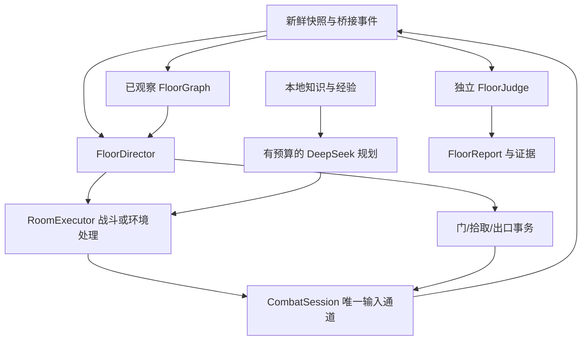

# M2-A 详细实施计划：正常完成第一层

日期：2026-10-27。状态：待实施。基线 `a7cd1a3`，当前缺口见 [P0–P6 审查](phase-2a-preparation.zh-CN.md)。本文是 M2-A 实施顺序、模块接口、预算和验收的唯一计划；总体规则见 [任务契约](task-contract.zh-CN.md)，M2-B/M3 见 [路线图](phase-2-3-roadmap.zh-CN.md)。

## 1. 交付目标与支持范围

从正常 Isaac 普通难度第一层起点开始，在**同一 run** 内探索、正常战斗、选择拾取、击败本层 Boss，通过正常主线出口进入下一层，确认玩家存活且恢复可行动状态，保存完整报告并释放输入。无需清完所有支路。

| 维度 | 首版决策 |
|---|---|
| 环境 | J835、全解锁槽 1、原版桥接；不引入 REPENTOGON |
| 普通场景 | 非 XL 的 Basement/Cellar/Burning Basement 首层；从一条真实场景闭环起步，再按实际遇见的机制扩展 |
| 尚未覆盖场景 | XL、替代路线/维度、特殊入口和强制未知构筑明确记录 UNSUPPORTED，不宣称全首层分布稳定 |
| 角色/武器 | Isaac、普通泪弹、已有属性/飞行支持；初始主动 105 保留但不使用 |
| 资源 | 普通钱/钥匙/炸弹按已验证子型；补充普通红心与魂心的狭窄支持。特殊心型、药丸、卡牌、未知箱子先跳过 |
| 可选房间 | 普通房、Boss 房、可安全进入的宝箱房；商店可识别但默认不购买。需要钥匙的可选门按预算决定 |
| 地形 | 复用已验证便便/按钮处理；需要主动放炸弹、献血、献祭或未验证机关的路线不自动执行 |
| 信息 | 当前房间及已观察门/房间图；不查询未探索房间内部、未来掉落或 RNG |
| LLM | DeepSeek 负责有预算的房间战术/异常诊断；整层图搜索与硬约束由本地执行 |
| 学习 | 启用修复后的被动记录；没有可信样本就使用先验。P7 主动实验关闭 |

固定种子用于复现；可行性验收使用启动前记录的正常随机种子。若随机尝试碰到不支持场景，要报告该次不支持及覆盖范围，不能看到结果后换种子并只保留成功。一次成功只证明该范围可行，不代表全部首层 Boss、诅咒或稳定胜率。

**不把狭窄道具支持当成后续终点。** M2-A 允许跳过未知道具，必须保留缺口任务；M2-B 再让 DeepSeek 实现缺失的机制程序，不能由工程 Agent 永久包办所有道具适配。

## 2. 执行结构与状态机

新增 `SocketBridge/python/campaign/`，仅放楼层编排、图、预算和判定；现有 `combat/` 保留逐帧控制、RoomExecutor 与物品交互。不要在首层开发中为了目录整齐再拆全部模块。

`WAIT_READY → CLASSIFY → RESOLVE_ROOM → POST_CLEAR → SELECT_OBJECTIVE → EXECUTE_OBJECTIVE → VERIFY_TRANSITION`，确认普通门转换后回到 CLASSIFY，确认合法离层后进入 `VERIFY_ACTIONABLE → COMPLETE`。

- 每个状态都有 enter/step/cancel/deadline；只有 EXECUTE/RESOLVE 路径拥有动作租约，取消立即释放。
- 死亡、断线、过期观测、换 run、未授权楼层变化、人工接管优先中断。复活按健康账本有界等待，不能将暂时 dead 或 HP=0 单独当作可继续/已终止。
- `CLASSIFY` 等待房间过渡稳定和敌人出现宽限，再分战斗、环境未解锁、已清安全或未知。重访清房不能直接复用旧安全判断；残留攻击和新敌人重新检查。
- `POST_CLEAR` 是独立阶段：无阻门敌人不等于可以立即捡物。先处理弹体、炸弹、火、亡语和机关，再执行有限的可选交互。
- 所有完成事件由最新观测确认。发送命令成功、模型说“完成”、导演进入下一状态都不能直接记成功。

## 3. 模块接口与观测增量

以下 DTO 是待实现合同，不能从现有模型中假定它们已经存在。

| 对象 | 必需字段与含义 |
|---|---|
| `FloorContext` | run_id、floor_instance_id、stage/stage_type、dimension、诅咒与已知状态、support_profile、初始 snapshot_ref |
| `RoomKey` | floor_instance_id + dimension + room_list_index；visit_id 单独记录本次进入，不作为地图永久节点 |
| `DoorObservation` | 当前 slot、目标索引/已可观察类型、位置、开闭/锁状态、已知交互语义、缺口；不可见目标内容不填 |
| `ExitObservation` | 当前房间实体/网格身份、type/variant/state、位置、可用性与依据、目标路线候选、unknowns |
| `FloorObjective` | objective_id、context_ref、kind、目标身份、预算、前提、期限、成功证据要求；kind 为 enter_room/pickup/leave_floor |
| `RoomResult` | room_key/visit、combat_result、post_clear_result、终态快照、alive/actionable、威胁、构筑/经验版本、损失、交互结果与失败原因 |
| `TransitionReceipt` | intent_id、源节点与门/出口、接收/应用动作证据、实际落点、资源差分、是否匹配、完成帧 |
| `FloorReport` | 初态合同、Boss 证据、离层证据、可行动证据、逐房结果、健康资源账本、请求/token、时间与最终失败原因 |

观测协议保持 V2 兼容：新增可选 `floor_progress/exit_observations` 等扩展并声明能力版本；旧消费者可继续读 V2，M2-A 启动必须检查自己需要的字段。缺失不能补成“无诅咒”“没有出口”或“出口一定安全”。若必须改变现有字段含义，再升主版本并提供迁移，不能为了一个附加字段机械重写整个协议。

Lua 目前已经提供房间类型/外形、部分门、当前网格、NPC 的 `is_boss` 和楼层实例。A1 重点补：当前层 curses、明确 Boss 身份/生命周期证据、合法出口分类所需当前态，以及普通红/魂心是否可拾取的可靠依据。每个原版 API 先用本地 Lua 合同和 J835 小探针核对；接口不可用时显式 unknown。

`GRID_TRAPDOOR=17`、`GRID_STAIRS=18` 只区分基础网格类型，不能仅凭 17 就判定主线出口。需要联合房间类型、Boss 完成、出口 variant/state、已选路线和实际楼层变化确认。[GridEntityType API](https://wofsauge.github.io/IsaacDocs/rep/enums/GridEntityType.html)

## 4. 已观察地图与目标选择

`FloorGraph` 保存已进入节点和当前门揭示的 frontier；通过门前仅记录候选边，落点确认后记录实际有向边。多格房间归并到当前 RoomDescriptor 的稳定身份，不能把一间大房的入口索引当成多间房。不同 dimension 或生成实例不共用图。

目标选择采用可解释规则，首版不让 LLM 搜索整张地图：

1. 先恢复当前房间安全和控制有效性；低血时选择已知、可达且代价可接受的恢复物。
2. Boss 门已知且路径可达时优先推进；沿途已知支持道具可做有界顺路拾取。
3. 否则选择可达的未探索普通门，路径距离与已观察危险决定顺序；宝箱房按可用资源与实际锁状态决定是否进入。
4. 当前无 frontier 时，在已确认图上 BFS/A* 回溯至最近可达 frontier；不调用“必须位于起始房”的 `navigate()`。
5. 同一目标失败进入原因相关冷却；同一失败上下文最多两次局部尝试，无新观测不反复选中。可选目标跳过，所有主路线耗尽则 FLOOR_ROUTE_EXHAUSTED。

图只记录已知事实。Maze 或其他实际落点偏离时，保留原意图和实际落点，重定位并修图；同一层多次不可解释偏离触发诊断/失败。首次实现可将未验证诅咒列为不支持，但不能把不支持记成已完成地图。

非必要商店消费默认 0。首层不盲目保留永远不用的钥匙，也不默认所有宝箱门都锁：由当前门事实、可选目标和预算决定。对未知代价的门不靠撞门试探。

## 5. 房间、拾取与门的事务

先修 R1–R4，随后复用底层能力：

- `RoomExecutor` 返回完整 RoomResult；战斗清理、清房后安全、可选拾取和终态各有结果。拾取不可达/收益不足可以 skip；死亡、断线、未知强制构筑或控制失效必须阻断后续路线。
- 清房后的 collection 返回最新 snapshot，必须被调用者消费。结算后若仍有敌人/危险或玩家未恢复，不能返回“可离房”。即使 finally 的模式恢复或存储失败，也要尽力生成包含 cleanup_error 的本地结果。
- 物品事务绑定完整目标与代价；库存与支出分别核实。同一 intent 重试不能再次消费；新实体、轮换 subtype、价格或构筑变化要求重新决定。免费资源也不能只根据 variant 放行。
- 先支持普通资源及有限回血；金色炸弹/钥匙、巨型炸弹、特殊心、轮换底座和复杂选择组保持明确不支持，直到有独立后置条件。
- 锁门事务先授权钥匙成本再接近，确认开锁、钥匙变化和实际过门。中途余额变化使旧意图失效，取消不等于已经扣除的资源被退回。
- 门转换后只依据实际 room/floor 变更确认，Lua 已切回 MANUAL 时由新任务显式接管，旧控制帧不可沿用。

第一房成功后一直开着同一连接；只有整层完成、失败或用户停止才 `close()`。RoomResult 的 first_clear 是地图事件，不代表本次到访可以跳过危险检查。

## 6. Boss、出口与独立判定

先按**当前实际遇见**的 Boss 建机制夹具，避免一次手写全首层 Boss 列表。可优先选择跳跃/落地、冲刺、召唤或分裂这类可复用行为；具体 type/variant/state 从 J835 轨迹确认，不能凭名字猜状态码。未知 Boss 暂用带标记的通用预测；一旦观测到未覆盖的无敌/多阶段/冲击机制，诊断或明确不支持，不将通用适配器存在等同于该 Boss 已支持。

Boss adapter 输出未来威胁、可攻击性、带截止帧的已证实等待和死亡/阶段后果，仍交统一求解器；不另写一个可直接发键的 Boss 脚本。正常无敌等待继续保留走位和观察，不能豁免断线、过期与整个 Boss 预算。

`FloorJudge` 只消费原始观测、事件与动作回执，不读取 FloorDirector 的 success 字段。至少要求连续证据链：

1. 有效正常首层起点，记录 run/floor/种子/构筑/配置。
2. 在本层目标 Boss 房实际观察到敌对 Boss 实体及战斗过程；单独 has_boss 或房间类型不够。
3. Boss 阶段/关联实体结束、房间真实 clear、阻门敌人消失，且保留亡语/延迟生成检查窗口；分裂 Boss 子体不得被忽略。
4. 在 Boss 已完成上下文中，授权并接近已分类的正常出口，观察到实际主线楼层推进、floor_instance 变化、run 不变。
5. 新层连续收到新鲜快照、角色存活或复活已完成；在安全起点执行一个有界正常移动并观察到响应，再释放输入、恢复 MANUAL。角色仍在下楼动画中时不能算 actionable。

普通非 XL 首层的主线预期进度为下一层；通用判定接口使用配置化进度关系，未来 XL 不按“恰好 stage+1”硬套。当前 XL 不支持则明确终止，不能少打一个 Boss 后判成功。道具传送、重开、特殊楼梯、未知维度跳转均不能替代正常离层证据。

## 7. 监督与预算

所有数值为首版工程上限，启动前记录；不是速度水平或统计成功门槛。

| 范围 | 首版预算/处理 |
|---|---|
| 普通战斗房 | 沿用 120 游戏秒；局部无进展失败仍优先触发 |
| Boss 房 | 最多 180 游戏秒；将 CombatJudge 的硬编码超时改为不可由 LLM 放宽的 RoomPolicy |
| 单次门导航 | 沿用最多 750 game_update；卡死监督先触发，不能靠等待总超时继续绕圈 |
| 拾取 | 接近 90 更新；已消费后普通确认 30、明确对应队列时最多 90；保留总循环与墙钟上限 |
| 离层/动画 | 最多 300 更新或 15 秒墙钟；每次过渡有证据，新威胁立即抢占 |
| 整层 | 最多 900 游戏秒、1,800 秒会话墙钟；同时统计启动、暂停和完整进程耗时 |
| 停滞/闲置 | 约 30 更新本地恢复，约 60 更新触发有预算诊断；沿用更早的硬危险保护。诊断不可无限续期 |
| 同上下文重复目标 | 最多两次局部尝试；新证据才解除冷却，路径耗尽明确失败 |
| 主动资源/实验 | 炸弹使用、主动道具、卡牌、药丸与 P7 实验全部为 0 |

物品举起、原生暂停、Boss 无敌、离层动画各有类型化等待凭证，包含依据、上下文和截止时间。只有对应状态可延缓该类进展检查；其余监督继续生效。不能把“LLM 正在思考”作为逐帧无动作的理由。

DeepSeek 统一 RequestBudget 下沉到 `DeepSeekClient.complete` 外围：一次真实 HTTP 请求占一个额度，工具往返、JSON 修复、重试也计入。初始配置建议整层最多 6 请求，其中常规最多 4、保留诊断额度 2；总输入 60,000 token、输出 12,000 token，单请求输出上限受剩余预算限制。无可靠 tokenizer 时采用保守估算并标记，响应 usage 对账；费用只有配置真实费率才计算，缺费率不能报 0 元。

规则模式请求预算为 0；先本地打通，再一次必要 LLM 闭环。入房不强制每房两轮：已有兼容 RoomPlanTemplate 可在宿主检查后绑定新 ContextRef；新机制/严重失败才请求。模板复用不复用旧 run/visit/帧租约。初次规划墙钟上限建议 45 秒，战中诊断 20 秒；累计暂停受整层墙钟约束。预算耗尽使用兼容本地计划或明确失败，不能静默超支。

## 8. 实施顺序、提交和完成条件

建议开发分支 `codex/phase2-floor-controller`，开始实际实施时创建；计划本身不创建空分支。A0–A7 逐步提交，旧首房入口保持可用。

| 工作包 | 修改范围与建议提交 | 完成条件与验证 |
|---|---|---|
| A0a 交互与终态修复 | item_knowledge/item_interaction/room_execution；`fix: bind pickup authority and verify post-clear outcomes` | R1/R3/R4 探针不再触发；错误目标零动作，未知资源拒绝，拾取中死亡/断线/换房不返回可继续；cleanup 错误仍落盘 |
| A0b 被动样本去重 | builds/item_learning/agent_store；`fix: publish passive evidence only for new observations` | R2 不再触发；样本批次 ID 与水位、缓存不自证、模式过滤和重启去重；旧经验元数据不足时不补造样本身份 |
| A1 观测与合同 | Lua、DTO、campaign/models；`feat: observe floor objectives and transition evidence` | curses/Boss/出口所需字段有已知/未知语义；Lua/Python 合同、旧记录兼容；必要一次只读 J835 核验 |
| A2 地图与单门导航 | campaign/graph、目标选择、门动作适配；`feat: traverse an observed floor graph` | 模拟分叉、死路回溯、大房多入口、实际落点偏离、锁门预算；连接持续，无隐藏内容查询 |
| A3 楼层状态机 | campaign/director、RoomResult 适配；`feat: orchestrate bounded multi-room floor tasks` | 模拟战斗/空房/环境房/重访串联，构筑更新后继续；所有状态有取消/期限，无重复关闭服务 |
| A4 有限掉落与恢复 | 子型策略、生命拾取、清房后决策；`feat: collect supported floor resources with explicit costs` | 普通资源、普通红/魂心前后态确认，满容量跳过，未知物品避让；损失与消费不被增益抵消 |
| A5 规划复用与预算 | planner/client、campaign/budget；`feat: bound floor planning requests and reuse compatible tactics` | 假客户端覆盖工具/修复/重试计费、并发额度占用、超时/取消、额度耗尽、模板过期；0 付费测试 |
| A6 Boss 与离层判定 | Boss 适配、ExitExecutor、FloorJudge；`feat: verify boss completion and normal floor exit` | 多阶段/延迟子体、残留危险、错误出口、相同 run 重建层、死亡与离层同时发生等负例；单房 clear 不能伪装层成功 |
| A7 入口与可行性 | 计划入口 run_floor.py、报告和手册；`feat: add first-floor runner and feasibility evidence` | 本地规则真实完整首层；再必要一次 DeepSeek 首层完整流程，记录实际采用模型计划及本地降级；全部尝试保留 |

A1/A2 可在 A0 进行时设计接口；A3 必须依赖修复后的 RoomResult，A6 依赖 A1/A3，A7 在 A0–A6 相关检查通过后进行。A4 不自动扩大收藏品白名单；M2-A 不顺手加入模型编程、更多角色或大量特殊入口。

## 9. 验收与日志

| 层级 | 必要证据 | 不额外执行 |
|---|---|---|
| 本地契约 | A0 四项、图与预算、上下文/资源/终态、FloorJudge 正负例；模拟 TCP 连续完整层 | 不为文档和纯配置反复跑全量测试 |
| 观测机制 | 原版新字段/出口语义、需要新增的 Boss 动作或回血机制做少量实机确认 | 已证实普通移动/输入 TTL 不重复大批测试 |
| 正常流程 | 同一 run 从正常第一层到正常下一层，完整成功证据、损失/资源/耗时/回退 | 不以控制台生成奖励的开发夹具冒充正常流程 |
| 模型接入 | 真实 DeepSeek 请求、经过校验并实际执行的战术，以及完整结果；预算内即可 | 不做 LLM 消融、配对批次或统计显著性实验 |

输出 `manifest.json / trace.jsonl / room-results.jsonl / decisions.jsonl / floor-report.json`，沿用单运行目录。manifest 固定游戏/模组/代码/种子/存档基线/知识/组件/预算；报告区分 local、LLM、local_fallback、development_initialization。

失败分类至少包括死亡、卡死、观测过期、断线、人工接管、未知构筑/场景、路径耗尽、交互失败、Boss 未确认、错误离层、预算耗尽与持久化失败；总超时是失败，不是“还差一点”。首次正常完成后即可报告范围内可行性；不同首层变体和 Boss 的覆盖另列，后续只按实际缺口追加验证。

## 10. 为 M2-B/M3 留下的扩展点

FloorDirector 不假定“只运行一次”、RoomKey 不用裸房间索引、ExitReceipt 不假定每次 stage+1、成本意图不绑定单一道具，避免连续六层时重写框架。跨层生成新图，保留健康、库存、资源、经验、请求总账和 run 目标。

M2-B 机制程序只能替换已定义计算/时序模块，不能修改 FloorJudge、预算、权限或输入安全内核。若新增武器需要改所有七个策略槽，说明接口仍有隐式耦合，应先补通用合同；不要靠一个武器专属整套控制器绕过它。Mom 长途规划、Eden、主动实验与统计竞速评估均由各自里程碑承担。
