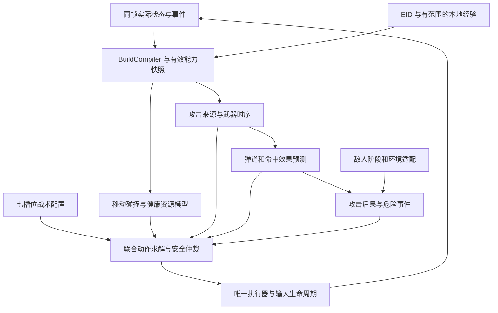

# M2-A 前置准备与含道具战斗组件评估

日期：2026-10-26。审查基线：`136cac8`。目标环境：忏悔原版 `1.7.9b.J835`、Isaac、普通难度、全解锁槽 1。

状态：P0–P6 已完成进入 M2-A 开发所需的基础实现和本地准入。J835 开发场景已验证正常拾取属性道具后出门清房；跨次经验复用以本地模拟与真实进程重启验证，实机尚无足够弹速样本。证据见 [P0–P2 报告](phase-2a-p0-p2-validation.zh-CN.md) 和 [P3–P6 报告](phase-2a-preparation-validation.zh-CN.md)。P7 主动实验关闭，P8 保留合同、运行器归 M2-B；首层路线、Boss 和正常离层尚未实现。

## 1. 目标和范围

本文中的第二阶段 A 指 **M2-A：正常首层探索、选择拾取、击败 Boss、正常离层并恢复可行动状态**，不是 EID 学习计划中编号 A 的接入提交。

前置准备的目标是让“单房控制器”具备可持续运行、可感知道具变化、可约束组件行为的基础。完成准备后，才能开始整层路线、Boss 与出口的集成验收；准备通过本身不等于打赢第一层。

采用两个准入边界：

- **进入 M2-A 开发前：** 完成本文 P0–P6 的基础能力和本地准入验证，再建设 FloorDirector、Boss 适配和 FloorJudge。
- **正式宣称 M2-A 完成前：** 基础能力有必要的实机证据，并正常完成首层全流程。若流程使用了主动实验能力，P7 也必须完成对应验证。

M2-A 仅承诺普通泪弹、已验证的简单属性/飞行变化和明确的道具拒绝策略。复杂武器可以暂不支持，但要能识别、避免误拾、记录缺口；被迫获得后必须有界降级或明确失败。完整受限程序运行器、DeepSeek 自主开发和复杂交互属于 M2-B，不作为首层开发的无条件前置。

关联合同： [二、三阶段路线](phase-2-3-roadmap.zh-CN.md)、[EID 与本地学习](eid-local-learning-plan.zh-CN.md)、[知识库接口](knowledge-project-interface-plan.zh-CN.md)、[组件开发设计](item-knowledge-and-skill-evolution.zh-CN.md)。本文统一准备顺序，来源和学习 DTO 继续使用上述合同。

## 2. 审查基线与扩展阻断

现有七个策略槽位、敌人适配器、联合动作求解器、唯一输入通道、Lua TTL 和记录系统值得保留。主要问题不是组件数量少，而是组件之间仍通过普通泪弹的隐含假设耦合。

下表描述 `136cac8` 基线中的依赖与阻断；已交付范围以第 6 节及验证报告为准。

| 证据位置 | 审查基线实现 | 含道具场景的影响 | 决策 |
|---|---|---|---|
| [controller.py](../SocketBridge/python/combat/controller.py)：`NormalTearsBuild.update / BuildResolver.update` | 收藏品变化或途中武器变化会抛 `BUILD_CHANGED`；校准样本挂在适配器实例 | 拾取后不能继续，未来若只删除异常可能沿用旧弹速样本 | 用构筑事务替换禁止变化；按相关能力失效校准 |
| [components.py](../SocketBridge/python/combat/components.py)：`CapabilitySet / WeaponAdapter` | 只有 family、moving_attack、break_plain_poop；协议只声明 propose，调用方还依赖可选路由/伤害方法 | 能注册一个发射器，不代表其前提、时序与回退均可检查 | 显式能力合同和可选扩展接口，缺失能力不能用默认真值补齐 |
| 同文件：`ResilientComponent / DEFAULT_IDS` | 捕获异常，默认发射回退为 normal_tears，不校验返回结果 | 新武器出错可能采用错误输入语义；空提案、非法值可进入求解器 | 统一结果校验、能力兼容回退和明确故障事件 |
| [controller.py](../SocketBridge/python/combat/controller.py)：`select_profile` | 低血量应急限定 normal_tears | 新武器正常路径通过，低血量路径仍失败 | 应急调整风险偏好，不能偷偷替换武器家族 |
| 同文件：`solve` | 模块实例键主要为 profile JSON；几何缓存键包含 can_fly，但不包含玩家半径 | 构筑变化但 profile 不变时可能保留状态；体型变化可能复用旧半径几何 | 显式作用域重置；几何键包含有效移动碰撞签名 |
| [geometry.py](../SocketBridge/python/combat/geometry.py)：构造、`line_clear` | 已有飞行通行处理；移动与射击使用不同格集合，但射击规则仍固定 | 飞行是部分基础，不能推广到穿墙攻击/其他碰撞变化 | 分离玩家通行与攻击穿障能力，不重复“实现已有飞行” |
| [components.py](../SocketBridge/python/combat/components.py)：`NormalTears.propose`；`controller.py:solve` | expected_damage 计算为伤害/发射间隔，最终效用主要使用 hit_score×6 | 数量同名但单位不清；不同攻击时序/多发收益不能比较 | 定义统一预测时间窗和伤害单位；命中质量不能冒充概率 |
| [threats.py](../SocketBridge/python/combat/threats.py)：`attack_safe` | 攻击足迹是单条线，命中时刻用距离/tear_speed 估计 | 持续激光、散射、范围爆炸和延迟后果不适用 | 武器产出时空攻击效果，威胁层统一消费，不按道具 ID 加分支 |
| [models.py](../SocketBridge/python/combat/models.py)：`hp / ContextRef`；[runtime.py](../SocketBridge/python/combat/runtime.py) | hp 是红心＋魂心；多个运行分支据此判死；目录版本限 1–2 | 骨心/复活与动态技能目录不完整，不能只改一个判定点 | 健康状态模型、版本迁移、统一生存判定 |
| [main.lua](../SocketBridge/main.lua)：`PLAYER_STATS / PLAYER_INVENTORY / COMBAT_FRAME` | 武器普通泪弹/其他二分，库存扫描 1..733，原子战斗帧无地上拾取集合 | 拾取前决策、临时效果、复合武器、动态未知身份不足 | 快照 V2，能力与未知项均明确表达 |
| [tests/test_components.py](../SocketBridge/python/tests/test_components.py) | 覆盖注册替换、异常回退、每帧状态更新和敌人适配等 | 未证明新家族的低血量、构筑切换、超时、失效回退全链路 | 增加生命周期夹具，不靠更多同类正常路径测试代替 |

以上是实际代码依赖及可描述的扩展失败场景，不表示已在实机复现所有情况。此前五个离线边界探针及完整审查见 [扩展性审查](phase-1-extensibility-review.zh-CN.md)；本次没有重跑其 207 项全套测试。

## 3. 含道具组件的目标结构

### 3.1 核心设计

**物品是能力变化的来源，组件是能力的执行实现。** 一个道具可能同时改变攻击、移动和生命；多个道具也可能共用同一种弹道算法。因此不按“一个道具一个 fire 类”扩展，也不让 LLM 逐个复制整个战斗状态机。

保留七槽位作为战术配置入口；在其下分清能力数据和机制接口。不是让 LLM 同时管理数十个微组件：它提出配置或候选程序，由 BuildCompiler 与本地校验器解析依赖、组合和支持范围。

### 3.2 分工和替换边界

| 层/模块 | 负责的事实或算法 | 输出 | 替换场景 |
|---|---|---|---|
| `BuildCompiler` | 观测合并、机制依赖、有效临时状态、冲突和支持判定 | 不可变 CapabilitySnapshot 与变化集合 | 增加道具映射，不直接写按键 |
| `MovementModel / CollisionPolicy` | 速度响应、体型、飞行、玩家通行 | 位移预测和可通行查询 | 飞行、体型、运动机制改变 |
| `HealthModel / ResourceLedger` | 生命类型、生存/复活、消耗归因 | 健康语义、危险预算、资源账本 | 骨心、护盾、交易、复活等；不伪装为普通 HP |
| `EmitterSet` | 玩家/跟班/已存在攻击源身份与控制关系 | 来源、位置、所有者、可控性 | 跟班/多发来源；被动来源不能冒充可控按钮 |
| `WeaponTiming` | 按住、蓄力、释放、冷却及输入限制 | 有期限的攻击意图与等待依据 | 蓄力、持续攻击、释放型攻击 |
| `TrajectoryModel` | 发射、移动继承、飞行、反弹/穿透等模型 | 多个带时间和不确定范围的攻击轨迹 | 新弹道机制；无需改目标排序和输入通道 |
| `HitEffectModel` | 目标阶段、命中、伤害、穿透与重复命中约束 | 统一时间窗内的目标收益与效果事件 | 多发、持续命中、状态效果 |
| `AttackConsequenceModel` | 自伤、反射、亡语、连锁及已发攻击残留 | 后果事件/危险区域与适用限制 | 爆炸攻击、死亡触发；武器和敌人知识在此汇合 |
| 七槽位策略 | 目标优先、站位、瞄准偏好、开火选择、避险、退路、恢复 | 目标和有界候选/评分 | LLM 房间打法、风险偏好与参数 |
| `InteractionExecutor` | 拾取接近、槽位操作、边沿与实际效果确认 | 幂等事务结果 | 主动道具/卡牌等；不是另一个逐帧输入写入者 |
| 宿主校验/仲裁/监督 | 合同、预算、当前上下文、合法输出、安全优先级 | 唯一可执行动作及失败原因 | 不允许候选程序替换或绕过 |

首版只落地普通泪弹所需实现和一组替换夹具。表格是稳定职责，不要求一次实现所有机制或创建所有目录；可先在现有模块中划清函数/数据接口。

## 4. 最小合同及组合规则

### 4.1 能力快照

`CapabilitySnapshot` 至少包含：上下文/修订、实际属性与单位、移动/碰撞签名、健康状态引用、攻击来源、武器时序、弹道/命中/后果能力、资源操作、临时效果范围、unknown/conflicts、来源与校准引用、支持状态。

属性取实际观测值，不能先读面板再叠加 EID 的“伤害增加”而重复计算。EID 负责解释未直接暴露的语义、前提和潜在风险；本地测量有范围，不能写成全游戏事实。

能力有明确 `supported / partial / unsupported / unknown` 状态，缺字段不是 false。相关机制签名用于复用，完整库存用于审计；未知组合不能因为各单品都见过就判为支持。

### 4.2 组件清单与状态生命周期

组件声明 `provides/requires/conflicts`、输入输出 schema、参数边界、状态作用域、复位事件、计算/输出预算、候选上限、兼容回退和证据范围。状态按 run / floor instance / room visit / build signature / profile 区分。

每个游戏更新只执行一次观测状态推进；候选评估为纯计算，不能在九个移动候选下重复增加蓄力计数或消耗资源。只有选中动作的执行确认才能推进相应执行状态；反馈缺失按未知处理。`begin_frame` 只能代表观测更新，不能代替“动作已执行”。

参数策略仍用现有注册表，目录元数据必须由宿主真正执行检查。M2-A 只运行工程侧可信模块；M2-B 的模型程序必须在受限执行器内，不能因注册成功就获得控制进程权限。

### 4.3 攻击合同

建议用 `AttackIntent → AttackPrediction → ValidatedAction` 形成明确边界：

- Intent：来源、动作阶段（hold/release/idle 等）、方向、有效帧、前提、资源成本、构筑与组件版本。
- Prediction：预测时间窗及单位、多个时空形状、命中目标集合、累计伤害估计、伤害到达时刻、危险后果和未知项；缺乏概率依据时不用“期望”掩盖启发式评分。
- ValidatedAction：宿主验证后的唯一输入、意图 ID、实际执行关联和期限。移动与射击仍同包刷新，资源边沿另行去重；刷新 TTL 不等于重复触发主动使用。

预测时间窗统一使用 game_update 并记录更新率。明确伤害是窗口累计量还是每帧速率，避免把二者混合排序；M2-A 先把普通泪弹单位和效用接通，复杂形状先做合同与夹具，不实现所有武器。

不能仅在“不打中目标”时返回安全：射击可能碰到 TNT、机关或产生自伤。攻击后果评估依据实际效果覆盖，而非只依赖目标 hit_score；新武器必须具备匹配后果模型，或明确不支持。

**释放输入是安全机制要求，但不保证取消攻击。** 对释放发射型武器，正常抢占应评估释放方向/时刻和撤离余量；断线、TTL 到期仍独立释放，不为保持蓄力而取消保护。残留攻击继续记录和避让，无法保证无风险时如实报告。具体武器的释放行为需在目标构建验证。

### 4.4 构筑变化事务

`发现变化 → 失效旧意图/计划 → 按当前已知能力执行有界保护 → 读取完整新态 → 编译/验证 → 重置受影响状态与缓存 → 发布新修订 → 恢复任务`。

库存变化不是唯一触发：临时 Buff、主动使用、角色/生命变化和实际攻击偏差也可触发；普通运动位置不递增构筑修订。短暂缺数不应无限重编译，需去重、超时和缺失原因。

变化集合决定失效范围：伤害改变更新收益；发射机制改变清空相关校准和蓄力状态；飞行/体型改变重建通行与碰撞缓存；生命结构改变重评风险和生存。切换射击组件不能无故清空整层路线，也不能因组件名称没变就保留旧状态。

组合按显式阶段和已验证优先级处理，不靠道具 ID 或拾取顺序排序。穿障、穿敌、反弹、分裂、自伤与命中触发属于不同语义；非交换组合没有规则时标记未知，不让 LLM 临时编个顺序当事实。

## 5. M2-A 支持矩阵与缺口处理

| 能力族 | M2-A 准入范围 | 前置验证 | 后续扩展 |
|---|---|---|---|
| 属性改变 | 普通泪弹算法可覆盖的数值变化 | 不重复叠加，校准正确失效，射速/伤害单位一致 | 复杂属性触发机制 |
| 飞行/体型 | 已验证移动碰撞变化，其他未知副作用仍限制 | 更新几何缓存；飞行不等于所有危险免疫 | 特殊运动机制 |
| 生命变化 | 健康账本完整表达观察值，正常存活/复活不误判 | 空骨心、伤害后回血、容器变化、复活序列 | 特殊角色独立策略 |
| 饰品/主动槽/临时状态 | 可读、可识别变化、可禁用；未知不静默忽略 | 非收藏品变化能触发重编译 | 有限资源主动策略 |
| 蓄力/多发/穿透/激光等 | 合同与合成替换夹具；未实测机制不宣称支持 | 新家族全生命周期通过本地边界测试 | M2-B 首个实际机制程序 |
| 跟班/残留攻击 | 保留观测、归属不明时不污染参数校准 | 玩家弹体与其他来源区分；无关样本不参与标定 | 多来源收益和控制 |
| 爆炸/自伤/未知随机/错误道具 | 拾取前拒绝或延后，明确避让和缺口；被动获得有界处置 | 误拾、地图变化、不可辨识身份有记录 | 独立训练与新能力验证 |

此矩阵按能力定义支持，不是道具白名单。真正的可拾取集合由固定 EID、实际状态、能力组合和已验证模块共同计算。未知道具可以跳过，敌人和场景中的强制未知无法靠白名单消失。

## 6. 准备工作队列

所有工作包均须保存失败原因、版本与必要轨迹。每行可拆成小提交，避免桥接、求解器、数据库和模型提示词一次混改。

| 编号/顺序 | 具体工作 | 完成条件 | 当前状态 |
|---|---|---|---|
| P0 范围与合同 | 本文结构评估、M2-A 支持矩阵、输入/输出/生命周期及依赖边界 | 编号、职责、验收与延期范围明确；合同进入实现时再固化 DTO | 已实现，[组件合同](component-contract.zh-CN.md) |
| P1 组件边界 | 统一结果校验：空集合、非法方向、NaN/Inf、尺寸/数量/期限；能力匹配回退与应急 | 普通泪弹和合成新家族都覆盖正常、低血量、故障、过期路径；无兼容发射器有限避险/失败 | 已实现，本地回归通过；可信 Python 不提供硬隔离 |
| P2 观测与语义 | 快照 V2：地上物品实体/价格/可见性、武器能力、临时状态、生命/资源、楼层实例；保留未知库存；协议迁移 | Lua/Python 同帧契约、旧入口兼容、信息权限明确；安装模组与源码哈希可核对 | 已实现，本地合同及 J835 只读观测通过；复杂效果实机覆盖另列限制 |
| P3 构筑与基础组件 | 健康/资源账本、增量 BuildCompiler、普通泪弹参数与简单移动变化；攻击合同和缓存失效 | 拾取可继续；校准/体型/飞行/临时失效正确；收益单位清楚；错误武器不得回退成泪弹 | 已实现；本地边界与 J835 属性拾取通过，复杂生命/效果不宣称实机覆盖 |
| P4 房间生命周期 | 连接与 RoomExecutor 分离；run/floor/visit 状态重置；记录有界保留；上下文和目录迁移 | 模拟三房、回房、同索引新楼层、迟到计划、断线和清房残留；不提前关服务 | 已实现；同连接模拟多房、回访和跨层生命周期通过 |
| P5 EID 最小接入 | 独立说明包/SDK；本项目 Gateway、首次遭遇前态、本地 SQLite、来源与版本；拾取/跳过/延后 | 未解析条件明确；不联网阻塞；实际拾取确认；跳过物品进入路径避让；缺口记录可检索 | 已实现；独立可安装子项目，固定包 2,136 行，J835 正常拾取确认通过 |
| P6 被动学习与准入 | 原始记录、局部测量、反例、能力支持版本；普通属性不调用模型；有界等待/预算 | 一条遭遇→决定→实际构筑→房间使用→重启检索的本地链路；P1–P5 集成检查通过 | 已实现并通过本地闭环；实机被动标定仅 1 样本，未晋升经验，跨局实机复用待有足够证据 |
| P7 有界主动实验 | Gate/Supervisor/Runner、暂停握手、测量、后果/预算、中止/复用 | 完成 EID 计划的低风险探针闭环；新威胁和断线抢占；只证明该范围 | 关闭且延期；M2-A 若使用此功能则必须先实现验收 |
| P8 DeepSeek 扩展准备 | 提供/依赖接口、候选产物结构、独立夹具、状态与预算合同 | P0–P3 留好边界；无需在 M2-A 前完成程序生成和完整运行器 | 合同见本文及组件设计，实际开发归 M2-B |

推荐提交顺序：`fix: validate component outputs and compatible recovery` → `feat: version item and health observations` → `feat: compile observed build transitions` → `refactor: separate room and run lifecycles` → `feat: integrate EID pickup knowledge` → `feat: persist scoped item experience`。P7 独立提交，M2-B 的程序执行器与模型开发分别提交。

P2 的原版 API 可用性先以最小本地探针确认；拿不到的字段有显式缺口，不把相近 API 或其他版本能力写成已支持。不默认安装 REPENTOGON。

## 7. EID 与学习工作如何纳入准备

EID 计划的 A–F 是道具学习功能顺序，不是另一组通关里程碑，映射如下：

| EID 学习步骤 | 本文位置 | 对 M2-A 的要求 |
|---|---|---|
| A 固定说明查询与遭遇记录 | P5，来源适配可提前做 | 最小数据包与接入必需；不要求结构化解释全量道具 |
| B 构筑/健康变化 | P1–P3 | 必需；不能仅靠 EID 名称识别就继续战斗 |
| C 拾取及被动经验 | P5/P6 | 必需；本地规则优先，少量必要 DeepSeek 推理 |
| D 有界实验 | P7 | 作为可关闭能力；启用前必须完成安全和预算验证 |
| E 校准跨房/跨次复用 | P6 的被动参数复用＋P7 的主动实验闭环 | 被动链路必需；主动链路在依赖其参数前完成 |
| F 模型机制程序 | P8 → M2-B | 合同前置，完整实现和实机扩展属于 M2-B |

没有必要把每个道具先实验一遍再开始首层。可直接读取的属性用真实状态，适用经验命中就复用；只有未知影响下一步且可安全区分时才测试。跳过因能力不足而有价值的道具，产生独立学习任务，避免永久停留在普通泪弹支持范围。

## 8. 准入用例与低成本验证

| 用例 | 应满足的结果 | 验证方式 |
|---|---|---|
| 普通属性道具进入库存 | 只更新受影响能力，不结束会话，不重复 EID 加成 | 合成快照；后续一次必要实机 |
| 相同 profile、构筑或体型改变 | 相关模块状态/校准/几何缓存失效，无旧计划动作 | 本地序列夹具 |
| 武器替换遇低血量或异常输出 | 使用兼容应急/回退，无错误泪弹接管 | 合成新家族，不需真实复杂道具 |
| 提案空、非有限数、越界、过多、过期 | 明确组件故障；不可执行；安全内核持续 | 本地故障注入 |
| 同一帧多移动候选 | 只推进一次观测状态，仅确认选中动作的执行状态 | 带计数的时序夹具 |
| 蓄力时抢占/TTL/断线 | 输入释放保护有效；释放攻击后果显式保留；不称作无攻击 | 合同测试；实际武器支持前再实机验证 |
| 空骨心、受击后回血、复活 | 不把生命数值简化为死亡；伤害不被回血抵消 | 本地账本序列；支持范围内补实机 |
| 不拿道具与实际拾取不符 | 避让或检测误拾并重编译；不能继续旧构筑 | 路径/实体变化夹具 |
| 三房、回房、跨层同索引 | 房间状态不泄漏，连接持续，记录不无限增长 | 模拟会话和有界缓存检查 |
| EID 缺失、冲突、未知身份 | 明确未知、无隐式联网/无限等待，不伪造机制 | 本地包/数据库合同 |
| 经验仅对某构筑成立 | 适用范围检查，反例返回，版本过期重新验证 | 本地检索与迁移夹具 |

不要求每个用例单独消耗一次 DeepSeek。先用现有测试框架、合成快照和模拟 TCP 验证工程边界；只对真实输入、属性/生命事件或模组兼容等无法离线确认的内容做少量实机。程序预算隔离测试在 M2-B 运行器实现时加入，不能把当前异常捕获称为硬隔离。

进入 M2-A 开发的准入报告至少列出 P1–P6 状态、支持能力范围、仍未知字段、所跑检查、失败和是否用了游戏/模型。未完成项保持待办，不把本文计划或历史测试写成新的完成证据。

## 9. 准备之后的工作

M2-A 主体才实现已探索楼层图、门与特殊入口策略、Boss 目标与适配、奖励/出口交互和 FloorJudge。成功必须有同一 run 的 Boss 完成、合法楼层变化、存活且可继续操作的独立证据；一次清房不能代替。

M2-B 实现 DeepSeek 真正编写机制程序、隔离校验、试用、发布和下次复用。第三阶段补连续楼层、资源规划与章节机制；复杂组合以实际失败推进，不预先实现全道具笛卡尔积。

进入 M2-A 开发的前置基础已具备。后续整层开发应优先复用 `CombatSession.open/execute_room/close`、`RoomExecutor` 和独立知识 Gateway；不要把第一房入口直接循环调用，也不要放开未验证武器。M2-A 正式验收需补充同一 run 的真实楼层全流程证据；被动经验未命中时继续使用已验证先验，不为凑样本启用主动实验。
