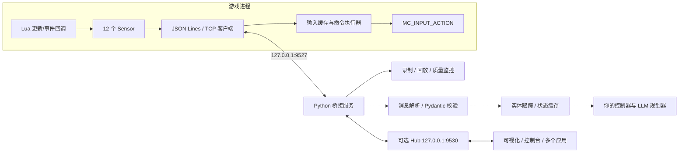

# SocketBridge 源码导读与接入说明

> 历史阶段资料；当前执行状态与已知缺陷以 [P0–P6 审查](../phase-2a-preparation.zh-CN.md) 和 [M2-A 计划](../phase-2a-plan.zh-CN.md) 为准。本文保留对应版本的设计或证据，不作为当前完成清单。

核查日期：2026-10-24。对象：`EmptyEmeraldTablet/SocketBridge` 的 `refactor/v2` 分支，提交 `89dab7852c987a4ef4f62f168c309fe27a91a598`。本文件依据本地源码和已运行的 Python 单元测试编写。**尚未在《以撒的结合：忏悔》游戏进程中验证。**

## 先理解它是什么

SocketBridge 是一个**游戏状态与外部程序之间的双向桥**：游戏内 Lua 模组读取当前局的实体与房间状态，发给本机 Python；Python 可以发回移动、射击、道具、控制模式、调试控制台和采集配置等命令。它还提供状态规范化、实体跨帧跟踪、记录回放和多客户端 Hub。

它不包含现成的 LLM 规划器、完整地图探索策略或保证通关的战斗策略。仓库 `python/archive/` 有一些较早期的 AI / 寻路实验，应视为归档材料，不能当作 v3.0 主运行链路。

这个分支的中文 README 标记为 **v3.0**，协议文件和 `main.lua` 也使用 `3.0`。英文 README 仍写 v2.1；集成时应以锁定的提交、当前源码和实际握手消息为准。

## 运行形态



游戏端是 TCP **客户端**，Python 的 `BridgeServer` 或旧版 `IsaacBridge` 是本机 TCP **服务端**。游戏从 `MC_POST_UPDATE` 中尝试建立连接、收集状态、发消息、处理外部命令。Python 端依据换行切分 JSON 消息。Hub 是第二层代理，让多个应用共享一条游戏连接；它不是游戏模组本身。

| 层 | 关键文件 | 实际职责 |
|---|---|---|
| 游戏采集、输入、事件 | `SocketBridge/main.lua` | 网络、Sensor、指令分发、输入回调、房间和伤害事件 |
| TCP 传输 | `python/connection/server.py` | asyncio 服务端、单游戏连接、JSON Lines、收发与断线通知 |
| 协议 / 校验 | `python/protocol/messages.py`、`schema.py` | 消息模型、v2.1 / v3.0 兼容处理、Pydantic 数据类型 |
| 状态转换 | `python/sensors/*.py` | 每类 Sensor 的解析、类型化与注册 |
| 跨帧跟踪 | `python/entities/tracker.py` | 实体 ID 缓存、过期、房间切换清理与变化报告 |
| 对应用的接口 | `python/facade.py` | `SocketBridge`、同步包装、查询角色 / 敌人 / 房间、发动作 |
| 多应用接入 | `python/bridge_hub_service.py`、`hub_bridge.py` | Hub 代理、客户端订阅、广播、命令路由 |
| 数据存储 | `python/persistence/*` | JSONL gzip 会话记录、按帧回放 |
| 质量检查 | `python/validation/*` | 数据合法性与问题报告 |
| 应用入口 | `python/apps/*` | Hub、外置控制台、录制器、地形可视化与回放工具 |

注意当前 Hub 的游戏侧仍使用 `isaac_bridge.py` 旧接口，`facade.py` 是另一条直接接入链路；两者并未完全合并为同一内部实现。决定接入方式后应统一一个主要入口，避免在同一局中同时启动两个争用 `9527` 端口的服务。

## 一帧数据如何产生

Lua 为每个 Sensor 定义搜索方法、采集频率、提取函数、缓存策略和可选事件触发器。搜索可以根据实体类别、范围或完整房间扫描；非实体信息直接调用游戏 API。更新回调根据战斗 / 空闲状态和配置决定本次收集哪些通道。变化检测和缓存减少重复发送；某些事件可以强制下一次收集。

当前 12 个通道如下：

| 通道 | 内容 | 主要用途 |
|---|---|---|
| `PLAYER_POSITION` | 角色位置、速度、移动与瞄准方向 | 控制闭环 |
| `PLAYER_STATS` | 伤害、速度、射速等属性 | 构筑与控制参数 |
| `PLAYER_HEALTH` | 不同血量信息 | 生存决策 |
| `PLAYER_INVENTORY` | 资源、物品槽与充能等 | 道具 / 资源规划 |
| `ENEMIES` | 敌人位置、速度、生命和部分状态 | 目标选择、危险预测 |
| `PROJECTILES` | 敌方弹幕、己方泪弹、激光 | 躲避与输出估计 |
| `ROOM_INFO` | 房间类型、楼层、边界等 | 房间级决策 |
| `ROOM_LAYOUT` | 网格、门、障碍 | 寻路 |
| `BOMBS` | 炸弹位置与计时等 | 爆炸避险 |
| `FIRE_HAZARDS` | 火焰 / 地面危险 | 局部风险图 |
| `PICKUPS` | 地面掉落、价格、位置 | 拾取与商店选择 |
| `INTERACTABLES` | 机器、乞丐等 | 房间交互 |

采样频率不是统一的“每帧全量”：角色位置和战斗实体可较频繁更新；属性、房间、库存等可低频或按变化发送。每条数据带 `frame`、`seq`，各 Sensor 元数据包括真实采集帧 `collect_frame` 与 `stale_frames`。上层控制器必须依据这些字段判断数据是否过期，不能把收到消息的时间当作所有字段的采集时间。

普通消息类型包括 `DATA`、完整状态 `FULL`、事件 `EVENT`、命令结果 `CMD` 和订阅确认 `SUBSCRIBE_ACK`。`SUBSCRIBE` 和 `CONFIGURE_SENSOR` 让外部应用选择通道与节流设置。若不订阅，Lua 代码默认仍可采集全部通道；高弹幕房的吞吐需要实测。

## 外部命令如何变成角色动作

Python 的 `facade.SocketBridge.send_input()` 可下发移动 `move`、射击 `shoot`、使用道具、炸弹、卡牌 / 药丸与丢弃。Lua 在更新回调收到命令后先写入 `InputExecutor` 缓存；游戏随后查询按键时，`MC_INPUT_ACTION` 读取缓存，按游戏所需的布尔或 0–1 数值返回。这条路保留游戏的正常角色输入语义，并不是直接修改角色位置。

控制模式有 `MANUAL`、`AUTO` 和 `FORCE_AI`，游戏内 `F3` 可在人控和默认模式间切换。`AUTO` 的逻辑主要在战斗房中接管输入；项目目标包含空房寻路时，应验证并显式设置 `FORCE_AI` 或调整接管条件。

具名命令还包括读取完整状态、列出和重配 Sensor、切换控制模式，以及 `EXEC_CONSOLE`。控制台命令能方便地准备训练场景，但正式通关验收时必须在上层策略中封闭这一路径，并记录辅助档位。

**上游原版尚不具备可靠实时控制所需的全部保障；本项目的首轮补丁已增加输入超时和断线释放，但仍待实机验证：**

- 上游输入缓存没有按动作 TTL 自动过期。本项目本地补丁设为超过 3 个游戏更新帧清零，并在断线、换房时退出自动控制；实机效果尚待验证。
- `use_bomb`、`use_item` 等资源位在缓存中作为布尔值保存。单次触发与持续按住的边沿语义需要实机验证，不能直接以高频重复 `true` 驱动消耗品。
- 当前 `Network.connect()` 仅检查 Lua 调用没有抛错，代码没有严格区分套接字对象存在与连接真正完成；`Network.send()` 也未检查底层发送返回值和部分发送。网络稳定性要做故障注入测试。
- Python `subscribe()` 发送后固定等待短时间并返回所请求的列表，返回值不代表游戏已正式接受；要以收到的 `SUBSCRIBE_ACK` 或实际通道数据为准。

这些结论来自源码审阅，尚未以游戏实测量化发生频率。它们意味着 SocketBridge 可作为原型底座，但不能原样承担“稳定通关”的实时控制责任。

## Python 层有哪些现成功能

`facade.py` 提供异步 `SocketBridge` 和同步包装 `SocketBridgeSync`。它把原始消息解析为类型化对象，缓存最近的角色、房间和实体状态，提供 `get_player()`、`get_enemies()`、`get_enemy_projectiles()`、`get_room_layout()` 等读取方法，以及 `send_input()` 和 `send_console()`。应用可注册每帧与事件回调。

`entities/tracker.py` 跟踪敌人、弹幕、掉落物等实体的新增、更新和过期情况，并在换房时清理旧实体。它解决“通道不是每帧都发送”造成的状态拼接问题，但上层仍应检查年龄和身份复用；跟踪状态不等于真实游戏中的未来预测。

`persistence/` 可把会话消息写成压缩 JSONL，并按帧回放。这适合调试传输协议、离线训练和复现数据处理错误。**消息回放并不会自动重建游戏物理状态**，因此不能把它当作完整游戏模拟器。

Hub 运行在本地 `9530`，游戏连接仍在 `9527`。一个常驻 Hub 占有游戏连接，上层可分别启动控制台、可视化、记录器或策略程序。各应用可订阅所需通道；Hub 负责按订阅过滤、转发消息和命令回复。策略程序最好只有一个写动作的“控制权所有者”，避免多个应用同时发送互相矛盾的动作。

现有 `apps` 主要是开发辅助：交互控制台、会话录制与回放、地形可视化和地形验证。它们证明桥接可被不同应用消费，但没有组成完整的“LLM + 战斗控制器”产品。

## 忏悔原版兼容性：需要说清的矛盾

README 声称兼容 Repentance，源码运行时明确尝试 `require("socket.core")`，文档要求启动参数 `--luadebug`。但 `metadata.xml` 的描述又写“利用 REPENTOGON 实现”。全仓 `main.lua` 未直接调用名为 `REPENTOGON` 的全局对象；同时部分游戏 API / 回调可能依赖具体版本。这条描述可能过时，但**仅凭字符串检索不能断定 REPENTOGON 完全不需要**。

正确的实测顺序是：锁定你的 Repentance 具体构建；先在隔离存档中仅用 SocketBridge + `--luadebug` 启动；核对 Lua 控制台报错和通道可用性；有明确缺失的扩展接口时，再选与忏悔原版匹配的 REPENTOGON 旧版。不要把当前面向 Repentance+ 的 REPENTOGON 安装指南照搬到忏悔原版。

## 本地环境与验证结果

仓库位于项目根目录 `SocketBridge/`；根目录的 `.venv/` 使用 CPython **3.12.9**，由 uv 创建。按仓库 `python/requirements.txt` 安装了 `pydantic>=2.0`、`typing-extensions>=4.0.0`，解析得到 pydantic **2.14.1** 和 typing-extensions **4.16.0**，以及三个传递依赖。uv 缓存置于项目根目录 `.uv-cache/`。

已运行 `python -m unittest discover`，仓库当前 `python/tests/` 的 **46 项测试全部通过**。这些测试覆盖协议 Schema、Sensor 解析注册、实体缓存与换房清理。`apps.bridge_hub --help` 能在本地环境启动并列出参数。尚未启动游戏、安装游戏模组或证明 TCP 连通；因此不能声称实机兼容或控制可靠性已通过。

在 PowerShell 中，从项目根目录进入 Python 目录后可用此环境运行 Hub：

```powershell
cd D:\internship1\issac\SocketBridge\python
..\..\.venv\Scripts\python.exe -m apps.bridge_hub
```

游戏侧仍需要把模组放入当前游戏版本实际使用的 `mods` 目录，并依据项目文档配置 `--luadebug`。这个操作尚未执行，避免擅自修改你的游戏安装与存档。

## 如何接入本项目的分层智能体

建议把 SocketBridge 定位为“观测和执行适配器”，在它外面增加三个模块：

1. **本地实时控制器**：读取带采集帧的角色 / 弹幕 / 地形，生成短时移动和射击动作；游戏侧增设动作过期清零。
2. **技能层**：导航、清房、拾取、使用资源等技能维护终止和中断条件，避免每个 LLM 回复都直接变成按键。
3. **LLM 战略层**：只在入房、资源选择和阶段变化时给技能层下发目标；动作和控制台命令分别建立权限白名单。

第一个实机验收只需四件事：连接并收到角色 / 弹幕状态；能同时移动和射击；停发动作后按预期释放输入；换房与断连后不会沿用旧动作。通过后再测采集延迟与高弹幕吞吐，决定是否保留 Python 端实时控制，还是把紧急避险迁回 Lua。
